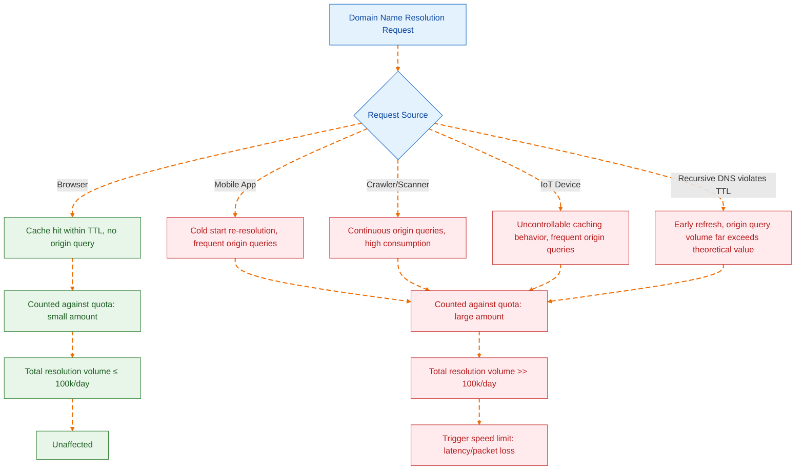
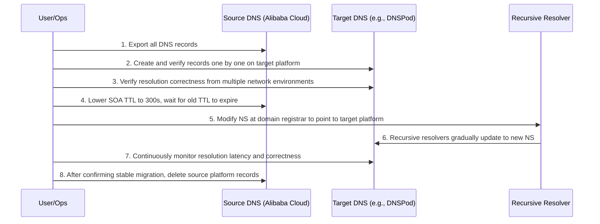

On May 14, 2026, Alibaba Cloud released a low-key but far-reaching product announcement: starting from June 24, the public network authoritative resolution free version of Cloud DNS will add a daily resolution limit of 100,000 times per domain name. Exceeding this limit will trigger dynamic speed limiting—latency, packet loss, or both[^1]. The announcement was cautiously worded, stating that "the vast majority of free users' daily resolution volume is far below this threshold," making it seem like everything is calm.

But the true weight of this announcement lies not in the technical parameters themselves, but in the turning point it marks: **The free DNS services of mainstream Chinese cloud providers are shifting from a 'default sufficient' stage to a 'needs accounting' stage.** For independent developers, individual webmasters, and small to medium-sized teams relying on free DNS, this is not an isolated price adjustment, but a repricing of the entire DNS service business logic.

## Is 100,000 Times Enough: The Real Composition of Resolution Volume

The official statement that "the vast majority of users are unaffected" may be statistically true—if only looking at the median. But the problem is that for a normally running service site, its DNS resolution volume is affected by multiple overlapping factors, and 100,000 times/day is not a threshold that allows for complacency.

The core variables affecting single-domain resolution volume include:

**Number of subdomains.** The limit is "per domain name," but here "single domain name" refers to the sum of resolution volumes of the primary domain and all its subdomains[^1]. If a site uses multiple subdomains like `www`, `api`, `cdn`, `static`, the resolution of each subdomain will be counted toward the total. For a moderately complex web application, the resolution volume can easily multiply several times.

**TTL and actual caching behavior.** Theoretically, recursive resolvers cache resolution results according to TTL, thereby reducing origin queries. But in reality: domestic carrier-grade recursive resolvers generally do not strictly adhere to TTL, some even refresh before TTL expiration, or ignore overly long TTL values and shorten them on their own. This means the actual number of origin queries may far exceed theoretical values.

**Crawlers and scanners.** Search engine crawlers, security scanners, SEO tools, etc., continuously trigger DNS resolution. This traffic does not generate page visits but同样 consumes resolution quotas.

**Mobile and IoT devices.** The DNS caching behavior of mobile apps differs from browsers; some implementations re-resolve every cold start. The DNS implementation of IoT devices is even more inconsistent, with many devices not caching at all or having extremely short cache times.

There is a real case for reference: the independent blog yijile.com discovered after the announcement that its daily resolution volume exceeded 300,000 times, approaching 300% of the limit[^2]—while the site's page visits were far from reaching the same order of magnitude. This indicates a significant non-linear relationship between DNS resolution volume and website UV/PV, making it unreliable to estimate 'daily resolution volume' using 'daily visits'.

## The Business Logic Behind Speed Limiting: The End of Free is Speed Limiting

Alibaba Cloud is not the first vendor to set thresholds for free DNS, nor will it be the last.

From a business perspective, free DNS is a 'negative asset' for cloud providers—it consumes infrastructure resources (global resolution nodes, bandwidth, operations manpower) but generates almost no direct revenue besides brand exposure and user entry value. When user scale is small, this investment can be viewed as customer acquisition cost; but when the scale of free users expands to affect overall stability, speed limiting becomes an inevitable choice.

The 'continuously rising total resolution volume borne by the platform' and 'avoiding local traffic spikes or abnormal queries affecting normal business' mentioned in the announcement, when translated into business language, mean: **The excessive use by free users has begun to erode the SLA guarantees of paying users.**

This logic is consistent with the path of international vendors like Cloudflare and Google Cloud DNS: first use free services to establish a user base and market recognition, then gradually tighten free quotas and guide commercial conversion. The difference is that Alibaba Cloud chose a more direct 'hard speed limit' rather than 'pay-as-you-go after exceeding the limit'—this precisely reflects the competitive landscape of the domestic cloud service market: when the migration cost for free users is low enough, vendors tend to directly cut off excessive users rather than converting them through refined billing.

## Domestic Alternatives: Who Can Still Bear the Free Burden

For sites with daily resolution volume potentially exceeding 100,000 times, migrating to alternative DNS services is a realistic option. Below is a comparison of core dimensions of current mainstream domestic free DNS services:

| Service Provider | Free Tier Resolution Limit | Split-horizon DNS | Minimum TTL | DDoS Protection | Notes |
| --- | --- | --- | --- | --- | --- |
| Alibaba Cloud DNS | 100k times/day (from 2026.6.24) | Supported in paid version | 120s (free tier) | Basic | The protagonist of this speed limit |
| Tencent Cloud DNSPod | No explicit daily resolution limit | Supported in free tier (carrier/region/search engine routes) | 1s | Basic | The most mature domestic alternative |
| Huawei Cloud DNS | No explicit daily resolution limit | Supported in paid version | Determined by package | Basic | Relatively lenient, suitable for Huawei ecosystem users |
| Volcano Engine TrafficRoute | No explicit daily resolution limit | Basic routes supported in free tier | 1s | Basic | Produced by ByteDance, newer ecosystem |

Tencent Cloud DNSPod is currently the most transparent alternative option. Its free tier explicitly supports split-horizon DNS by carrier (Telecom, Mobile, Unicom), by region (domestic/overseas), and dedicated search engine routes. For sites that need to distinguish between domestic and overseas resolution or carrier optimization, this is a differentiated capability that Alibaba Cloud's free tier cannot provide.

But what needs to be警惕 is: **No speed limit today does not mean there won't be one tomorrow.** DNSPod's free tier also faces resource pressure from user growth; it just hasn't reached the trigger threshold yet. When choosing an alternative, do not equate 'no current restrictions' with 'will never have restrictions'.

## Migration Strategy: Not as Simple as Changing an NS

DNS migration is not technically complex—simply modify the NS records at the domain registrar and wait for global recursive resolvers to update. But there are several easily overlooked key points in actual operation:

**Record export and format compatibility.** Different DNS providers have varying levels of support for record types. Some extended record types supported by Alibaba Cloud (such as explicit/implicit URL forwarding) may be implemented differently or not supported by DNSPod and other providers. Before migration, all records need to be fully exported and verified one by one.

**TTL transition period design.** When migrating NS, the old and new authoritative DNS systems will coexist during the transition period (depending on the TTL of the old NS records). Best practice is: first configure identical records on the target platform, verify they are correct, then switch the NS to the new platform. Before switching, lower the SOA record TTL of the old NS (e.g., to 300 seconds) to shorten the transition window.

**Split-horizon DNS strategy migration.** If you originally relied on Alibaba Cloud's paid split-horizon DNS, migrating to DNSPod's free tier can directly reuse route configurations; if migrating to a platform that does not support free split-horizon DNS, you need to evaluate whether to accept a single resolution strategy.

**Monitor first.** Before complete switching, establish resolution monitoring—continuously probe key subdomains from multiple network environments (Telecom, Unicom, Mobile) to ensure that resolution results and latency after migration are within acceptable ranges.

## Deeper Level: The Structural Dilemma of Free DNS Services

Looking at a longer historical dimension, Alibaba Cloud DNS free tier speed limiting is not an isolated incident, but the surfacing of structural problems in the free DNS service model.

DNS authoritative resolution is a 'low margin, high volume' infrastructure service—marginal cost is extremely low, but stability and availability requirements are extremely high. When a free service's hosted domains grow from hundreds of thousands to millions, and resolution volume grows from hundreds of millions to hundreds of billions, the sustainability of the free model faces fundamental questions: either implement speed limiting and traffic diversion, or degrade service quality, or convert to a paid model.

The dilemma for cloud providers is that DNS is the most底层 internet entrance—domain resolution failure means the entire business is unreachable. Users won't distinguish 'this is the free version so the service quality is poor,' but will only attribute it to 'Alibaba Cloud/Tencent Cloud is not good.' This pressure of 'free service holding brand reputation hostage' is the key factor driving the speed limiting decision.

For webmasters and developers, the lesson from this is not 'quickly switch to another free platform,' but: **Any free, non-self-controlled infrastructure dependency has an inherent expiration date.** Today it's Alibaba Cloud limiting speed, tomorrow it could be DNSPod, and the day after tomorrow it could be Cloudflare Free Plan adjusting its terms.

## Conclusion

Alibaba Cloud DNS free tier speed limit of 100,000 times/day is not harsh in absolute terms, but the signal it sends is more important than the number: **The free DNS bonus period for domestic cloud providers is narrowing.**

For the vast majority of sites with daily resolution volume far below the threshold, nothing needs to be done. For sites near the临界 line, it is recommended to immediately enable resolution volume monitoring and understand their true usage before making a decision. For sites that have already exceeded or are about to exceed the limit, DNSPod's free tier is currently the most pragmatic migration target, but incorporating DNS self-control into medium and long-term planning—whether through multi-vendor redundant deployment or self-built authoritative DNS (even lightweight NSD or CoreDNS instances)—is worth serious consideration.

Free is temporary, controllable is long-term.

[^1]: Alibaba Cloud. "Product Change" Cloud DNS - Public Network Authoritative Resolution Free Tier Speed Limit Notice. 2026-05-14. https://www.aliyun.com/notice/118259
[^2]: Yijile. "Alibaba Cloud DNS Free Tier Limits Single Domain to 100k Resolutions, Switch to Better Alternative Products." 2026-05-24. https://yijile.com/zh/alibaba-cloud-dns-resolution-limit-replacement-products/
