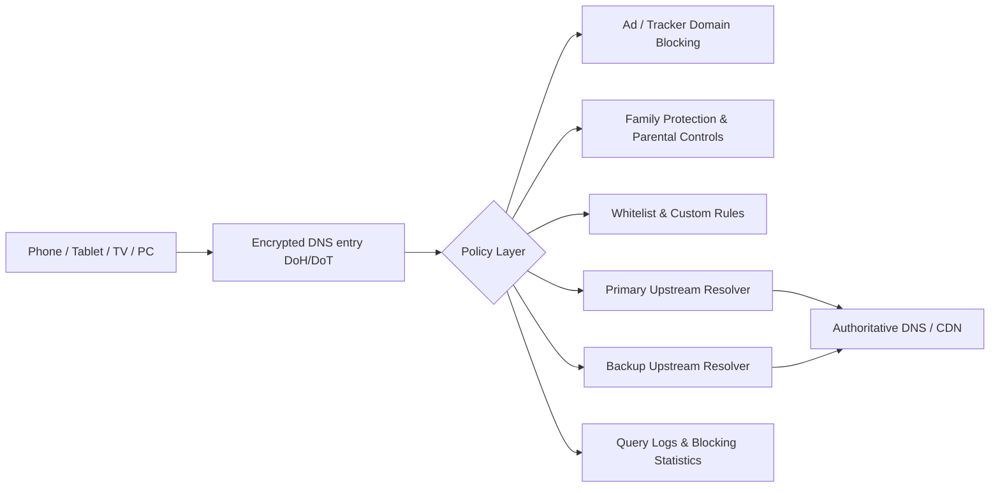

Many users treat DNS as a “fill‑in‑the‑address‑and‑done” setting, but the two publicly disclosed incidents in 2024 and 2025 show that **the resolver itself can fail**, and the impact is immediately felt as “pages won’t load, apps can’t connect, the whole house loses internet”.

This article does not compare providers; it focuses on one goal: **turning DNS from a single‑point dependency into an observable, switchable, and recoverable home‑grade infrastructure**.

## Two Verifiable Events: What Happened

First, the key timestamps from public reports (all UTC, aligned with official timelines):

| Event | Public Date | Key Impact | Root‑Cause Type |
| --- | --- | --- | --- |
| Cloudflare 1.1.1.1 incident (2024‑06‑27) | 2024‑07‑04 post‑mortem published | Users in some regions unreachable or experiencing high latency | External routing event (BGP hijack + route leak) |
| Cloudflare 1.1.1.1 incident (2025‑07‑14) | 2025‑07‑15 post‑mortem published | Majority of global users affected; official 62‑minute outage window | Internal misconfiguration causing prefix withdrawal |

Both incidents share a common trait:

- From the user’s perspective the symptom is “DNS stopped working”;
- The underlying causes are completely different (one is an external internet‑routing issue, the other an internal service change);
- The conclusion is the same: **a single upstream, a single entry point, and a single protocol concentrate risk at one spot**.

## Technical Breakdown: Why DNS Appears “Broken Everywhere”

When a device points its sole DNS to an unavailable target, the application layer typically cascades:

- Domain names cannot be resolved, showing `timeout` or `SERVFAIL`.
- Browsers and apps retry repeatedly, creating a “sometimes works, then fails again” jittery experience.
- Even if the upstream link is healthy, users mistakenly think “the broadband is broken” or “all websites are down”.

The diagram’s focus is not “pile on more features”; it highlights three essentials:

- **Path separation**: decouple the access layer (DoH/DoT) from the policy layer (blocking/whitelisting).
- **Upstream redundancy**: when the primary upstream fails, a backup resolution path remains available.
- **Observability**: logs and statistics let you determine whether a block is a false positive, an upstream outage, or a client‑side issue.

## Practical Home‑Network Implementation

Based on the `nullprivate/adguardprivate` service maintained by jqknono, a workable approach includes:

1. **Use an encrypted DNS entry (DoH/DoT)**  
   - Reduces exposure of plain‑text DNS and mitigates local‑network interference.  
   - Leverage client‑ID / device identifiers to differentiate each household device.

2. **Configure primary + backup upstream resolvers**  
   - Avoid betting all resolution on a single provider or a single prefix.  
   - Combine split‑routing so different domain categories use distinct upstream paths.

3. **Centralize “ad‑blocking, anti‑phishing, parental‑control” in the policy layer**  
   - Block advertising and tracking domains.  
   - Block malicious/phishing domains.  
   - Apply time‑based and content restrictions for children’s devices.

4. **Maintain a false‑positive correction channel**  
   - Use query logs to pinpoint blocked domains.  
   - Quickly add entries to a whitelist to avoid prolonged service disruption.

5. **Run regular “failure drills”**  
   - Temporarily take the primary upstream offline and verify that the backup path activates.  
   - Test critical home apps (payment, online classes, video conferencing) on the home network.

## A Common Misconception

Many believe that “using encrypted DNS guarantees zero downtime”. In reality, encryption only protects the transport channel’s privacy and integrity; it does **not** automatically provide high availability. High availability comes from:

- Upstream redundancy design;
- Reasonable policy configuration;
- Executable monitoring and emergency procedures.

## Operational Checklist

- Do you still rely on a single DNS provider?  
- Are you using only one protocol (DoT *or* DoH) with no fallback?  
- Can you locate a “false block vs. upstream outage” within 3 minutes via logs?  
- Are elder or child devices configured with dedicated family‑protection policies?  
- Have you performed at least one switchover drill this month?

If most answers are “no”, the next public DNS incident will likely hit your home network directly.

## References (publicly verifiable)

- Cloudflare: 2024‑06‑27 1.1.1.1 incident post‑mortem (includes BGP hijack & route‑leak timeline)  
  https://blog.cloudflare.com/cloudflare-1111-incident-on-june-27-2024
- Cloudflare: 2025‑07‑14 1.1.1.1 incident post‑mortem (includes 62‑minute outage details & remediation timeline)  
  https://blog.cloudflare.com/cloudflare-1-1-1-1-incident-on-july-14-2025/
- Cloudflare Radar (useful for observing DNS availability changes during public incidents)  
  https://radar.cloudflare.com/

For individuals and families, DNS is not merely a “make it faster” tweak—it is a fundamental security and availability concern. Combining encrypted DNS, ad blocking, family protection, and observability gives you the best chance to minimize damage and anxiety when a real DNS outage occurs.
