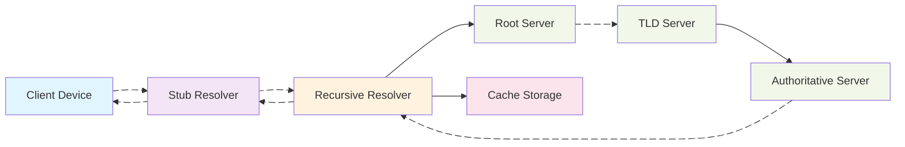
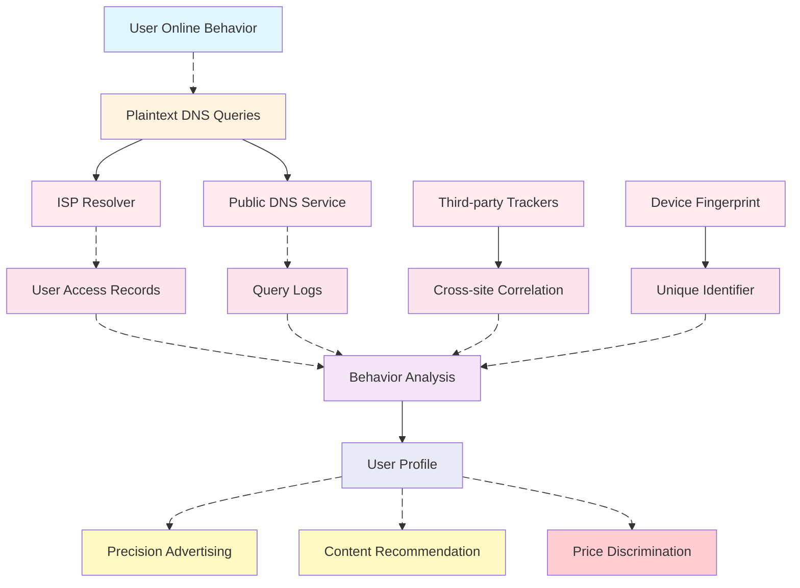
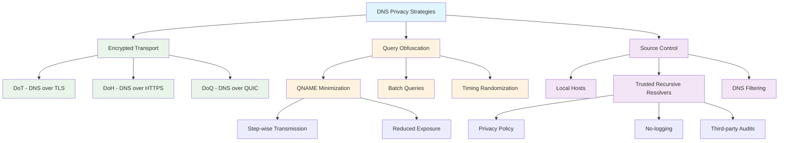

# DNS Privacy Protection and User Profiling Mitigation Strategies

> Audience: Engineers/Operators/Security Professionals concerned with network privacy and data governance  
> Keywords: Stub resolver, Recursive resolution, Authoritative server, QNAME minimization, ECS, DNSSEC, DoT/DoH/DoQ  

## Background and Problem Overview  

In the digital age, users' online behavioral data has become crucial for enterprises to construct user profiles. As a core component of internet infrastructure, the Domain Name System (DNS) performs the critical task of converting human-readable domain names into machine-readable IP addresses during daily network activities. However, traditional DNS queries are typically transmitted in plaintext over UDP port 53, making users' browsing history, application usage patterns, and other sensitive information vulnerable to collection and analysis by network operators, ISPs, and various intermediaries.  

User profiling refers to constructing characteristic models of users through collecting and analyzing various behavioral data. Enterprises leverage these models for precision marketing, content recommendation, risk assessment, and other commercial activities. While these services enhance user experience to some extent, they also raise concerns about privacy leaks, data misuse, and potential discriminatory pricing. Understanding how to reduce the accuracy of user profiling through DNS-level technical measures has become an important approach to protecting personal privacy.  

This article begins with DNS fundamentals, analyzes data collection points in user profiling processes, explores DNS-based privacy protection strategies, and explains implementation approaches and considerations for different scenarios.  

## Fundamentals and Terminology  

To understand DNS privacy protection, one must first grasp the basic DNS query workflow and related terminology. DNS queries typically involve multiple participants, each potentially becoming a privacy leakage point.  

The stub resolver is the DNS client component in operating systems or applications, responsible for receiving DNS query requests from applications and forwarding them to recursive resolvers. Recursive resolvers (typically provided by ISPs or third-party DNS services) complete the full domain resolution process, including querying root servers, Top-Level Domain (TLD) servers, and authoritative servers, then returning final results to clients.  

Authoritative servers store DNS records for specific domains and serve as the ultimate source of domain information. Caching mechanisms are essential components of the DNS system, where recursive resolvers cache query results to reduce duplicate queries and improve resolution efficiency. TTL (Time To Live) values determine how long DNS records remain cached.  

EDNS Client Subnet (ECS) is an extension mechanism that allows recursive resolvers to transmit client subnet information to authoritative servers, aiming to improve CDN and geolocation service accuracy. However, ECS also exposes users' geographical location information, increasing privacy leakage risks.  

## Privacy Threats and Motivations  

Plaintext DNS queries provide rich data sources for user profiling construction. By analyzing DNS query logs, attackers or data collectors can obtain sensitive information including users' browsing habits, application usage patterns, and geographical locations, enabling the construction of detailed user profiles.  

DNS query data provides value for user profiling construction in several aspects. First, query frequency and temporal patterns can reveal users' daily routines, such as differences between weekday and weekend internet habits, or nighttime activity patterns. Second, queried domain types can reflect user interests, such as preferences for news websites, social media, video platforms, or shopping sites. Additionally, subdomain access patterns can provide granular behavioral analysis, such as whether users frequently access specific sub-feature pages of social platforms.  

Geolocation information is a crucial component of user profiles. Through ECS mechanisms and analysis of recursive resolver locations, users' physical locations or movement trajectories can be inferred. Combined with time-series analysis, frequently visited locations and activity ranges can be identified.  

Cross-device identity correlation is another key aspect of user profiling. By analyzing specific patterns in DNS queries—such as query timing distributions for the same domain across different devices—multiple devices belonging to the same user can potentially be correlated to build more comprehensive profiles.  

Commercial motivations drive user profiling construction. Precision advertising is the primary application, where enterprises analyze users' browsing interests to display more relevant ads, improving conversion rates. Content recommendation systems leverage user profiles to provide personalized news, videos, and product suggestions, enhancing user engagement. Risk assessment applies to financial and insurance sectors, evaluating credit risks or fraud probabilities based on user behavior patterns.  

## Protection Strategies and Principles  

To address DNS privacy leakage risks, the industry has developed multiple protection strategies focusing on three main directions: encrypted transmission, query obfuscation, and source control. These strategies each have distinct characteristics suitable for different scenarios and requirements.  

Encrypted transport forms the foundation of DNS privacy protection, primarily comprising three technologies: DNS over TLS (DoT), DNS over HTTPS (DoH), and DNS over QUIC (DoQ). DoT uses TCP port 853 to transmit encrypted DNS queries, providing end-to-end encryption through TLS. DoH encapsulates DNS queries within HTTPS traffic using standard port 443, better integrating with existing network environments and avoiding identification/blocking by firewalls or network management devices. DoQ is an emerging solution based on the QUIC protocol, combining UDP's low latency with TLS security while supporting advanced features like connection migration.  

QNAME minimization (RFC7816) is a query obfuscation technique where recursive resolvers incrementally send domain components to upstream servers rather than complete domain names. For example, when querying "www.example.com", it first queries "com", then "example.com", and finally "www.example.com". This approach reduces complete domain exposure to upstream servers but may increase query latency.  

Batch queries and timing randomization are additional obfuscation methods. Batch queries distribute multiple DNS requests across different times to prevent behavioral correlation through query patterns. Timing randomization introduces random delays between queries to disrupt temporal pattern analysis.  

Source control strategies focus on DNS query origination points. Local hosts files can bypass DNS queries for frequently accessed domains, reducing query records. Trusted recursive resolver selection involves choosing DNS providers with strict privacy policies, such as those committing to no query logging and rejecting third-party tracking. DNS filtering blocks known trackers and malicious domains to minimize unnecessary data exposure.  

## Implementation Paths and Considerations  

Implementing DNS privacy protection requires balancing technical feasibility, performance impact, and deployment complexity. When selecting and implementing specific solutions, trade-offs between privacy protection effectiveness and practical usability must be carefully considered.  

Encrypted DNS deployment can adopt multiple approaches. Operating system-level support represents the ideal scenario, with Android 9+, iOS 14+, and Windows 11 all featuring built-in DoH or DoT support. Application-level implementation suits specific software, such as browsers with built-in encrypted DNS functionality. Network device-level deployment configures encrypted DNS on routers or firewalls to protect entire networks.  

QNAME minimization implementation primarily relies on recursive resolvers, requiring users to select DNS services supporting this feature. Note that QNAME minimization may impact certain performance optimizations relying on complete domain information, such as prefetching and load balancing.  

Selecting trusted recursive resolvers involves evaluating multiple factors. Privacy policies are paramount, including whether query logs are recorded, log retention periods, and data sharing policies. Service performance affects user experience through resolution latency, availability, and global distribution. Service transparency is also crucial, such as whether operational policies are publicly disclosed and undergo third-party audits.  

DNS filtering requires attention to false positives and negatives. Overly aggressive filtering may block legitimate websites, while overly lenient filtering fails to adequately protect privacy. Regular filter list updates and customizable allowlists provide necessary balancing measures.  

Hybrid strategies can deliver better privacy protection. For example, combining encrypted DNS with QNAME minimization while using DNS filtering to block trackers. However, excessive privacy measures may impact network performance and compatibility, necessitating adjustments based on actual requirements.  

## Risks and Migration  

Deploying DNS privacy protections may encounter various risks and challenges, requiring corresponding migration strategies and contingency plans.  

Compatibility risks constitute primary considerations. Encrypted DNS might be blocked in certain network environments, particularly enterprise networks or strictly regulated regions. Fallback mechanisms are critical—when encrypted DNS becomes unavailable, systems should gracefully revert to traditional DNS while minimizing privacy leakage.  

Performance impacts require careful evaluation. Encrypted DNS may increase query latency, especially during initial connection handshakes. Cache optimization and connection reuse can mitigate some performance issues. When selecting encrypted DNS services, consider network latency and response times, avoiding geographically distant servers.  

Compliance requirements are essential considerations for enterprise deployments. Some regions may have data retention or monitoring requirements potentially conflicting with privacy protections. Understanding local regulatory requirements before deployment and finding balance between privacy and compliance is crucial.  

Phased rollout strategies effectively reduce risks. First validate solution feasibility in test environments, then gradually expand to small user groups before full deployment. Monitor key metrics like query success rates, latency changes, and error rates for timely configuration adjustments.  

User education and training should not be neglected. Many users may not understand DNS privacy importance, requiring clear explanations and configuration guidance. Particularly in enterprise environments, IT departments should explain privacy protection purposes and usage methods to employees.  

## Scenario-based Recommendations  

Different usage scenarios present distinct DNS privacy protection requirements and implementation strategies, necessitating tailored solutions for specific environments.  

In home network scenarios, router-level deployment represents an excellent choice. Routers supporting encrypted DNS can protect entire home networks, including IoT devices and smart home products. Selecting family-friendly DNS services—such as those supporting parental controls and malicious site filtering—provides additional security alongside privacy protection.  

Mobile work scenarios require special attention to network switching and battery consumption. Choosing DoQ services supporting connection migration improves stability during mobile network transitions. Simultaneously, consider battery optimization strategies to prevent frequent DNS queries and encryption operations from excessive power drain.  

Enterprise environments must balance privacy protection with network management needs. Hybrid solutions may be necessary, providing privacy protection for general employee traffic while maintaining visibility into specific business traffic for management and compliance. DNS filtering can integrate with enterprise security policies to block malicious domains and data leakage risks.  

High-privacy scenarios—such as journalists, lawyers, and medical professionals—may require multi-layered protections. Combine encrypted DNS with VPNs and Tor for comprehensive privacy. Consider using anonymous recursive resolvers that commit to zero query logging.  

Cross-border network scenarios require special attention to censorship and regional restrictions. Some encrypted DNS services may be unavailable in specific regions, necessitating multiple backup solutions. Understand local network environment characteristics to select optimal privacy strategies.  

Development and testing environments can experiment with cutting-edge privacy technologies, such as experimental DoQ implementations or custom obfuscation schemes. These controlled environments suit testing new technologies' impacts and compatibility, accumulating experience for production deployments.  

## FAQ and References  

### Common Questions  

**Q: Does encrypted DNS completely prevent user profiling?**  
A: Encrypted DNS prevents network-level eavesdropping on DNS query content, but recursive resolvers still see complete query records. Choosing trustworthy providers committing to no logging is essential. Combining with other privacy measures like browser anti-tracking features provides more comprehensive protection.  

**Q: Does QNAME minimization affect DNS resolution performance?**  
A: QNAME minimization may increase query latency due to multiple upstream queries. Modern recursive resolvers typically optimize performance through intelligent caching and parallel queries, making actual impacts smaller than expected. For most users, privacy benefits far outweigh minor performance costs.  

**Q: How to verify DNS privacy protection effectiveness?**  
A: Specialized testing tools like dnsleaktest.com or dnsprivacy.org can validate whether DNS queries use encrypted channels. Network packet sniffers can also check DNS traffic encryption status. Note these tests only verify technical implementation, not providers' actual privacy policy compliance.  

**Q: How to balance privacy protection with management needs in enterprise networks?**  
A: Enterprises can adopt tiered strategies—providing privacy protection for general internet access while maintaining necessary monitoring capabilities for internal business traffic. Solutions supporting traffic splitting apply different DNS policies based on domains or user groups. Clear privacy policies and employee communication are equally important.  

**Q: Can encrypted DNS be blocked by network operators?**  
A: Some network environments may restrict or block encrypted DNS traffic, particularly DoT using non-standard ports. DoH—using standard HTTPS port 443—is typically harder to identify and block. In such cases, consider combining multiple encrypted DNS solutions or using complementary privacy tools like VPNs.  

### Reference Resources  

**RFC Documents:**  
- RFC7858: Specification for DNS over Transport Layer Security (TLS)  
- RFC8484: DNS Queries over HTTPS (DoH)  
- RFC7816: DNS Query Name Minimisation to Improve Privacy  
- RFC9250: DNS over Dedicated QUIC Connections  

**Tools and Services:**  
- Cloudflare DNS: 1.1.1.1 (Supports DoH/DoT, privacy commitment)  
- Quad9: 9.9.9.9 (Supports DoH/DoT, blocks malicious domains)  
- NextDNS: Customizable privacy DNS service  
- Stubby: Open-source DoT client  

**Testing and Validation:**  
- dnsleaktest.com: DNS leak testing  
- dnsprivacy.org: DNS privacy testing tools  
- browserleaks.com/dns: Browser DNS configuration detection  

**Further Reading:**  
- [Comprehensive DNS Privacy Technologies](https://nullprivate.com)  
- [Enterprise DNS Security and Privacy Balancing Strategies](https://blog.jqknono.com)  

---  

This article begins with DNS fundamentals, analyzes privacy risks in user profiling processes, and systematically introduces protection strategies including encrypted transport, query obfuscation, and source control. Practical deployments require selecting appropriate solutions based on specific scenarios and needs, balancing privacy protection, performance impact, and compatibility requirements. DNS privacy protection remains an evolving field—as technologies advance and regulations change, protection strategies must continuously adapt and improve.
