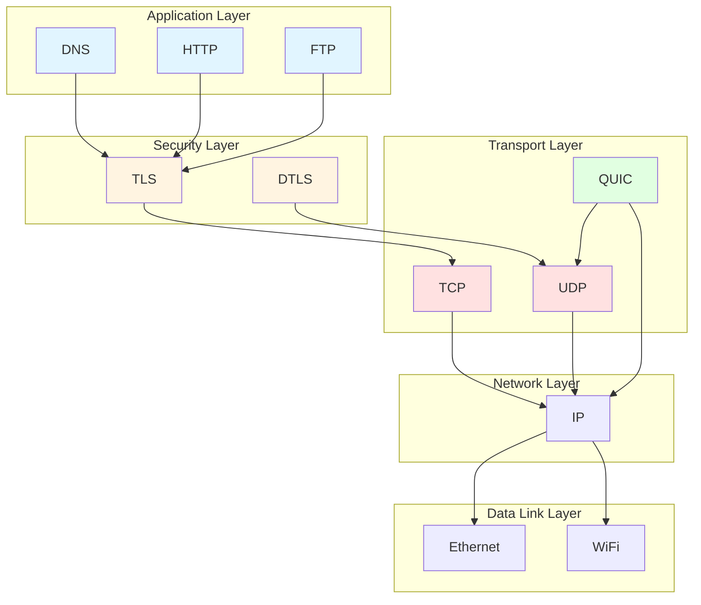
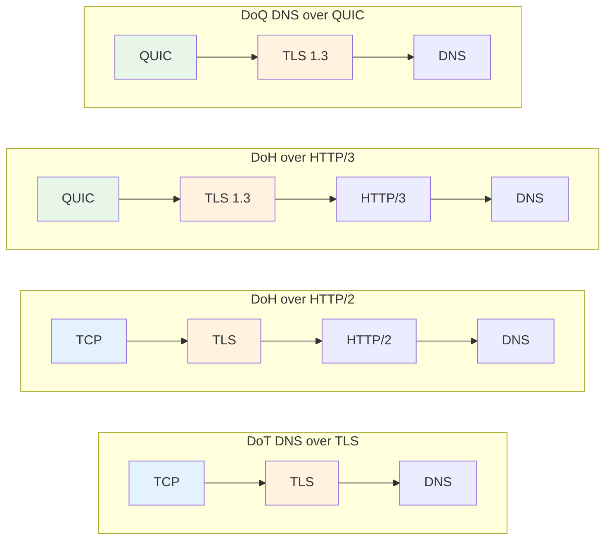

DNS over HTTPS (DoH) and DNS over TLS (DoT) are two common encrypted DNS transport methods. Both can protect DNS queries from being easily eavesdropped on or tampered with, but they rely on different protocol stacks.

Here's the conclusion first:

- **DoH**: Carries DNS over HTTP, making it easier to reuse existing Web infrastructure.
- **DoT**: Carries DNS directly over TLS, with a shorter protocol path and a more straightforward structure.
- **Both share the same core goal**: Protecting the privacy and integrity of DNS queries.

The corresponding standards are as follows:

| Protocol | Standard | Description |
| --- | --- | --- |
| DoT | [RFC 7858](https://datatracker.ietf.org/doc/html/rfc7858) | DNS over TLS |
| DoH | [RFC 8484](https://datatracker.ietf.org/doc/html/rfc8484) | DNS Queries over HTTPS |

To truly understand the differences between the two, it's best to start with the network protocol hierarchy.

## Network Protocol Hierarchy

Modern network protocol stacks use a layered design, with each layer responsible for different tasks. Although DNS is an application-layer protocol, it is not tightly bound to any specific transport method.

Here's a quick reference table to understand the role of each layer:

| Layer | Common Protocols | Primary Role |
| --- | --- | --- |
| Application Layer (L7) | DNS, HTTP/1.1, HTTP/2, HTTP/3, FTP | Defines application semantics |
| Security Layer | TLS, DTLS | Provides encryption and identity verification |
| Transport Layer (L4) | TCP, UDP, QUIC | Handles connections, retransmission, flow control, etc. |
| Network Layer (L3) | IPv4, IPv6 | Handles routing and forwarding |
| Data Link Layer (L2) | Ethernet, Wi‑Fi | Handles local link transmission |

Here are a few key points:

- **DNS belongs to the application layer.**
- **TLS sits between the application layer and the transport layer.**
- **HTTP/3 is still an application layer protocol**, it just runs on top of QUIC.
- **QUIC is often regarded as an "enhanced transport layer"**, because it integrates reliable transmission, congestion control, multiplexing, and encrypted handshake capabilities.

If you strip away TLS from DoT, it is essentially close to **DNS over TCP**. This shows that "whether encryption is used" and "which transport DNS runs on" are actually two different dimensions.

## Plain DNS Characteristics

The most common form of DNS is referred to as Plain DNS, typically running over UDP or TCP.

| Transport Method | Advantages | Disadvantages | Typical Characteristics |
| --- | --- | --- | --- |
| UDP | Low connection overhead, fast initial query | Unreliable, prone to packet loss | Most common form of traditional DNS |
| TCP | Has retransmission mechanism, more reliable | Higher handshake cost | Acceptable performance after long connection is established |

Simply put:

- **UDP is lighter**: Better suited for quick requests.
- **TCP is more stable**: More reliable when packet loss occurs.
- **In certain network environments**, especially when UDP packet loss is severe, TCP may actually be more stable.

Some carriers tend to drop UDP packets preferentially during network congestion. In such cases, DNS queries relying on UDP will be affected, while TCP, with its retransmission capability, often achieves more stable results.

## Application Layer Nesting

Both DNS and HTTP are application layer protocols, so DoH can be seen as "**the application layer wrapping another application layer**".

There are two key points to grasp here:

- **The core of DoH is not the name "HTTP", but the HTTP transport mechanism**.
- **Theoretically, DNS can be carried over many application layer protocols**, but in practice there is no need to make it overly complex.

For example:

- DoH = Placing DNS requests inside HTTP requests.
- Unencrypted HTTP can also carry DNS, but it offers virtually no practical advantage.
- Theoretically, you could even do "DNS over FTP", but there is no real-world value in doing so.

## Transport Layer Nesting

QUIC is based on UDP but provides many capabilities traditionally associated with the transport layer.

It typically has the following characteristics:

- Connection-oriented
- Congestion control
- Retransmission mechanism
- Flow control
- Multiplexing
- Deep integration with TLS 1.3

Therefore, QUIC can be understood as:

| Comparison Target | QUIC Characteristics |
| --- | --- |
| Compared to TCP | Typically lower latency for connection establishment and recovery |
| Compared to UDP | More reliable, more complete capabilities |

## Protocol Combination Relationships

Application layer protocols and transport layer protocols are not one-to-one bound. The same application protocol can run on different transport methods.

Here's a simplified overview table:

| Solution | Protocol Combination |
| --- | --- |
| Plain DNS | UDP/TCP + DNS |
| HTTP/2 | TCP + TLS 1.2/1.3 + HTTP/2 |
| HTTP/3 | QUIC + TLS 1.3 + HTTP/3 |
| DoT | TCP + TLS 1.2/1.3 + DNS |
| DoH | HTTP/2 or HTTP/3 + DNS |
| DoQ | QUIC + TLS 1.3 + DNS |

To summarize in one sentence:

- **DoT**: Shorter path, DNS runs directly over TLS.
- **DoH**: Goes through HTTP first, then carries DNS.
- **DoQ**: Uses QUIC to carry DNS directly.

## Performance and Compatibility Analysis

Understanding the protocol combinations makes the differences between DoH and DoT more intuitive.

### 1. Performance

| Dimension | DoH | DoT |
| --- | --- | --- |
| Theoretical low-latency potential | High, especially DoH/3 | Medium to relatively high |
| Dependence on UDP environment | DoH/3 relies on QUIC/UDP | Primarily relies on TCP |
| Stability in poor network conditions | Depends on HTTP/2 fallback | Generally more stable |

Simplified understanding:

- If the service provider supports **HTTP/3**, DoH often has better low-latency potential.
- If the network environment is **unfriendly to UDP**, DoT is generally more stable.
- Theoretical speed does not equal actual experience; carrier packet-dropping strategies directly affect results.

### 2. Privacy and Security

| Dimension | DoH | DoT |
| --- | --- | --- |
| Transport encryption | Yes | Yes |
| Anti-eavesdropping / Anti-tampering | Yes | Yes |
| Common default port | 443 | 853 |

Key points:

- **Both DoH and DoT are encrypted DNS.**
- Both can effectively reduce the risk of DNS plaintext leakage.
- DoT is often said to be "easy to identify", largely because **port 853 is quite conspicuous**, not because the protocol itself inherently exposes more information.
- In fact, **DoT can also run on non-853 ports**, though platform support varies.

### 3. Extensibility and Service Deployment

| Dimension | DoH | DoT |
| --- | --- | --- |
| Reuse of existing Web infrastructure | Strong | Weak |
| Easy to reuse port 443 | Yes | No |
| Server-side scaling potential | Greater | Relatively limited |

This is more from the service provider's perspective:

- DoH can directly leverage the mature HTTP service ecosystem.
- DoH is easier to deploy alongside other Web services on port 443.
- DoT is more like a "dedicated DNS service" with a purer protocol path, but its extensibility is not as strong as the HTTP ecosystem.

### 4. Platform Compatibility

| Platform / System | DoH | DoT |
| --- | --- | --- |
| Chromium browsers | Supported | Depends on system or extensions |
| Windows 11 | Natively supported | Depends on configuration |
| Android 8+ | Supported in some scenarios | Natively supported |
| Android 11+ | Natively supported | Natively supported |
| macOS | Natively supported | Natively supported |
| iOS | Natively supported | Natively supported |

Overall trends:

- **DoH's platform adoption is increasingly widespread.**
- **DoT had an earlier start on Android.**
- For ordinary users, which is more convenient often depends on whether the system provides a native entry point.

## Practical Recommendations

If you only need a brief recommendation for ordinary users, you can refer to the table below:

| Scenario | More Recommended |
| --- | --- |
| Want simplicity and broad compatibility | DoH |
| Network is unfriendly to UDP | DoT |
| Service provider supports HTTP/3 | Try DoH first |
| System only provides a native DoT interface | Start with DoT |

Further details:

- For most users, **DoH is generally more hassle-free**.
- If the service provider supports **DoH/3**, it typically offers lower latency when the network is in good condition.
- If the network condition is poor, DoH may fall back to HTTP/2 to maintain availability.
- If the local network frequently drops UDP packets, **DoT may be more stable than DoH/3**.

### What to Focus on When Choosing

It is recommended to evaluate in the following order:

1. **Whether the service provider supports HTTP/3 / DoH/3**
2. **Whether your carrier's network is prone to dropping UDP packets**
3. **Whether your device natively supports DoH or DoT**
4. **Whether you prioritize ease of configuration or network stability**

### A Practical Suggestion

Try [NullPrivate](https://www.nullprivate.com/), which supports both DoT and DoH/3, and also provides ad blocking and DNS split-horizon functionality. If you need to self-host, you can also use its [open-source library](https://github.com/NullPrivate/NullPrivate).

## Summary

To wrap up in three sentences:

- **Both DoH and DoT significantly enhance DNS privacy protection.**
- **DoH leans toward compatibility and ecosystem reuse, while DoT leans toward directness and stability.**
- **For most users, DoH is generally the more balanced choice**, but ultimately it still depends on the network environment and service provider support.
