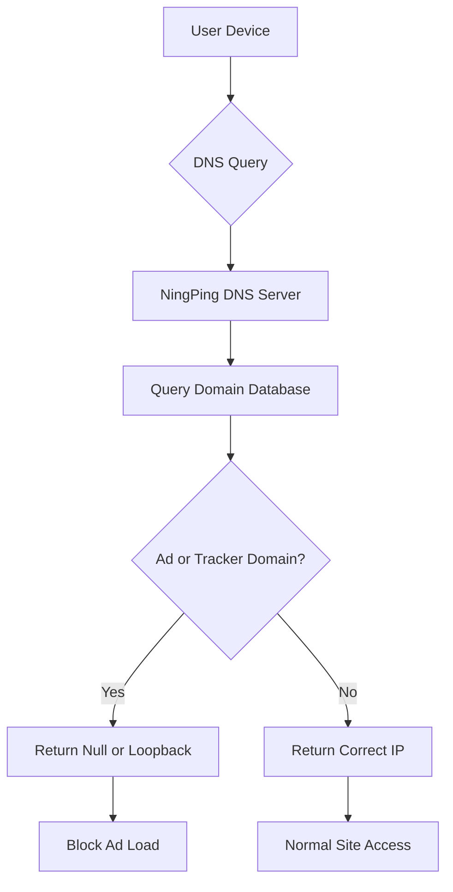

In today’s digital era, advertising has become an integral part of the internet ecosystem, yet excessive ads not only degrade user experience but also pose privacy risks. NingPing (NullPrivate), a DNS service focused on privacy protection, adopts DNS-filtering technology similar to AdGuard Home to provide users with an effective ad-blocking solution.

## How NingPing Ad-Block Works

NingPing’s ad-blocking relies on DNS (Domain Name System) filtering. The workflow is as follows:

### DNS Request Monitoring

When your device tries to visit a website, it first queries the DNS server for the domain’s IP address. Acting as your primary DNS server, NingPing receives and analyzes these queries.

### Intelligent Filtering

NingPing maintains a large database of advertising and tracking domains. When it detects a request for such a domain, the system blocks it immediately.

### Efficient Response

For blocked requests, NingPing returns a null address or the local loopback address (e.g., 127.0.0.1), preventing ad content from loading. For legitimate requests, NingPing supplies the correct IP so users can access the intended site normally.

## Technical Advantages

### Efficiency

- **Network-level blocking**: Ads are stopped at the DNS-resolution stage, before any web content is downloaded.  
- **Millisecond-level response**: Localized DNS responses add virtually no latency.  
- **Whole-network protection**: One configuration shields every device on the network.

### Precision

- **Multi-layer filtering**: Supports exact domain matching, wildcard rules, and regular expressions.  
- **Smart categorization**: Rules are grouped by ads, trackers, malware, etc.  
- **Dynamic updates**: Regularly pulls the latest rules from trusted sources.

### Privacy Protection

- **No-trace browsing**: No user-visit logs are kept.  
- **Reduced data leakage**: Prevents advertisers and trackers from harvesting user data.  
- **Local processing**: Most filtering occurs locally, minimizing data exposure.

## Similarities to AdGuard Home

NingPing and AdGuard Home share the same core ad-blocking principles:

1. **DNS-based filtering**: Both intercept DNS queries to block ad domains.  
2. **Rule management**: Both allow custom rules and whitelist/blacklist configuration.  
3. **Network-wide protection**: Both can safeguard an entire LAN.  
4. **Open-source community**: Both benefit from community-maintained filter lists.

## User-Experience Optimizations

NingPing is designed to block ads effectively without disrupting normal use.

### Transparent Management

- Detailed blocking statistics let users see protection effectiveness.  
- Flexible whitelist settings prevent accidental blocking of important sites.  
- Rule updates take effect instantly—no device restart required.

### Ease of Use

- Simplified setup process—accessible even for non-technical users.  
- Multi-language support for global audiences.  
- Compatible with all network environments and device types.  
- Secure, reliable DNS infrastructure.

### Privacy Safeguards

- Strict privacy measures protect user data.  
- No personally identifiable information is collected.  
- User data remains secure.

## Usage Recommendations

For optimal ad-blocking:

1. **Configure rules wisely**: Choose filter lists that match your needs.  
2. **Check for updates regularly**: Keep rule databases current.  
3. **Review statistics**: Use stats to gauge blocking effectiveness.  
4. **Adjust whitelists promptly**: Add mistakenly blocked sites to the whitelist.

## Conclusion

Using advanced DNS filtering, NingPing delivers an efficient, precise, and privacy-centric ad-blocking solution. We protect users from intrusive ads while preserving normal web experiences. Choose NingPing for a cleaner, safer internet.

In the digital age, everyone deserves a private, uncluttered online space. NingPing is built to deliver exactly that, helping users reclaim control of their digital lives.
