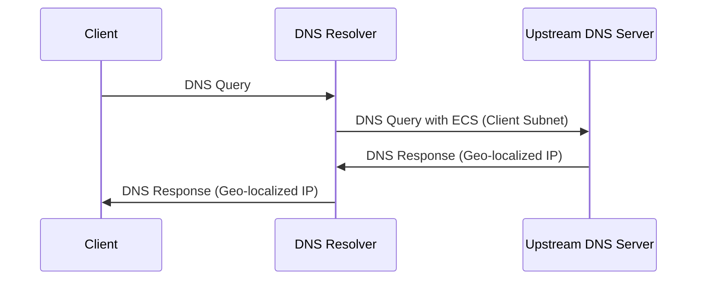

To provide the best DNS resolution experience, we have preset some recommended configurations, but there is still one setting that requires your attention: “EDNS Client Subnet”.

## Enable EDNS Client Subnet (ECS)

For an even better experience, you may want the DNS server to return the server IP closest to your geographic location. `EDNS Client Subnet (ECS)` makes this possible. It allows sending a subnet containing geolocation information to the DNS server so that the server can return the optimal DNS resolution result.

**How it works:**

When ECS is enabled, your DNS resolver (e.g., AdGuard Home) includes a portion of the client IP address (usually the first 24 bits, representing the subnet where the client is located) in the DNS query and sends it to the upstream DNS server. The upstream DNS server then returns the server IP address most suitable for that region based on this subnet information.

**Privacy considerations:**

Enabling ECS can improve DNS resolution accuracy and speed, but it may also have privacy implications. By sharing the subnet of your client IP address, your approximate geographic location may be recorded by the upstream DNS server. Please weigh whether to enable this feature based on your own circumstances.

**How to weigh:**

Enabling ECS can balance access speed and accuracy. If you have high privacy requirements, you can choose to disable ECS, but this may reduce access speed. If you want the best access experience, you can enable ECS, but please be aware of the potential privacy impact. This privacy information is collected by the upstream DNS; this service still adheres to the privacy policy commitment of not collecting or utilizing any information.
