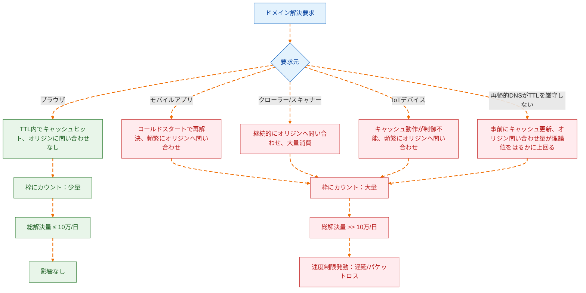
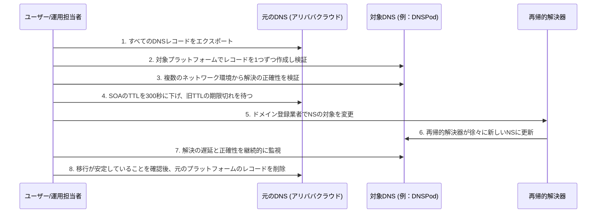

2026年5月14日、アリババクラウドは控えめだが影響の大きい製品告知を発表しました：6月24日より、クラウドDNS解決のパブリック権威解決無料版に、1ドメインあたり1日の解決量制限が新たに追加され、上限は10万回、超過すると動的速度制限が発動され、遅延やパケットロス、あるいはその両方が発生します[^1]。告知の文言は抑制的で、「大多数の無料ユーザーの1日平均解決量はこの閾値をはるかに下回る」と述べ、何事もないかのような様子でした。

しかし、この告知の真の重要性は技術的なパラメータ自体ではなく、それが示す転換点にあります：**中国の主要クラウドベンダーの無料DNSサービスは、「デフォルトで十分」から「使用量を計算する必要がある」段階に移行しつつあります。** 無料DNSに依存する独立開発者、個人サイト運営者、中小チームにとって、これは単独の価格調整ではなく、DNSサービス全体の商業ロジックの再定義です。

## 10万回で本当に十分か：解決量の実態

公式には「大多数のユーザーは影響を受けない」と述べていますが、この発言は統計的に見て中央値だけを見れば成立する可能性があります。しかし問題は、正常に稼働しているサービスサイトのDNS解決量は複数の要因が重なることで決まり、1日10万回は安心できる閾値ではないということです。

1ドメインあたりの解決量に影響する主要な変数は以下の通りです：

**サブドメインの数。** 制限の対象となる「単一ドメイン」とは、親ドメインとそのすべてのサブドメインの解決量の合計を指します[^1]。`www`、`api`、`cdn`、`static`など複数のサブドメインを使用するサイトの場合、各サブドメインの解決はすべて合計にカウントされます。中程度の複雑さのWebアプリケーションであれば、解決量は簡単に数倍になります。

**TTLと実際のキャッシュ動作。** 理論上、再帰的解決器はTTLに従って解決結果をキャッシュし、オリジンへの問い合わせを削減します。しかし現実には、国内の通信事業者級再帰的解決器はTTLを厳守しないケースが広く存在し、中にはTTLの期限切れ前に先にキャッシュを更新したり、長すぎるTTLを無視して独自に短くしたりするものもあります。これは、実際のオリジン問い合わせ回数が理論値をはるかに上回る可能性があることを意味します。

**クローラーとスキャナー。** 検索エンジンのクローラー、セキュリティスキャナー、SEOツールなどが継続的にDNS解決をトリガーします。これらのトラフィックはページアクセスを発生させませんが、同じく解決枠を消費します。

**モバイル端末とIoTデバイス。** モバイルアプリのDNSキャッシュ動作はブラウザと異なり、実装によってはコールドスタート時に毎回再解決を行います。IoTデバイスのDNS実装は品質にばらつきが大きく、多くのデバイスはキャッシュを行わないか、キャッシュ時間が非常に短いです。

実際の事例として参照できるものがあります：独立ブログyijile.comは告知後に自己点検したところ、1日平均解決量が30万回を超え、制限の300%に達していることがわかりました[^2]。一方、このサイトのページアクセス量は同程度の水準には到底達していません。これは、DNS解決量とサイトのUV/PVの間に顕著な非線形な関係があることを示しており、「1日アクセス量」から「1日解決量」を推測することは信頼できないということです。

## 速度制限の背景にある商業ロジック：無料の終点は速度制限

アリババクラウドは無料DNSに制限を設けた最初のベンダーではなく、最後のベンダーでもありません。

商業的な観点から見ると、無料版DNSはクラウドベンダーにとって「負の資産」です。インフラリソース（グローバルな解決ノード、帯域幅、運用・保守要員）を消費しますが、ブランド露出とユーザー入口としての価値以外には、ほとんど直接収入を生み出しません。ユーザー規模が小さいうちは、この投資は顧客獲得コストと見なすことができますが、無料ユーザーの数が膨れ上がって全局の安定性に影響を及ぼすようになると、速度制限は必然的な選択となります。

告知で言及された「プラットフォームが処理する解決総量の継続的な増加」と「局部のトラフィックの突発的な増加や異常な問い合わせが通常の業務に影響するのを回避する」は、商業的な言葉に翻訳すれば：**無料ユーザーの過剰な使用が、既に有料ユーザーのSLA保証を侵食し始めている**ということです。

このロジックはCloudflareやGoogle Cloud DNSなどの国際的なベンダーの経路と一致しています：まず無料サービスでユーザーベースと市場認知を確立し、その後徐々に無料枠を引き締めて商業的な転換を促します。異なる点は、アリババクラウドが「超過後に従量課金」ではなく、より直接的な「ハードな速度制限」を選択したことです。これは、国内のクラウドサービス市場の競争状況を反映しています：無料ユーザーの移行コストが十分に低い場合、ベンダーは精细化した課金による転換ではなく、超過ユーザーを直接切り離す傾向があるのです。

## 国内の代替案：誰がまだ無料で持ちこたえられるか

1日平均解決量が10万回を超える可能性のあるサイトにとって、代替DNSサービスへの移行は現実的な選択肢です。以下に、現在国内で主流の無料DNSサービスの主要な側面の比較を示します：

| サービス提供元 | 無料版の解決量制限 | ゾーン分割解決 | 最小TTL | DDoS対策 | 備考 |
| --- | --- | --- | --- | --- | --- |
| アリババクラウド DNS | 1日10万回（2026.6.24より） | 有料版で対応 | 120秒（無料版） | 基本 | 今回の速度制限の主役 |
| テンセントクラウド DNSPod | 1日あたりの明確な解決量制限なし | 無料版で対応（通信事業者/地域/検索エンジン回線） | 1秒 | 基本 | 国内で最も成熟した代替選択肢 |
| ファーウェイクラウド DNS | 1日あたりの明確な解決量制限なし | 有料版で対応 | プランによる | 基本 | 比較的緩く、ファーウェイエコシステムのユーザーに適している |
| 火山引擎 TrafficRoute | 1日あたりの明確な解決量制限なし | 無料版で基本回線に対応 | 1秒 | 基本 | バイトダンス製、エコシステムは比較的新しい |

テンセントクラウドDNSPodは現在、情報が最も透明な代替選択肢であり、その無料版は通信事業者別（電信、移動、聯通）、地域別（国内/海外）、検索エンジン専用回線によるゾーン分割解決を明確にサポートしています。国内外の解決を区別したり、事業者別の最適化が必要なサイトにとって、これはアリババクラウド無料版では提供できない差別化機能です。

ただし注意が必要です：**今日速度制限がなくても、明日速度制限がないとは限りません。** DNSPodの無料版も同様に、ユーザー増加によるリソース圧力に直面しており、現時点ではまだトリガーとなる閾値に達していないだけです。代替案を選択する際は、「現在制限がない」ことを「永遠に制限がない」と同等に考えてはいけません。

## 移行戦略：NSを単に変更するだけでは不十分

DNS移行は技術的には複雑ではなく、ドメイン登録業者のNSレコードを変更し、グローバルな再帰的解決器の更新を待つだけで済みます。しかし実際の操作では、見落とされやすい重要なポイントがいくつかあります：

**レコードのエクスポートとフォーマット互換性。** 異なるDNSサービス提供元はレコードタイプのサポート度合いが異なります。アリババクラウドがサポートする一部の拡張レコードタイプ（例えば、明示的/暗黙的URL転送など）は、DNSPodや他のベンダーでは異なる方法で実装されていたり、サポートされていなかったりします。移行前にはすべてのレコードを完全にエクスポートし、1つずつ検証する必要があります。

**TTLの移行期間設計。** NSを移行する際、新旧2つの権威DNSは移行期間中に共存します（旧NSレコードのTTLによります）。ベストプラクティスは、まず対象プラットフォームで全く同じレコードを設定し、検証して問題がないことを確認してから、NSを新しいプラットフォームに切り替えることです。切り替え前に旧NSのSOAレコードのTTLを下げる（例：300秒）ことで、移行期間を短縮できます。

**ゾーン分割解決の戦略移行。** 元々アリババクラウドの有料版のゾーン分割解決に依存していた場合、DNSPod無料版への移行では回線設定をそのまま再利用できます。無料のゾーン分割解決をサポートしていないプラットフォームに移行する場合は、単一の解決戦略を受け入れるかどうかを評価する必要があります。

**監視を先行させる。** 完全に切り替える前に、解決監視を構築します。複数のネットワーク環境（電信、聯通、移動）から重要なサブドメインの解決を継続的に検証し、移行後の解決結果と遅延が許容範囲内であることを確認します。

## さらに深く：無料DNSサービスの構造的な困境

より長い歴史のスパンで見ると、アリババクラウドDNS無料版の速度制限は孤立した事件ではなく、無料DNSサービスモデルの構造的な問題が表面化したものです。

DNS権威解決は「薄利多売」のインフラサービスです。限界費用は非常に低いものの、安定性と可用性への要求は非常に高いです。無料サービスが処理するドメイン数が10万級から100万級に、解決量が億級から千億級に増加すると、無料モデルの持続可能性は根本的な疑問に直面します：速度制限でトラフィックを分散するか、サービス品質を低下させるか、有料化するかのいずれかです。

クラウドベンダーの困境は、DNSが最も下層のインターネットの入口であるということです。ドメイン解決が失敗すると、業務全体が到達不可能になります。ユーザーは「これは無料版だからサービス品質が悪い」と区別せず、「アリババクラウド/テンセントクラウドはダメだ」と原因を帰属させます。この「無料サービスがブランド評判を人質にする」圧力が、速度制限の決定を推進する重要な要因です。

サイト運営者と開発者にとって、この件の教訓は「早急に別の無料プラットフォームに乗り換える」ことではなく：**無料で、自己制御不能なインフラへの依存は、すべてに有効期限が内蔵されている**ということです。今日アリババクラウドが速度制限を行い、明日はDNSPodが、明後日はCloudflareの無料プランが条項を変更する可能性があります。

## 結論

アリババクラウドDNS無料版の1日10万回の速度制限は、絶対的な数値としては厳しいものではありませんが、それが発するシグナルは数値よりも重要です：**国内のクラウドベンダーの無料DNSの紅利期が狭まっている**ということです。

大多数の1日平均解決量が閾値をはるかに下回るサイトは、何もする必要がありません。閾値の境界線付近にあるサイトは、直ちに解決量の監視を開始し、自身の実際の使用量を把握した上で判断することを推奨します。既に超過しているか、または超過が予想されるサイトにとって、DNSPod無料版は現在最も実用的な移行先ですが、DNSの自主的制御を中長期的な計画に組み込むべきです。複数のベンダーによる冗長構成にするか、独自に権威DNSを構築するか（軽量なNSDやCoreDNSのインスタンスでも構いません）、どちらも真剣に検討する価値があります。

無料は一時的なもので、制御可能であることが長期的なものです。

[^1]: アリババクラウド.『製品変更』クラウドDNS解決-パブリック権威解決無料版の速度制限通知. 2026-05-14. https://www.aliyun.com/notice/118259
[^2]: 一極楽. アリババクラウドDNS解決無料版が単一ドメインあたり10万回の解決量に制限、より優れた代替製品への乗り換え. 2026-05-24. https://yijile.com/zh/alibaba-cloud-dns-resolution-limit-replacement-products/
