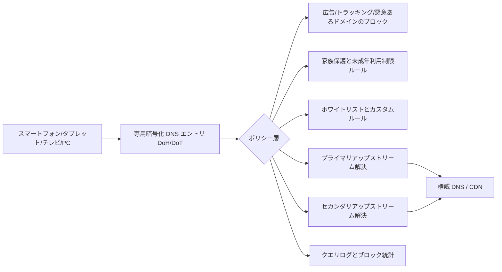

多くのユーザーは DNS を「アドレスを1つ入力して終わり」の基礎設定だと考えていますが、2024年と2025年に発生した2回の公開インシデントは、**リゾルバ自体にも障害が起こりうる**こと、そしてその影響が**「Webページが開けない」「アプリがネットワークに接続できない」「家族全員のネットワークが遮断される」**という体感レベルの問題に直接拡大することを示しました。

本記事では「どのサービスが優れているか」については議論しません。焦点は1つです：**DNS を単一依存の状態から、監視可能・切替可能・復旧可能な家庭レベルのインフラストラクチャに変える方法**。

## 2回の検証可能なインシデント：何が起きたか

まず、公開資料の中で最も重要な時系列を確認します（いずれも UTC 時間で、公式のタイムラインとの整合性を確保するため）：

| イベント | 公表日 | 主な影響 | 根本原因の種類 |
| --- | --- | --- | --- |
| Cloudflare 1.1.1.1 インシデント（2024-06-27） | 2024-07-04 に再分析を公開 | 一部地域のユーザーが到達不能または高遅延 | 外部ルーティングイベント（BGP ハイジャック + ルートリーク） |
| Cloudflare 1.1.1.1 インシデント（2025-07-14） | 2025-07-15 に再分析を公開 | 世界の大半のユーザーが影響を受け、公式は62分間の中断ウィンドウを公表 | 内部設定の誤りによるプレフィックス撤回 |

この2回のインシデントに共通する点があります：

- ユーザー側から見るとどちらも「DNS が動かなくなった」；
- しかし根本原因は全く異なり（1回目は外部インターネットルーティング寄り、2回目はサービス内部の変更寄り）；
- 導き出される結論は同じ：**単一アップストリーム・単一エントリポイント・単一プロトコルは、リスクを1つのポイントに集中させる**。

## 技術分析：DNS が「全体的に壊れたように見える」理由

端末が唯一の DNS を利用できないターゲットに向けていた場合、アプリケーションレベルで連鎖反応が発生します：

- ドメイン名が解決できず、`timeout` または `SERVFAIL` として表れる。
- ブラウザーやアプリが繰り返しリトライを行い、「一時的に復旧するが、再び失敗する」という不安定な体験になる。
- インターネット回線自体は正常であっても、ユーザーは「回線が壊れた」や「Webサイトが全部落ちた」と誤認する。

上図のポイントは「機能をたくさん積み上げること」ではなく、以下の3つです：

- **パスの階層化**：アクセス層（DoH/DoT）とポリシー層（ブロック/ホワイトリスト）の分離。
- **アップストリームの冗長性**：プライマリアップストリームに異常が発生しても、バックアップの解決経路が確保されていること。
- **可観測性**：ログと統計があれば、誤ブロックなのかアップストリームの問題なのか端末の問題なのかを判断できる。

## 家庭ネットワーク向けの実践的な構成案

寧屏（NullPrivate）が提供する `nullprivate/adguardprivate` サービスを活用した場合の実用的な手順は以下の通りです：

1. 専用暗号化 DNS エントリ（DoH/DoT）を利用する
   - 平文 DNS の漏洩とローカルネットワークの干渉を軽減する。
   - クライアント ID / デバイス識別子と連携し、家庭内の各デバイスを区別する。

2. プライマリアップストリーム + セカンダリアップストリームを設定し、単一障害点を排除する
   - すべての解決を1つの DNS サービスや1つのプレフィックスに依存しない。
   - 分流戦略と組み合わせて、ドメインごとに異なるアップストリーム経路を利用する。

3. 「広告ブロック・詐欺防止・未成年利用制限」をポリシー層で一元管理する
   - 広告・トラッキングドメインのブロック。
   - 悪意・フィッシングドメインのブロック。
   - 子供のデバイスに対する時間帯管理とコンテンツフィルタリング。

4. 誤ブロック修正の経路を確保する
   - クエリログからブロックされたドメインを特定する。
   - ホワイトリストへの迅速な追加により、通常業務への長期的な影響を回避する。

5. 定期的に「障害訓練」を行う
   - 手動でプライマリアップストリームを一時的にダウンさせ、バックアップ経路が機能することを検証する。
   - 家庭ネットワーク内で決済アプリ、オンライン授業、ビデオ会議など重要なアプリの可用性を確認する。

## よくある誤解

多くの人は「暗号化 DNS を使えば絶対に中断しない」と考えています。しかし、暗号化は**伝送路のプライバシーと盗聴防止のみを解決するものであり、自動的に高可用性を保証するものではありません**。高可用性は以下の要素から実現されます：

- アップストリームの冗長設計；
- ポリシー設定の適切さ；
- 監視と緊急対応のアクションが実行可能であること。

## 実装チェックリスト

- DNS プロバイダーが依然として1つだけではないか？
- プロトコルが単一（DoT または DoH のみ）でバックアップがないのではないか？
- ログから「誤ブロック vs アップストリーム障害」を3分以内に切り分けられるか？
- 高齢者や子供のデバイスに個別の家族保護ポリシーを設定しているか？
- 毎月少なくとも1回の切替訓練を行っているか？

以上のいずれかの答えが「いいえ」であれば、**次の公開 DNS インシデントはあなたの家庭ネットワークに直接影響する**可能性が高いです。

## 参考資料（公開・検証可能）

- Cloudflare：2024年6月27日 1.1.1.1 インシデント再分析（BGP ハイジャック・ルートリークのタイムライン付き）  
  https://blog.cloudflare.com/cloudflare-1111-incident-on-june-27-2024
- Cloudflare：2025年7月14日 1.1.1.1 インシデント再分析（62分間の中断説明と復旧タイムライン付き）  
  https://blog.cloudflare.com/cloudflare-1-1-1-1-incident-on-july-14-2025/
- Cloudflare Radar（公開インシデント発生時の DNS 可用性変化を観測可能）  
  https://radar.cloudflare.com/

個人および家族ユーザーにとって、DNS は「もう少し速い」というレベルの話ではなく、基礎的なセキュリティと可用性の問題です。専用暗号化 DNS・広告ブロック・家族保護・可観測性を組み合わせることで、実際の障害発生時に損失と不安を軽減できます。
