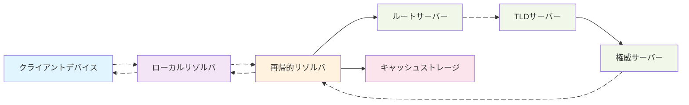
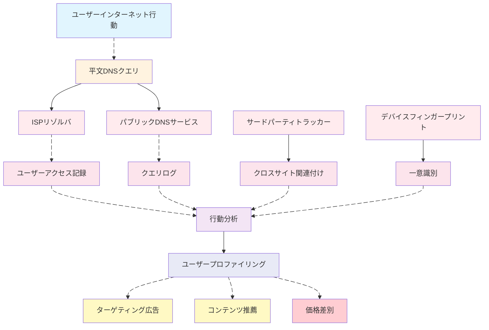
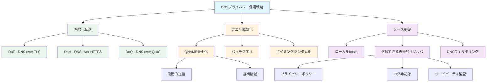

---
layout: blog
categories: ["network"]
tags: ["DNS", "DoH", "DoT", "DoQ", "プライバシー", "ユーザープロファイリング"]
draft: false
title: DNSプライバシー保護とユーザープロファイリング対策戦略
date: 2025-10-09 22:00:00 +0800
comments: false
giscus_comments: false
description: DNSクエリとユーザープロファイリング構築を中心に、原理とリスクから出発し、公開標準と資料に基づいて実現可能なプライバシー保護戦略と注意事項を説明し、憶測的な評価や実践を避ける。
weight: 100
---

# DNSプライバシー保護とユーザープロファイリング対策戦略

> 読者：ネットワークプライバシーとデータガバナンスに関心を持つエンジニア/運用/セキュリティ従事者  
> キーワード：ローカルリゾルバ、再帰的解決、権威サーバー、QNAME最小化、ECS、DNSSEC、DoT/DoH/DoQ  

## 背景と問題概要  

デジタル時代において、ユーザーのネットワーク行動データは企業がユーザープロファイリングを構築する重要な情報源となっています。インターネットインフラのコアコンポーネントであるドメインネームシステム（DNS）は、日常的なネットワーク活動において人間が読めるドメイン名を機械が読めるIPアドレスに変換する重要な役割を担っています。しかし、従来のDNSクエリは通常UDPポート53で平文で送信されるため、ユーザーの閲覧履歴、アプリケーション使用習慣などの機密情報がネットワーク事業者、インターネットサービスプロバイダ、および様々な中間者によって容易に取得・分析される可能性があります。  

ユーザープロファイリングは、ユーザーの様々な行動データを収集・分析して構築されるユーザー特性モデルであり、企業はこれらのモデルを活用してターゲティング広告、コンテンツ推薦、リスク評価などの商業活動を行っています。これらのサービスはある程度ユーザーエクスペリエンスを向上させますが、プライバシー漏洩、データ乱用、潜在的な差別的価格設定などの問題も引き起こします。DNSレベルの技術的手段を通じてユーザープロファイリングの精度を低下させる方法を理解することは、個人のプライバシー保護において重要なアプローチとなります。  

本稿ではDNSの基本原理から出発し、ユーザープロファイリング構築プロセスにおけるデータ収集ポイントを分析し、DNSベースのプライバシー保護戦略を探求し、異なるシナリオにおける実装の考え方と注意事項を説明します。  

## 基礎と用語整理  

DNSプライバシー保護を理解するには、まずDNSクエリの基本プロセスと関連用語を把握する必要があります。DNSクエリは通常複数の関係者を巻き込み、各段階がプライバシー漏洩のポイントとなる可能性があります。  

ローカルリゾルバ（Stub Resolver）はオペレーティングシステムまたはアプリケーション内のDNSクライアントコンポーネントで、アプリケーションからのDNSクエリ要求を受け取り、再帰的リゾルバに転送する役割を担います。再帰的リゾルバ（Recursive Resolver）は通常ISPまたはサードパーティDNSサービスが提供し、ルートサーバー、トップレベルドメイン（TLD）サーバー、権威サーバーへのクエリを含む完全なドメイン解決プロセスを実行し、最終結果をクライアントに返します。  

権威サーバー（Authoritative Server）は特定ドメインのDNSレコードを保存し、ドメイン情報の最終的な情報源です。キャッシュメカニズムはDNSシステムの重要な構成要素であり、再帰的リゾルバはクエリ結果をキャッシュして重複クエリを減らし、解決効率を向上させます。TTL（Time To Live）値はDNSレコードがキャッシュに保存される時間を決定します。  

EDNS Client Subnet（ECS）は拡張メカニズムで、再帰的リゾルバが権威サーバーにクライアントのサブネット情報を渡すことを可能にし、CDNや地理的位置サービスの精度向上を目的としています。しかし、ECSはユーザーの地理的位置情報を暴露し、プライバシー漏洩リスクを増加させる可能性もあります。  

## プライバシー脅威と動機  

平文DNSクエリはユーザープロファイリング構築に豊富なデータソースを提供します。DNSクエリ記録を分析することで、攻撃者またはデータ収集者はユーザーの閲覧習慣、アプリケーション使用状況、地理的位置情報などの機密データを取得し、詳細なユーザープロファイリングを構築することができます。  

DNSクエリデータがユーザープロファイリング構築に持つ価値は主にいくつかの側面に現れます。まず、クエリ頻度と時間パターンはユーザーの日常の生活リズムを明らかにし、例えば平日と週末のインターネット利用習慣の違い、夜間の活動パターンなどが分かります。次に、クエリするドメインの種類はユーザーの興味・関心を反映し、ニュースサイト、ソーシャルメディア、動画プラットフォーム、ショッピングサイトなどのアクセス傾向が分かります。さらに、サブドメインのアクセスパターンはより詳細な行動分析を提供し、例えばユーザーが特定のソーシャルプラットフォームのサブ機能ページを頻繁に訪問しているかどうかなどが分かります。  

地理的位置情報はユーザープロファイリングの重要な構成要素です。ECSメカニズムと再帰的リゾルバの位置分析を通じて、ユーザーの物理的位置または移動軌跡を推測できます。時系列分析と組み合わせることで、ユーザーのよく行く場所や活動範囲を識別することも可能です。  

クロスデバイスのID関連付けはユーザープロファイリング構築のもう一つの重要な環です。DNSクエリ内の特定のパターン（例えば異なるデバイスでの同じドメインへのクエリ時間分布）を分析することで、同一ユーザーの複数デバイスを関連付け、より包括的なユーザープロファイリングを構築できる可能性があります。  

商業的動機がユーザープロファイリング構築を推進しています。ターゲティング広告配信が主要な応用シナリオで、企業はユーザーの閲覧興味を分析して関連性の高い広告を表示し、コンバージョン率を向上させます。コンテンツ推薦システムはユーザープロファイリングを活用してパーソナライズされたニュース、動画、製品推薦を提供し、ユーザーエンゲージメントを強化します。リスク評価は金融、保険などの分野で応用され、ユーザーの行動パターンに基づいて信用リスクや詐欺の可能性を評価します。  

## 保護戦略と原理  

DNSプライバシー漏洩リスクに対し、業界では暗号化伝送、クエリ難読化、ソース制御の3方向を中心に様々な保護戦略が発展してきました。これらの戦略はそれぞれ特徴があり、異なるシナリオやニーズに適しています。  

暗号化伝送はDNSプライバシー保護の基本的な手段で、主に3つの技術が含まれます：DNS over TLS（DoT）、DNS over HTTPS（DoH）、DNS over QUIC（DoQ）。DoTはTCPポート853を使用して暗号化されたDNSクエリを伝送し、TLSプロトコルを通じてエンドツーエンドの暗号化保護を提供します。DoHはDNSクエリをHTTPSトラフィック内にカプセル化し、標準の443ポートを使用するため、既存のネットワーク環境に溶け込みやすく、ファイアウォールやネットワーク管理デバイスによる識別・ブロックを回避しやすくなっています。DoQはQUICプロトコルに基づく新興のソリューションで、UDPの低遅延とTLSのセキュリティを組み合わせ、接続マイグレーションなどの高度な機能をサポートします。  

QNAME最小化（RFC7816）はクエリ難読化技術の一つで、再帰的リゾルバが上流サーバーにクエリを送信する際、完全なドメイン名ではなく段階的にドメイン名を送信します。例えば、"www.example.com"をクエリする場合、まず"com"をクエリし、次に"example.com"、最後に"www.example.com"をクエリします。この方法は上流サーバーが取得する完全なドメイン名情報を減らしますが、クエリ遅延が増加する可能性があります。  

バッチクエリとタイミングランダム化は追加のクエリ難読化手段です。バッチクエリは複数のDNSリクエストを異なる時間に分散して送信し、クエリパターンを通じたユーザー行動の関連付けを回避します。タイミングランダム化はクエリ間隔にランダムな遅延を導入し、時間パターン分析の可能性を打破します。  

ソース制御戦略はDNSクエリの発信段階に注目します。ローカルhostsファイルはDNSクエリをバイパスして一般的なドメイン名を直接解決し、クエリ記録の生成を減らします。信頼できる再帰的リゾルバは厳格なプライバシーポリシーを持つDNSサービスプロバイダを選択します。例えば、クエリログを記録しない、サードパーティトラッキングを受け入れないサービスなどです。DNSフィルタリングは既知のトラッカーや悪意のあるドメインをブロックし、不必要なデータ露出を減らします。  

## 実装パスと注意事項  

DNSプライバシー保護の実装には技術的実現可能性、パフォーマンスへの影響、導入の複雑さを考慮する必要があります。具体的な方案を選択・実施する際には、プライバシー保護効果と実際の可用性のバランスを取る必要があります。  

暗号化DNSの導入には複数の方法があります。OSレベルでのサポートが最も理想的で、Android 9+、iOS 14+、Windows 11はいずれもDoHまたはDoTをネイティブサポートしています。アプリケーションレベルでの実装は特定のソフトウェアに適しており、ブラウザに組み込まれた暗号化DNS機能などが該当します。ネットワーク機器レベルでの導入はルーターやファイアウォールで暗号化DNSを設定し、ネットワーク全体に保護を提供します。  

QNAME最小化の実装は主に再帰的リゾルバが担当し、ユーザーはこの機能をサポートするDNSサービスを選択する必要があります。QNAME最小化は完全なドメイン名情報に依存するプリフェッチや負荷分散などのパフォーマンス最適化に影響を与える可能性があることに注意が必要です。  

信頼できる再帰的リゾルバの選択には複数の要素を考慮します。プライバシーポリシーが最優先で、クエリログの記録有無、ログ保存期間、データ共有ポリシーなどが含まれます。サービスパフォーマンスはユーザーエクスペリエンスに影響し、解決遅延、可用性、グローバル分散などが含まれます。サービスの透明性も重要な要素で、運営ポリシーの公開やサードパーティ監査の受入れなどが挙げられます。  

DNSフィルタリングは誤検知と見逃しの問題に注意が必要です。過度に厳格なフィルタリングは正常なウェブサイトへのアクセスを妨げる可能性があり、緩すぎるフィルタリングはプライバシー保護を効果的に行えません。フィルタリングルールの定期的な更新とカスタムホワイトリストの提供が必要なバランス措置です。  

混合戦略はより良いプライバシー保護効果を提供できます。例えば、暗号化DNSとQNAME最小化を組み合わせ、同時にDNSフィルタリングでトラッカーをブロックします。ただし、過剰なプライバシー保護措置はネットワークパフォーマンスと互換性に影響を与える可能性があるため、実際のニーズに基づいて調整する必要があります。  

## リスクと移行  

DNSプライバシー保護措置の導入には様々なリスクと課題が伴う可能性があり、対応する移行戦略と緊急対応計画を策定する必要があります。  

互換性リスクが主な考慮要素の一つです。暗号化DNSは一部のネットワーク環境でブロックされる可能性があり、特に企業ネットワークや制限の厳しい地域では注意が必要です。フォールバックメカニズムが極めて重要で、暗号化DNSが利用できない場合、システムは優雅に従来のDNSにフォールバックできる必要があり、同時にプライバシー漏洩を可能な限り抑える必要があります。  

パフォーマンスへの影響を慎重に評価する必要があります。暗号化DNSはクエリ遅延を増加させる可能性があり、特に初回接続時のハンドシェイクオーバーヘッドが顕著です。キャッシュ最適化と接続再利用により一部のパフォーマンス問題を緩和できます。暗号化DNSサービスを選択する際は、ネットワーク遅延と応答時間を考慮し、地理的に遠すぎるサーバーを避けるべきです。  

コンプライアンス要件は企業が導入時に考慮しなければならない要素です。一部の地域ではデータ保存や監視の要件があり、プライバシー保護措置と矛盾する可能性があります。導入前に現地の規制要件を理解し、プライバシー保護とコンプライアンスのバランスを見つける必要があります。  

段階的なグレーリリース導入はリスク低減の有効な戦略です。まずテスト環境で方案の実現可能性を検証し、次に小規模ユーザーグループに段階的に拡大し、最後に全面導入します。クエリ成功率、遅延変化、エラー率などの主要指標を監視し、設定を適宜調整します。  

ユーザー教育とトレーニングも見逃せません。多くのユーザーはDNSプライバシーの重要性を理解していない可能性があるため、明確な説明と設定ガイドを提供する必要があります。特に企業環境では、IT部門が従業員にプライバシー保護措置の目的と使用方法を説明すべきです。  

## シナリオ別推奨事項  

異なる使用シナリオではDNSプライバシー保護のニーズと実施戦略がそれぞれ特徴があり、具体的な環境に応じた方案を策定する必要があります。  

家庭ネットワークシナリオでは、ルーターレベルでの導入が良い選択です。暗号化DNSをサポートするルーターはIoTデバイスやスマートホーム製品を含む家庭ネットワーク全体に保護を提供できます。ペアレンタルコントロールや悪意のあるウェブサイトフィルタリングをサポートするなど、家庭向けのDNSサービスを選択することで、プライバシー保護と追加のセキュリティ機能を両立できます。  

モバイルワークシナリオでは、ネットワーク切り替えとバッテリー消費に特に注意が必要です。接続マイグレーションをサポートするDoQサービスを選択することで、モバイルネットワーク切り替え時の安定性を向上させます。同時に、頻繁なDNSクエリと暗号化操作による過度のバッテリー消費を避けるため、バッテリー最適化戦略を考慮します。  

企業環境ではプライバシー保護とネットワーク管理のバランスを見つける必要があります。一般従業員のトラフィックにはプライバシー保護を提供し、特定の業務トラフィックには管理要件を満たすため可視性を維持する混合方案が必要になる場合があります。DNSフィルタリングは企業のセキュリティポリシーと組み合わせ、悪意のあるドメインとデータ漏洩リスクを阻止できます。  

高いプライバシーが必要なシナリオ（ジャーナリスト、弁護士、医療従事者など）では、複数の保護措置を組み合わせる必要があるかもしれません。暗号化DNS、VPN、Torなどのツールを組み合わせ、多層的なプライバシー保護を実現します。同時に、クエリログを一切記録しない匿名再帰的リゾルバの使用を検討できます。  

クロスボーダーネットワークシナリオでは、ネットワーク検閲と地域制限に特に注意が必要です。一部の暗号化DNSサービスは特定地域で利用できない可能性があるため、複数の代替方案を準備する必要があります。現地のネットワーク環境の特徴を理解し、現地条件に最も適したプライバシー保護戦略を選択します。  

開発テスト環境では最新のプライバシー保護技術を試すことができます。実験的なDoQ実装やカスタム難読化方案などです。これらの環境は比較的制御しやすく、新技術の影響と互換性をテストするのに適しており、本番環境導入のための経験を蓄積できます。  

## FAQと参考資料  

### よくある質問  

**Q: 暗号化DNSはユーザープロファイリング構築を完全に防止しますか？**  
A: 暗号化DNSはネットワークレイヤーでの中間者によるDNSクエリ内容の盗聴を防止できますが、再帰的リゾルバは依然として完全なクエリ記録を確認できます。ログを記録しないと約束する信頼できるサービスプロバイダを選択することが重要です。同時に、ブラウザのトラッキング防止機能などの他のプライバシー保護措置と組み合わせることで、より包括的な保護を提供できます。  

**Q: QNAME最小化はDNS解決パフォーマンスに影響しますか？**  
A: QNAME最小化はクエリ遅延を増加させる可能性があります。上流サーバーへの複数回のクエリ送信が必要なためです。現代の再帰的リゾルバは通常、インテリジェントなキャッシュと並列クエリによってパフォーマンスを最適化しており、実際の影響は予想より小さいことが多いです。ほとんどのユーザーにとって、プライバシー上の利益はわずかなパフォーマンス低下をはるかに上回ります。  

**Q: DNSプライバシー保護が有効かどうかをどう確認しますか？**  
A: dnsleaktest.comやdnsprivacy.orgが提供する検出サービスなどの専用テストツールを使用し、DNSクエリが暗号化チャネルを介して送信されているかどうかを検証できます。ネットワークパケットキャプチャツールを使用してDNSトラフィックが暗号化されているかどうかを確認することもできます。ただし、これらのテストは技術的な実装のみを検証でき、サービスプロバイダの実際のプライバシーポリシー遵守状況は評価できないことに注意が必要です。  

**Q: 企業ネットワークでプライバシー保護と管理ニーズをどうバランスさせますか？**  
A: 企業は階層化戦略を採用できます。一般的なインターネットアクセスにはプライバシー保護を提供し、内部業務トラフィックには必要な監視能力を維持します。ドメイン名やユーザーグループに基づいて異なるDNSポリシーを適用する分流技術をサポートするソリューションを使用します。明確なプライバシーポリシーと従業員とのコミュニケーションも重要です。  

**Q: 暗号化DNSはネットワーク事業者によってブロックされますか？**  
A: 一部のネットワーク環境では暗号化DNSトラフィックを制限またはブロックする可能性があり、特に非標準ポートを使用するDoTが該当します。DoHは標準のHTTPSポート443を使用するため、通常識別・ブロックされにくくなっています。このような状況では、複数の暗号化DNS方案の組み合わせを検討するか、VPNなどの他のプライバシーツールと組み合わせることができます。  

### 参考資料  

**RFC文書:**  
- RFC7858: Specification for DNS over Transport Layer Security (TLS)  
- RFC8484: DNS Queries over HTTPS (DoH)  
- RFC7816: DNS Query Name Minimisation to Improve Privacy  
- RFC9250: DNS over Dedicated QUIC Connections  

**ツールとサービス:**  
- Cloudflare DNS: 1.1.1.1（DoH/DoTをサポート、プライバシー保護を約束）  
- Quad9: 9.9.9.9（DoH/DoTをサポート、悪意のあるドメインをブロック）  
- NextDNS: カスタマイズ可能なプライバシーDNSサービス  
- Stubby: オープンソースのDoTクライアント  

**テストと検証:**  
- dnsleaktest.com: DNS漏洩テスト  
- dnsprivacy.org: DNSプライバシーテストツール  
- browserleaks.com/dns: ブラウザDNS設定検出  

**さらなる読書:**  
- [DNSプライバシー保護技術の詳細](https://nullprivate.com)  
- [企業DNSセキュリティとプライバシーバランス戦略](https://blog.jqknono.com)  

---  

本稿はDNSの基本原理から出発し、ユーザープロファイリング構築プロセスにおけるプライバシーリスクを分析し、暗号化伝送、クエリ難読化、ソース制御などの保護戦略を体系的に紹介しました。実際の導入では、具体的なシナリオとニーズに基づいて適切な方案を選択し、プライバシー保護、パフォーマンス影響、互換性要件のバランスを取る必要があります。DNSプライバシー保護は継続的に発展する分野であり、技術の進化と規制の変化に伴い、保護戦略も絶えず調整・改善する必要があります。
