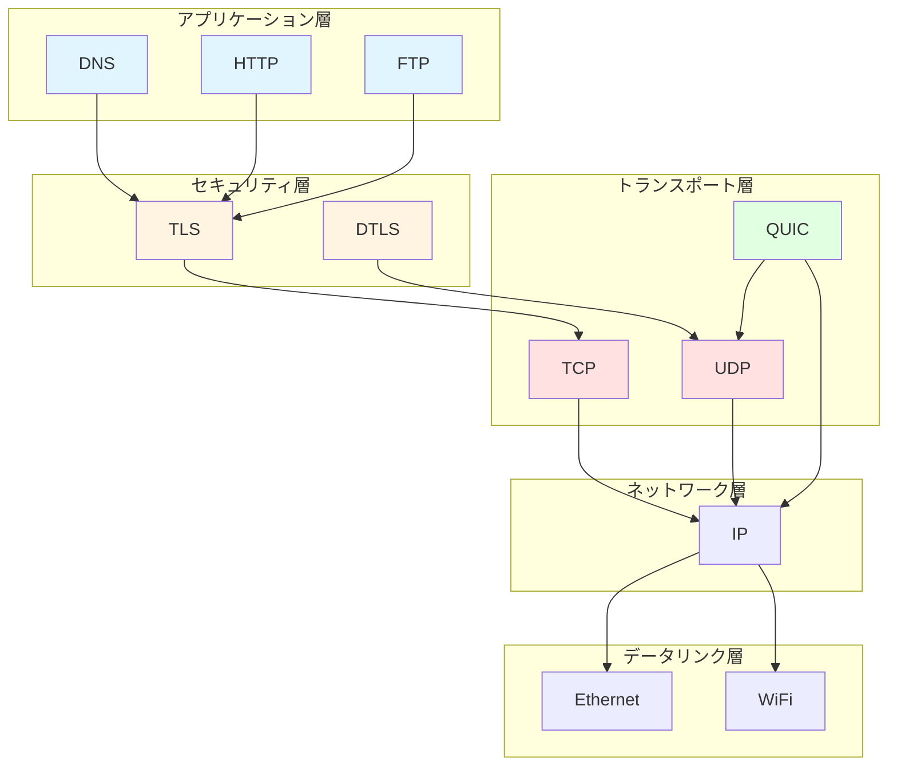
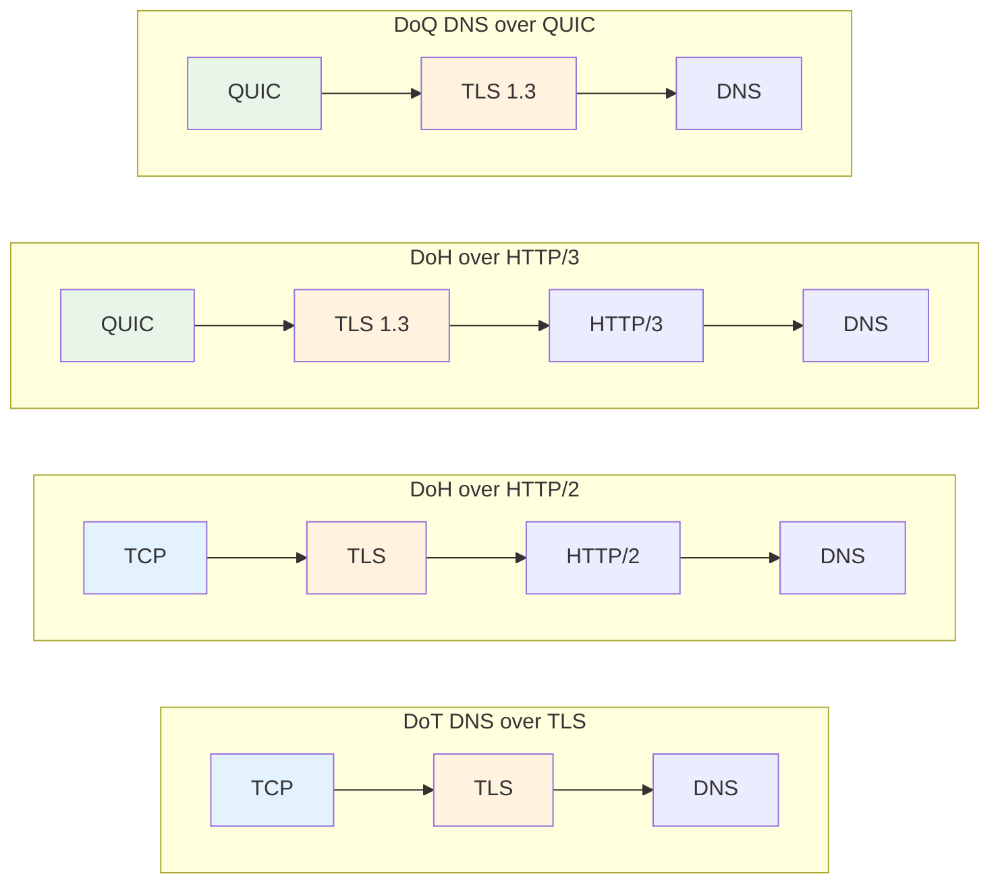

DNS over HTTPS (DoH) と DNS over TLS (DoT) は、いずれも一般的な暗号化 DNS トランスポート方式です。どちらも DNS クエリが盗聴や改ざんされにくくなりますが、基盤となるプロトコルスタックは異なります。

まず結論から見ていきましょう:

- **DoH**: HTTP を介して DNS を伝送するため、既存の Web インフラを活用しやすい。
- **DoT**: TLS の上に DNS を直接伝送するため、プロトコルパスが短く、構造がシンプル。
- **両者の根本的な目標は同じ**: DNS クエリのプライバシーと完全性を保護する。

対応する標準規格は以下の通りです:

| プロトコル | 標準 | 説明 |
| --- | --- | --- |
| DoT | [RFC 7858](https://datatracker.ietf.org/doc/html/rfc7858) | DNS over TLS |
| DoH | [RFC 8484](https://datatracker.ietf.org/doc/html/rfc8484) | DNS Queries over HTTPS |

DoH と DoT の違いを本当に理解するには、まずネットワークプロトコルの階層構造から見るのが最善です。

## ネットワークプロトコルの階層構造

近代的なネットワークプロトコルスタックは階層設計を採用しており、各層が異なる役割を担っています。DNS はアプリケーション層のプロトコルですが、特定のトランスポート方式に強く依存しているわけではありません。

まずは各層の役割を簡単に理解できる表から見てみましょう:

| 階層 | 代表的なプロトコル | 主な役割 |
| --- | --- | --- |
| アプリケーション層 (L7) | DNS, HTTP/1.1, HTTP/2, HTTP/3, FTP | アプリケーションセマンティクスの定義 |
| セキュリティ層 | TLS, DTLS | 暗号化と認証の提供 |
| トランスポート層 (L4) | TCP, UDP, QUIC | 接続管理、再送制御、フロー制御など |
| ネットワーク層 (L3) | IPv4, IPv6 | ルーティングと転送 |
| データリンク層 (L2) | Ethernet, Wi‑Fi | ローカルリンク上の伝送 |

ここでいくつかの重要なポイントがあります:

- **DNS はアプリケーション層に属する**。
- **TLS はアプリケーション層とトランスポート層の間にある**。
- **HTTP/3 は依然としてアプリケーション層のプロトコル**であり、QUIC 上で動作するだけ。
- **QUIC は「強化型トランスポート層」**と見なされることが多い。信頼性のある転送、輻輳制御、マルチプレクシング、TLS ハンドシェイクを統合しているため。

DoT の TLS を取り除くと、本質的には **DNS over TCP** に近くなります。これは、「暗号化するかどうか」と「DNS がどのトランスポート上で動作するか」が実は別の次元の話であることを示しています。

## Plain DNS の特徴

最も一般的な DNS は Plain DNS と呼ばれ、UDP または TCP 上で動作します。

| 伝送方式 | メリット | デメリット | 典型的な特徴 |
| --- | --- | --- | --- |
| UDP | 接続確立のオーバーヘッドが小さく、初回クエリが高速 | 信頼性が低く、パケットロストしやすい | 従来の DNS で最も一般的 |
| TCP | 再送メカニズムがあり、より信頼性が高い | ハンドシェイクのコストが高い | 長時間接続を確立すればパフォーマンスは許容範囲 |

簡単にまとめると:

- **UDP はより軽量**: 素早いリクエストに適している。
- **TCP はより安定**: パケットロスト時により安心できる。
- **一部のネットワーク環境では**、特に UDP パケットロストが深刻な場合、TCP の方が安定する可能性がある。

一部のキャリアはネットワーク混雑時に UDP パケットを優先的に廃棄します。この場合、UDP に依存する DNS クエリは影響を受け、TCP は再送機能を持つため、安定した結果を得やすくなります。

## アプリケーション層のネスト

DNS と HTTP はどちらもアプリケーション層のプロトコルであるため、DoH は「**アプリケーション層でさらにアプリケーション層を包む**」と見なせます。

この節では2つのポイントを押さえましょう:

- **DoH の核心は HTTP という名前ではなく、HTTP という伝送方式**。
- **理論上は DNS をさまざまなアプリケーション層プロトコル上で伝送可能**だが、現実には複雑にしすぎる必要はない。

例えば:

- DoH = DNS リクエストを HTTP リクエストに格納する。
- 暗号化されていない HTTP でも DNS を伝送可能だが、実用上のメリットはほぼない。
- 理論的には「DNS over FTP」も可能だが、現実的価値はない。

## トランスポート層のネスト

QUIC は UDP ベースですが、従来のトランスポート層が持つ多くの機能を提供します。

主な特徴は以下の通りです:

- 接続指向
- 輻輳制御
- 再送メカニズム
- フロー制御
- マルチプレクシング
- TLS 1.3 との深い統合

したがって、QUIC は次のように理解できます:

| 比較対象 | QUIC の特徴 |
| --- | --- |
| TCP と比較 | 接続確立と復旧の遅延が通常より低い |
| UDP と比較 | より信頼性が高く、機能がより充実 |

## プロトコルの組み合わせ関係

アプリケーション層プロトコルとトランスポート層プロトコルは一対一で紐づいていません。同じアプリケーションプロトコルでも、異なる伝送方式で動作できます。

まず簡略化された一覧表を見てみましょう:

| 方式 | プロトコルの組み合わせ |
| --- | --- |
| Plain DNS | UDP/TCP + DNS |
| HTTP/2 | TCP + TLS 1.2/1.3 + HTTP/2 |
| HTTP/3 | QUIC + TLS 1.3 + HTTP/3 |
| DoT | TCP + TLS 1.2/1.3 + DNS |
| DoH | HTTP/2 または HTTP/3 + DNS |
| DoQ | QUIC + TLS 1.3 + DNS |

一言でまとめると:

- **DoT**: パスが短く、TLS の上に DNS を直接載せる。
- **DoH**: まず HTTP を経由し、その上に DNS を載せる。
- **DoQ**: QUIC を使って直接 DNS を伝送する。

## パフォーマンスと互換性の分析

プロトコルの組み合わせを理解した上で、DoH と DoT の違いをより直感的に把握できます。

### 1. パフォーマンス

| 観点 | DoH | DoT |
| --- | --- | --- |
| 理論上の低遅延の可能性 | 高い、特に DoH/3 | 中〜やや高い |
| UDP 環境への依存 | DoH/3 は QUIC/UDP に依存 | 主に TCP に依存 |
| ネットワーク状態が悪い場合の安定性 | HTTP/2 へのフォールバックに依存 | 通常より安定 |

簡単にまとめると:

- サービスプロバイダが **HTTP/3** をサポートしている場合、DoH はより低遅延の可能性を持つ。
- ネットワーク環境が **UDP に不親切**な場合、DoT の方が安定していることが多い。
- 理論上の速度は実際の体験と必ずしも一致せず、キャリアのパケットロスト戦略が結果に直結する。

### 2. プライバシーとセキュリティ

| 観点 | DoH | DoT |
| --- | --- | --- |
| 伝送の暗号化 | あり | あり |
| 盗聴・改ざん防止 | あり | あり |
| 一般的なデフォルトポート | 443 | 853 |

要点は以下の通りです:

- **DoH も DoT も暗号化 DNS である**。
- どちらも DNS の平文漏洩リスクを大幅に低減できる。
- DoT は「識別されやすい」と言われることが多いが、これは主に **853 ポートが目立つため**であり、プロトコル自体が本来より多くの情報を露出するわけではない。
- 実際には **DoT も 853 ポート以外で動作可能**であるが、プラットフォームによってサポート状況は異なる。

### 3. 拡張性とサービス展開

| 観点 | DoH | DoT |
| --- | --- | --- |
| 既存の Web インフラの活用 | 強い | 弱い |
| 443 ポートの活用 | 可能 | 不可 |
| サービス側の拡張余地 | より大きい | 比較的限定的 |

これはよりサービスプロバイダの視点に近い話です:

- DoH は成熟した HTTP サービス体系を直接活用できる。
- DoH は他の Web サービスと一緒に 443 ポート上に展開しやすい。
- DoT は「専用の DNS サービス」に近く、プロトコルパスはよりシンプルだが、HTTP エコシステムほどの拡張性はない。

### 4. プラットフォームの互換性

| プラットフォーム/システム | DoH | DoT |
| --- | --- | --- |
| Chromium ブラウザ | 対応 | システムまたは拡張機能に依存 |
| Windows 11 | ネイティブ対応 | 設定により対応 |
| Android 8+ | 一部のシナリオで対応 | ネイティブ対応 |
| Android 11+ | ネイティブ対応 | ネイティブ対応 |
| macOS | ネイティブ対応 | ネイティブ対応 |
| iOS | ネイティブ対応 | ネイティブ対応 |

全体的な傾向は:

- **DoH のプラットフォーム普及率は年々上昇している**。
- **DoT は Android での対応が先行している**。
- 一般ユーザーにとって、どちらが便利かは、OS がネイティブに提供しているかどうかに大きく左右される。

## 実際の選択に関するアドバイス

一般的なユーザーに一言だけアドバイスするなら、以下の表を参考にしてください:

| シナリオ | 推奨 |
| --- | --- |
| 手軽さを求め、互換性も重視したい | DoH |
| ネットワークが UDP に不親切 | DoT |
| サービスプロバイダが HTTP/3 をサポート | DoH を優先して試す |
| システムが DoT のネイティブ対応のみ | まず DoT を使う |

さらに詳しく:

- ほとんどのユーザーにとって **DoH の方が手軽**である。
- サービスプロバイダが **DoH/3** をサポートしている場合、ネットワーク環境が良好であればより低遅延が期待できる。
- ネットワーク環境が悪い場合、DoH は HTTP/2 へのフォールバックにより可用性を維持できる。
- ローカルネットワークで UDP パケットのロストが頻繁な場合、**DoT の方が DoH/3 より安定する可能性がある**。

### 選択時に注目すべきポイント

以下の4項目を順に確認することをおすすめします:

1. **サービスプロバイダが HTTP/3 / DoH/3 をサポートしているか**
2. **利用しているキャリアのネットワークで UDP パケットのロストが起きやすいか**
3. **使用デバイスが DoH または DoT をネイティブにサポートしているか**
4. **手軽な設定を重視するか、ネットワークの安定性を重視するか**

### 実用的なアドバイス

[宁屏](https://www.nullprivate.com/) の使用をおすすめします。DoT と DoH/3 の両方に対応しており、広告ブロックや DNS 分流機能も提供しています。セルフホストしたい場合は、[オープンソースライブラリ](https://github.com/NullPrivate/NullPrivate)もご利用いただけます。

## まとめ

最後に3つの要点でまとめます:

- **DoH も DoT も DNS のプライバシー保護を大幅に向上させる**。
- **DoH は互換性とエコシステムの活用に優れ、DoT は直接性と安定性に優れる**。
- **一般ユーザーにとっては DoH が通常よりバランスの良い選択**だが、最終的にはネットワーク環境やサービスプロバイダのサポート状況による。
