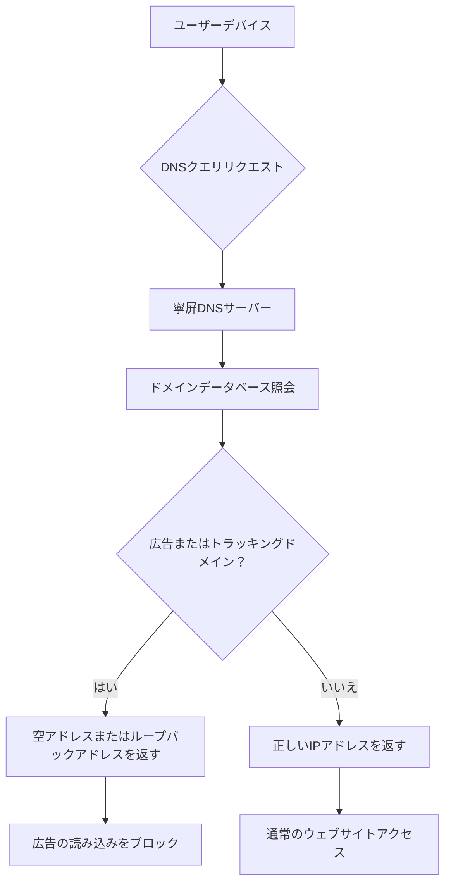

デジタル化が進む現代において、広告はインターネットエコシステムの重要な構成要素となっていますが、過度な広告はユーザーエクスペリエンスを損ない、プライバシーの漏洩リスクを引き起こす可能性もあります。寧屏（NullPrivate）は、プライバシー保護に特化したDNSサービスとして、AdGuard Homeと同様のDNSフィルタリング技術を採用し、ユーザーに効率的な広告ブロックソリューションを提供します。

## 寧屏アドブロックの仕組み

寧屏の広告ブロック機能はDNS（ドメインネームシステム）フィルタリング技術に基づいており、以下のようなワークフローで動作します：

### DNSリクエスト監視

デバイスがウェブサイトにアクセスしようとすると、まずDNSサーバーにドメインに対応するIPアドレスを問い合わせます。寧屏は優先DNSサーバーとしてこれらのクエストを受信し、分析します。

### スマートフィルタリングメカニズム

寧屏は、膨大な広告およびトラッキングドメインデータベースを維持しています。ユーザーがアクセスしようとするドメインが広告またはトラッキングに該当する場合、システムは即座にリクエストをインターセプトします。

### 高速レスポンス

ブロックされたリクエストに対して、寧屏は空アドレスまたはローカルループバックアドレス（例：127.0.0.1）を返すことで、広告コンテンツの読み込みを防ぎます。通常のウェブサイトアクセスリクエストに対しては、正しいIPアドレスを提供し、ユーザーが目的のサイトに正常にアクセスできるようにします。

## 技術的優位性

### 高効率

- **ネットワークレベルでのブロック**：DNS解決段階で広告の読み込みを阻止し、ウェブコンテンツのダウンロードを待つ必要がありません
- **ミリ秒単位のレスポンス**：ローカライズされたDNSレスポンスメカニズムにより、ウェブページの読み込み速度にほとんど影響しません
- **全デバイス保護**：一度設定すれば、ネットワーク内のすべてのデバイスを保護

### 高精度

- **多層フィルタリング**：正確なドメインマッチング、ワイルドカードルール、正規表現に対応
- **スマート分類**：フィルタリングルールを広告、トラッカー、マルウェアなどに分類管理
- **動的アップデート**：信頼できるソースから最新のフィルタリングルールを定期的に取得

### プライバシー保護

- **トレースフリーブラウジング**：ユーザーのアクセス履歴を記録せず、閲覧プライバシーを保護
- **データ漏洩の削減**：広告主やトラッカーによるユーザーデータ収集を阻止
- **ローカル処理**：大部分のフィルタリング処理をローカルで実行し、データ外部漏洩リスクを削減

## AdGuard Homeとの類似点

寧屏は広告ブロックにおいて、AdGuard Homeと同じコア技術原理を採用しています：

1. **DNSベースのフィルタリングメカニズム**：両方ともDNSクエリをインターセプトすることで広告ドメインの解決を阻止
2. **フィルタリングルール管理**：カスタムフィルタリングルールとホワイト/ブラックリスト設定に対応
3. **ネットワーク範囲保護**：LAN全体に広告ブロックサービスを提供
4. **オープンソースコミュニティサポート**：オープンソースコミュニティが維持するフィルタリングルールリストの恩恵を受ける

## ユーザーエクスペリエンスの最適化

寧屏は設計において特にユーザーエクスペリエンスに重点を置き、広告ブロック機能が効率的でありながら通常の使用に干渉しないことを保証しています：

### 透明性のある管理

- 詳細なブロック統計情報を提供し、ユーザーが保護効果を把握できる
- 柔軟なホワイトリスト設定に対応し、重要なサイトの誤ブロックを回避
- リアルタイムで有効となるルールアップデート、デバイスの再起動不要

### 使いやすさの設計

- 設定プロセスを簡素化し、一般ユーザーでも簡単に利用可能
- 多言語サポートを提供し、様々なユーザーのニーズに対応
- あらゆるネットワーク環境およびデバイスタイプと互換性あり
- 安全で信頼できるDNSサーバーサポートを備える

### プライバシー保護

- 厳格なプライバシー保護措置により、ユーザープライバシーを保護
- ユーザーの個人識別情報を収集しない
- ユーザーデータのセキュリティを確保

## 使用に関する推奨事項

最適な広告ブロック効果を得るため、以下をお勧めします：

1. **ルールの適切な設定**：実際のニーズに応じて適切なフィルタリングルールリストを選択
2. **定期的なアップデート確認**：フィルタリングルールデータベースが最新の状態であることを確認
3. **ブロック統計の確認**：統計データを通じて広告ブロック効果を把握
4. **ホワitelistのタイムリーな調整**：誤ブロックされた正常なサイトをホワイトリストに追加

## まとめ

寧屏は先進的なDNSフィルタリング技術を通じて、ユーザーに効率的で高精度かつプライバシーを重視した広告ブロックソリューションを提供します。私たちは、ユーザーが広告の煩わしさから守られると同時に、通常のネットワーク使用体験に影響を与えないように努めています。寧屏を選ぶことで、ネットワーク環境をよりクリーンで安全なものにできます。

デジタル時代において、誰もがクリーンでプライベートなサイバー空間を持つ権利があります。寧屏はまさにこの目標を実現するために設計され、ユーザーが自身のデジタルライフを再びコントロールできるよう支援します。
