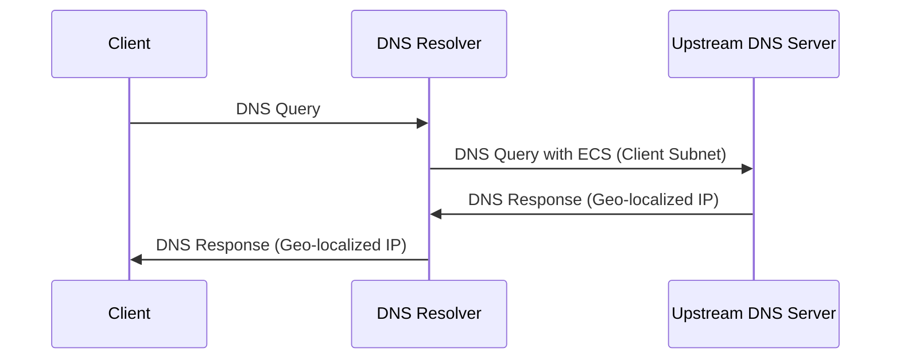

最適な DNS 解決体験を得るため、いくつかの推奨設定をプリセットしていますが、ユーザーが注意すべき設定がまだ残っています。それは「EDNS クライアント・サブネット」です。

## EDNS クライアント・サブネット (ECS) を有効にする

より良い体験を得るために、DNS サーバーが地理的に最も近いサーバー IP を返してほしい場合があります。`EDNS クライアント・サブネット (ECS)` はそれを実現します。ECS を使うと、クライアントの地理的位置情報を含む IP サブネットを DNS サーバーへ送信でき、サーバーは最適な DNS 解決結果を返せます。

**仕組み:**

ECS を有効にすると、DNS リゾルバー（例：AdGuard Home）はクライアント IP アドレスの一部（通常は上位 24 ビットでクライアントのサブネットを示す）を DNS クエリに含め、上流 DNS サーバーへ送信します。上流 DNS サーバーはこのサブネット情報に基づき、その地域に最適なサーバー IP アドレスを返します。

**プライバシーに関する注意:**

ECS を有効にすると、DNS 解決の精度と速度は向上しますが、同時に一定のプライバシー影響が生じる可能性があります。クライアント IP アドレスのサブネットを共有することで、おおよその地理的位置情報が上流 DNS サーバーに記録されることがあります。ご自身の状況に応じて、この機能を有効にするかどうかをご判断ください。

**どう判断するか:**

ECS を有効にすると、アクセス速度と精度のバランスを取れます。プライバシー保護を重視する場合は ECS を無効にすることもできますが、アクセス速度が低下する可能性があります。最適なアクセス体験を求める場合は ECS を有効にできますが、潜在的なプライバシー影響をご承知おきください。このプライバシー情報は DNS 上流側で収集されるものであり、本サービスはプライバシーポリシーに従い、一切の情報を収集・利用しません。
