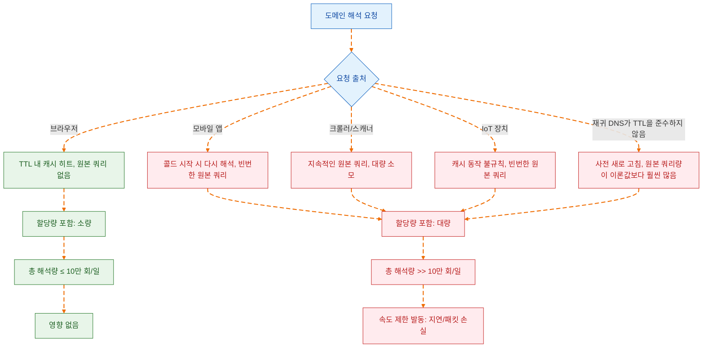
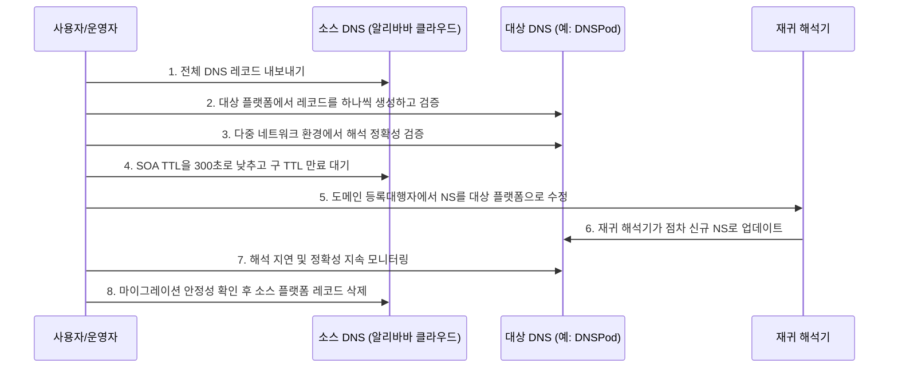

2026년 5월 14일, 알리바바 클라우드는 조용하지만 영향력 있는 제품 공지를 발표했습니다: 6월 24일부터 공용 권위 해석 DNS 무료 버전에 도메인당 일일 해석량 제한이 추가되어 제한은 10만 회이며, 초과 시 동적 속도 제한이 발동됩니다——지연, 패킷 손실, 또는 둘 다 발생할 수 있습니다[^1]. 공지의 표현은 절제되어 있었으며, "대부분의 무료 사용자의 일일 평균 해석량은 이 임계값보다 훨씬 낮다"고 명시되어 마치 모든 것이 평온한 것처럼 보였습니다.

하지만 이 공지의 진정한 무게는 기술 매개변수 자체에 있는 것이 아니라, 그것이 표시하는 전환점에 있습니다: **중국 주요 클라우드 공급업체의 무료 DNS 서비스는 "기본적으로 충분함"에서 "계산이 필요한" 단계로 전환되고 있습니다.** 무료 DNS에 의존하는 독립 개발자, 개인 사이트 운영자 및 중소팀에게 이것은 고립된 가격 조정이 아니라 DNS 서비스 상업 논리의 재가격 책정입니다.

## 10만 회로 충분한가: 해석량의 실제 구성

공식적으로는 "대부분의 사용자에게 영향이 없다"고 말했지만, 이 문장은 통계적으로는 중앙값만 본다면 성립할 수 있습니다. 하지만 문제는 정상적으로 운영되는 서비스 사이트의 DNS 해석량이 여러 요인이 중첩되어 10만 회/일은 안심할 수 있는 임계값이 아니라는 점입니다.

도메인당 해석량에 영향을 미치는 핵심 변수는 다음과 같습니다:

**하위 도메인 수.** 제한은 "단일 도메인"이지만, 여기서 "단일 도메인"은 기본 도메인과 모든 하위 도메인의 해석량 합계를 의미합니다[^1]. `www`, `api`, `cdn`, `static` 등 여러 하위 도메인을 사용하는 사이트의 경우 각 하위 도메인의 해석이 모두 합계에 포함됩니다. 중간 복잡도의 웹 애플리케이션의 경우 해석량이 쉽게 몇 배로 증가합니다.

**TTL과 실제 캐시 동작.** 이론적으로 재귀 해석기는 TTL에 따라 해석 결과를 캐시하여 원본 쿼리 수를 줄입니다. 하지만 현실은 국내 통신사급 재귀 해석기가 TTL을 엄격히 준수하지 않는 경우가 보편적이며, 일부는 TTL 만료 전에 미리 새로 고치거나 너무 긴 TTL 값을 무시하여 자체적으로 단축하기도 합니다. 이는 실제 원본 쿼리 수가 이론값보다 훨씬 많을 수 있음을 의미합니다.

**크롤러 및 스캐너.** 검색 엔진 크롤러, 보안 스캐너, SEO 도구 등이 지속적으로 DNS 해석을 발생시킵니다. 이러한 트래픽은 페이지 액세스를 생성하지 않지만 동일하게 해석 할당량을 소모합니다.

**모바일 및 IoT 장치.** 모바일 앱의 DNS 캐시 동작은 브라우저와 다르며, 일부 구현은 콜드 시작할 때마다 다시 해석합니다. IoT 장치의 DNS 구현은 더욱 수준 편차가 커서, 많은 장치가 전혀 캐시하지 않거나 캐시 시간이 매우 짧습니다.

실제 사례를 참고할 수 있습니다: 독립 블로그 yijile.com은 공지 후 자체 조사한 결과 일일 평균 해석량이 30만 회를 넘어 제한의 300%에 달한다는 것을 발견했습니다[^2]——해당 사이트의 페이지 방문량은 동등한 수준에 전혀 미치지 못했습니다. 이는 DNS 해석량과 웹사이트 UV/PV 사이에 뚜렷한 비선형 관계가 있음을 보여주며, "일일 방문량"으로 "일일 해석량"을 추정하는 것은 신뢰할 수 없습니다.

## 속도 제한 뒤의 상업 논리: 무료의 종점은 속도 제한

알리바바 클라우드는 무료 DNS에 장벽을 설정한 첫 번째 공급업체가 아니며, 마지막도 아닐 것입니다.

상업적 관점에서 무료 버전 DNS는 클라우드 공급업체에게 "부채 자산"입니다——글로벌 해석 노드, 대역폭, 운영 인력 등의 인프라 자원을 소모하지만, 브랜드 노출 및 사용자 진입 가치 외에는 거의 직접 수익을 발생시키지 않습니다. 사용자 규모가 작을 때는 이러한 투자를 고객 유치 비용으로 볼 수 있지만, 무료 사용자 규모가 팽창하여 전체 안정성에 영향을 미치면 속도 제한이 필연적인 선택이 됩니다.

공지에서 언급된 "플랫폼이 감당하는 총 해석량이 지속적으로 상승"과 "국소 트래픽 급증 또는 이상 쿼리가 정상 업무에 영향을 미치는 것을 방지"는 상업 언어로 번역하면 다음과 같습니다: **무료 사용자의 과도한 사용이 이미 유료 사용자의 SLA 보장을 침해하기 시작했습니다.**

이 논리는 Cloudflare, Google Cloud DNS 등 국제 공급업체의 경로와 일치합니다: 먼저 무료 서비스로 사용자 기반 및 시장 인식을 구축한 다음 점차 무료 할당량을 축소하고 상업 전환을 유도합니다. 다른 점은 알리바바 클라우드가 "초과 후 종량제 과금"이 아닌 더 직접적인 "하드 속도 제한"을 선택했다는 점입니다——이는 국내 클라우드 서비스 시장의 경쟁 구도를 정확히 반영합니다: 무료 사용자의 마이그레이션 비용이 충분히 낮을 때 공급업체는 정교한 과금을 통한 전환보다는 직접 초과 사용자를 차단하는 것을 선호합니다.

## 국내 대안: 누가 아직 무료로 버틸 수 있는가

일일 평균 해석량이 10만 회를 넘을 수 있는 사이트의 경우 대체 DNS 서비스로 마이그레이션하는 것이 현실적인 옵션입니다. 다음은 현재 국내 주요 무료 DNS 서비스의 핵심 차원 비교입니다:

| 서비스 제공업체 | 무료 버전 해석량 제한 | 분할 해석 | 최소 TTL | DDoS 방어 | 비고 |
| --- | --- | --- | --- | --- | --- |
| 알리바바 클라우드 DNS | 10만 회/일 (2026.6.24부터) | 유료 버전 지원 | 120초 (무료 버전) | 기본 | 이번 속도 제한의 주인공 |
| 텐센트 클라우드 DNSPod | 명확한 일일 해석량 제한 없음 | 무료 버전 지원 (통신사/지역/검색 엔진 라인) | 1초 | 기본 | 국내 가장 성숙한 대안 선택 |
| 화웨이 클라우드 DNS | 명확한 일일 해석량 제한 없음 | 유료 버전 지원 | 요금제에 따라 결정 | 기본 | 비교적 관대하며, 화웨이 생태계 사용자에게 적합 |
| 화산 엔진 TrafficRoute | 명확한 일일 해석량 제한 없음 | 무료 버전 기본 라인 지원 | 1초 | 기본 | 바이트댄스 제작, 생태계가 비교적 신규 |

텐센트 클라우드 DNSPod는 현재 정보가 가장 투명한 대안 옵션으로, 무료 버전이 통신사(텔레콤, 모바일, 유니콤), 지역(국내/국외) 및 검색 엔진 전용 라인별 분할 해석을 명확히 지원합니다. 국내외 해석을 구분하거나 통신사 최적화가 필요한 사이트의 경우 알리바바 클라우드 무료 버전이 제공할 수 없는 차별화된 기능입니다.

하지만 주의해야 할 점은: **오늘 속도 제한이 없다고 해서 내일 속도 제한이 없지 않다는 것입니다.** DNSPod 무료 버전 역시 사용자 증가로 인한 자원 압박에 직면해 있으며, 아직 트리거 임계값에 도달하지 않았을 뿐입니다. 대안을 선택할 때 "현재 제한이 없다"는 것을 "영원히 제한이 없다"는 것과 동일시하지 마십시오.

## 마이그레이션 전략: NS를 하나 바꾸는 것만으로는 충분하지 않습니다

DNS 마이그레이션은 기술적으로 복잡하지 않습니다——도메인 등록대행자의 NS 레코드를 수정하고 글로벌 재귀 해석기가 업데이트되기를 기다리면 됩니다. 하지만 실제 운영에서 자주 간과하기 쉬운 핵심 포인트가 몇 가지 있습니다:

**레코드 내보내기 및 형식 호환성.** DNS 서비스 제공업체마다 레코드 유형 지원 정도가 다릅니다. 알리바바 클라우드가 지원하는 일부 확장 레코드 유형(예: 명시적/암시적 URL 전달)은 DNSPod 및 기타 공급업체에서 다른 방식으로 구현되거나 지원하지 않을 수 있습니다. 마이그레이션 전에 모든 레코드를 완전히 내보내고 하나씩 검증해야 합니다.

**TTL 전환기 설계.** NS를 마이그레이션할 때 구식 및 신규 권위 DNS 두 세트가 전환 기간 동안 공존합니다(구 NS 레코드의 TTL에 따라 다름). 모범 사례는 다음과 같습니다: 먼저 대상 플랫폼에 완전히 동일한 레코드를 구성하고 오류가 없음을 검증한 후 NS를 신규 플랫폼으로 전환합니다. 전환 전에 구 NS의 SOA 레코드 TTL을 낮춥니다(예: 300초)하여 전환 기간을 단축합니다.

**분할 해석 전략 마이그레이션.** 원래 알리바바 클라우드 유료 버전의 분할 해석에 의존하던 경우 DNSPod 무료 버전으로 마이그레이션하면 라인 구성을 직접 재사용할 수 있습니다. 무료 분할 해석을 지원하지 않는 플랫폼으로 마이그레이션하는 경우 단일 해석 전략을 수용할지 평가해야 합니다.

**모니터링 우선.** 완전히 전환하기 전에 해석 모니터링을 구축합니다——여러 네트워크 환경(텔레콤, 유니콤, 모바일)에서 지속적으로 핵심 하위 도메인에 대한 해석 탐지를 수행하여 마이그레이션 후 해석 결과와 지연이 허용 가능한 범위 내에 있는지 확인합니다.

## 더 깊은 층위: 무료 DNS 서비스의 구조적 딜레마

더 긴 역사적 차원에서 볼 때 알리바바 클라우드 DNS 무료 버전 속도 제한은 고립된 사건이 아니라 무료 DNS 서비스 모델의 구조적 문제가 표면화된 것입니다.

DNS 권위 해석은 "박리 다매" 인프라 서비스입니다——한계 비용이 매우 낮지만 안정성 및 가용성 요구는 매우 높습니다. 무료 서비스가 감당하는 도메인이 10만 단위에서 100만 단위로, 해석량이 억 단위에서 천억 단위로 증가하면 무료 모델의 지속가능성에 근본적인 의문이 제기됩니다: 속도 제한으로 분산하거나 서비스 품질을 하향 조정하거나 유료로 전환하는 것입니다.

클라우드 공급업체의 딜레마는 DNS가 가장 기초적인 인터넷 진입점이라는 점입니다——도메인 해석 실패는 전체 업무에 도달할 수 없음을 의미하며, 사용자는 "이것은 무료 버전이므로 서비스 품질이 나쁘다"고 구분하지 않고 "알리바바 클라우드/텐센트 클라우드가 안 된다"고만 귀결시킵니다. 이러한 "무료 서비스가 브랜드 평판을 납치한다"는 압박이 속도 제한 결정을 추진하는 핵심 요인입니다.

사이트 운영자와 개발자에게 이 사건의 시사점은 "빨리 다른 무료 플랫폼으로 바꾸라"는 것이 아니라: **무료이며 자주 제어할 수 없는 인프라 의존에는 모두 만료 시간이 내장되어 있습니다.** 오늘 알리바바 클라우드가 속도 제한을 하고, 내일은 DNSPod가, 모레는 Cloudflare 무료 요금제 조항이 조정될 수 있습니다.

## 결론

알리바바 클라우드 DNS 무료 버전의 10만 회/일 속도 제한은 절대적인 수치로는 엄격하지 않지만, 그것이 전달하는 신호가 수치보다 더 중요합니다: **국내 클라우드 공급업체의 무료 DNS 황금기가 축소되고 있습니다.**

대부분의 일일 평균 해석량이 임계값보다 훨씬 낮은 사이트의 경우 아무것도 할 필요가 없습니다. 임계값 근처에 있는 사이트의 경우 즉시 해석량 모니터링을 시작하여 실제 사용량을 파악한 후 결정하는 것을 권장합니다. 이미 또는 곧 제한을 초과할 사이트의 경우 DNSPod 무료 버전이 현재 가장 실용적인 마이그레이션 목표이지만, DNS 자주 제어를 중장기 계획에 포함시켜야 합니다——다중 공급업체 중복 배포이든, 자체 권위 DNS 구축(가벼운 NSD 또는 CoreDNS 인스턴스라도)이든 진지하게 고려할 가치가 있습니다.

무료는 일시적이며, 제어 가능한 것이 장기적입니다.

[^1]: 알리바바 클라우드. 《제품 변경》공용 권위 해석 DNS 무료 버전 속도 제한 공지. 2026-05-14. https://www.aliyun.com/notice/118259
[^2]: 일극락(一极乐). 알리바바 클라우드 DNS 해석 무료 버전이 단일 도메인에 대해 10만 회 해석량 제한, 더 나은 대체 제품으로 변경. 2026-05-24. https://yijile.com/zh/alibaba-cloud-dns-resolution-limit-replacement-products/
