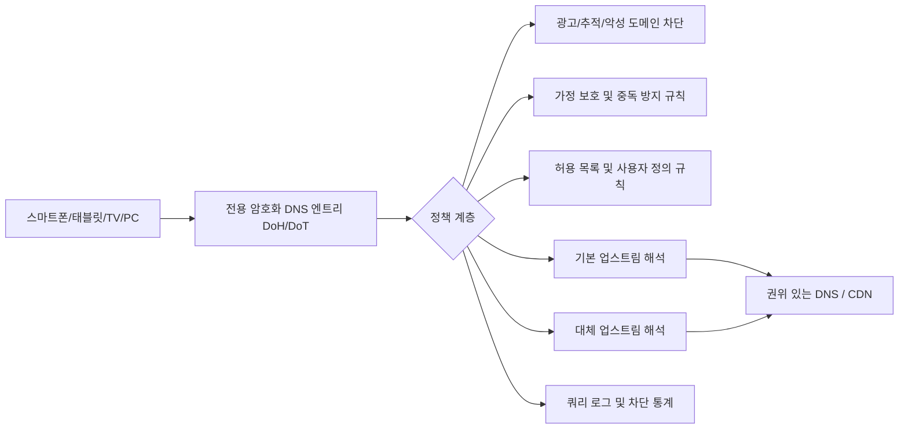

많은 사용자가 DNS를 "주소 하나만 입력하면 끝나는" 기본 설정으로 여기지만, 2024년과 2025년에 발생한 두 차례의 공개 사고는 **해석자(Resolver) 자체도 장애가 날 수 있다**는 것을 보여주었습니다. 그리고 이는 "웹페이지가 열리지 않음, 앱이 인터넷에 연결되지 않음, 가족 전체의 인터넷이 끊김"과 같은 체감 문제로 직접 확대됩니다.

본 문서는 "어떤 업체가 더 좋은지"를 논의하지 않고, 한 가지에 집중합니다: **DNS를 단일 의존점에서 관측 가능하고, 전환 가능하고, 복구 가능한 가정 수준의 인프라로 만드는 방법**.

## 두 차례의 검증 가능한 사건: 무슨 일이 있었나

공개 자료에서 가장 중요한 시점부터 살펴보겠습니다(모두 UTC 시간이며, 공식 타임라인과 대조용입니다):

| 사건 | 공개일 | 주요 영향 | 근인 유형 |
| --- | --- | --- | --- |
| Cloudflare 1.1.1.1 사고 (2024-06-27) | 2024-07-04 복기 발표 | 일부 지역 사용자 접근 불가 또는 고지연 | 외부 라우팅 사건 (BGP 하이재킹 + 라우트 누출) |
| Cloudflare 1.1.1.1 사고 (2025-07-14) | 2025-07-15 복기 발표 | 전 세계 다수 사용자 영향, 공식 62분 중단窗口 | 내부 설정 오류로 인한 접두사 철회 |

이 두 사건의 공통점이 있습니다:

- 사용자 입장에서는 "DNS가 작동하지 않음"으로 보임;
- 그러나 근본 원인은 완전히 다름(한 건은 외부 인터넷 라우팅, 한 건은 서비스 내부 변경);
- 결론은 동일합니다: **단일 업스트림, 단일 진입점, 단일 프로토콜은 위험을 한 곳에 집중시킨다**.

## 기술 분석가 "전체가 고장난 것처럼 보이는" 이유

단말이 유일한 DNS를 사용할 수 없는 대상으로 지정하면, 애플리케이션 계층에서 연쇄 반응이 발생합니다:

- 도메인 이름 해석 불가, `timeout` 또는 `SERVFAIL`로 표시됨.
- 브라우저와 앱이 반복적으로 재시도하여 "가끔 복구되었다가 다시 실패하는" 흔들리는 사용자 경험을 유발.
- 공용 링크가 정상이라도 사용자는 "광대역이 고장났다" 또는 "사이트가 전부 망가졌다"고 오인.

위 다이어그램의 핵심은 "기능을 많이 쌓는 것"이 아니라 세 가지입니다:

- **경로 분층**: 접근 계층(DoH/DoT)과 정책 계층(차단/허용 목록) 분리.
- **업스트림 중복**: 기본 업스트림 이상 시에도 대체 해석 경로 존재.
- **관측 가능성**: 로그와 통계가 있어야 오인 차단인지, 업스트림 문제인지, 단말 문제인지 판단 가능.

## 가정 네트워크를 위한 실행 방안

jqknono가 만든 `nullprivate/adguardprivate` 서비스를 기준으로, 실용적인 방법 세트입니다:

1. 전용 암호화 DNS 엔트리(DoH/DoT) 사용
   - 명문 DNS 노출과 로컬 네트워크 간섭을 줄이는 것이 목표.
   - 클라이언트 ID/기기 식별자를 결합하여 가정 내 각 기기를 구분.

2. 기본 업스트림 + 대체 업스트림 구성으로 단일 의존점 회피
   - 모든 해석을 하나의 해석 서비스 또는 하나의 접두사에 의존하지 않음.
   - 분류 전략을 결합하여 도메인별로 다른 업스트림 경로를 사용.

3. "광고 차단, 사기 방지, 중독 방지"를 정책 계층에서 통합 관리
   - 광고 및 추적 도메인 차단.
   - 악성/피싱 도메인 차단.
   - 자녀 기기에 대해 시간대 관리 및 콘텐츠 차단 설정.

4. 오인 차단 수정 채널 보유
   - 쿼리 로그를 통해 차단된 도메인 확인.
   - 허용 목록에 신속히 추가하여 정상 업무에 장기적 영향 방지.

5. 정기적 "장애 훈련" 수행
   - 기본 업스트림을 임시로 오프라인으로 전환하여 대체 경로가 작동하는지 확인.
   - 가정 네트워크에서 핵심 앱(결제, 온라인 수업, 화상 회의)의 가용성 확인.

## 흔한 오해

많은 사람이 "암호화 DNS를 사용하면 절대로 중단되지 않는다"고 생각합니다. 실제로 암호화는 전송 체인의 프라이버시와 도청 방지만 해결할 뿐, **자동으로 고가용성을 의미하지는 않습니다**. 고가용성은 다음에서 옵니다:

- 업스트림 중복 설계;
- 정책 설정의 적절성;
- 모니터링 및 비상 대응 조치의 실행 가능성.

## 실무 점검 목록

- DNS 제공업체가 여전히 하나뿐인가?
- 단일 프로토콜(DoT 또는 DoH만)이고 대체 수단이 없는가?
- 로그에서 "오인 차단 vs 업스트림 장애"를 3분 이내에 구분할 수 있는가?
- 고령자/자녀 기기에 대해 별도의 가정 보호 전략을 설정했는가?
- 매월 최소 한 번 이상 전환 훈련을 수행했는가?

위 질문의 대다수에 대한 답이 "아니오"라면, "다음 공개 DNS 사고"가 곧바로 당신의 가정 네트워크에 영향을 미칠 가능성이 높습니다.

## 참고 자료 (공개 검증 가능)

- Cloudflare: 2024년 6월 27일 1.1.1.1 사고 복기 (BGP 하이재킹 및 라우트 누출 타임라인 포함)  
  https://blog.cloudflare.com/cloudflare-1111-incident-on-june-27-2024
- Cloudflare: 2025년 7월 14일 1.1.1.1 사고 복기 (62분 중단 설명 및 복구 타임라인 포함)  
  https://blog.cloudflare.com/cloudflare-1-1-1-1-incident-on-july-14-2025/
- Cloudflare Radar (공개 사고 기간 동안의 DNS 가용성 변화를 관측하는 데 활용 가능)  
  https://radar.cloudflare.com/

개인 및 가정 사용자에게 DNS는 "조금 더 빠른" 문제가 아니라 기본적인 보안 및 가용성 문제입니다. 전용 암호화 DNS, 광고 차단, 가정 보호, 관측 가능 역량을 조합해야 실제 장애에서 손실과 불안을 줄일 수 있습니다.
