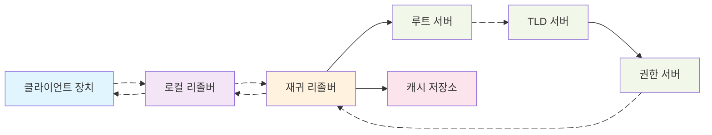
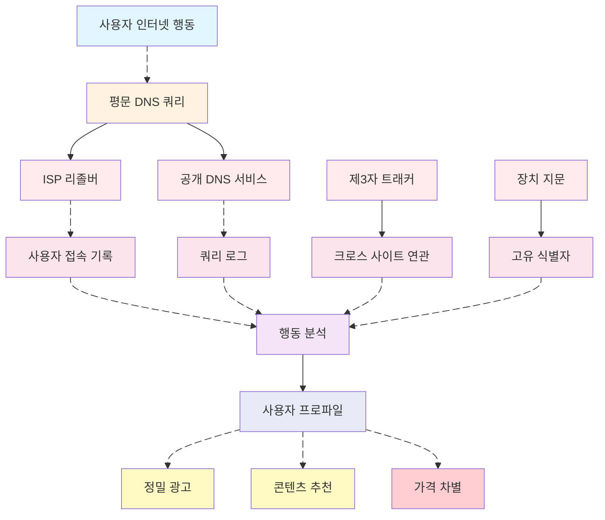
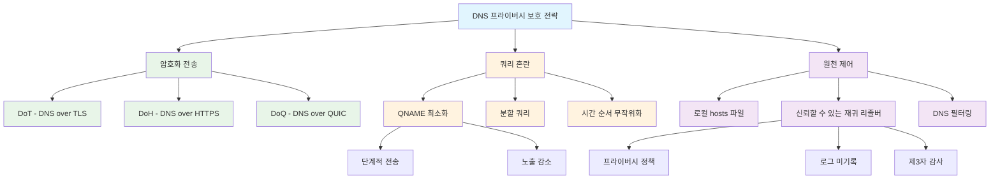

# DNS 프라이버시 보호 및 사용자 프로파일링 방지 전략

> 독자: 네트워크 프라이버시와 데이터 거버넌스에 관심 있는 엔지니어/운영/보안 전문가  
> 키워드: 로컬 리졸버, 재귀적 해석, 권한 서버, QNAME 최소화, ECS, DNSSEC, DoT/DoH/DoQ

## 배경 및 문제 개요

디지털 시대에 사용자의 네트워크 행동 데이터는 기업이 사용자 프로파일을 구축하는 중요한 원천이 되었습니다. 인터넷 인프라의 핵심 구성 요소인 도메인 이름 시스템(DNS)은 일상적인 네트워크 활동에서 인간이 읽을 수 있는 도메인 이름을 기계가 읽을 수 있는 IP 주소로 변환하는 중요한 역할을 담당합니다. 그러나 전통적인 DNS 쿼리는 일반적으로 UDP 포트 53에서 평문으로 전송되며, 이로 인해 사용자의 브라우징 기록, 애플리케이션 사용 습관 등 민감한 정보가 네트워크 사업자, 인터넷 서비스 제공자 및 다양한 중간자에 의해 쉽게 수집 및 분석될 수 있습니다.

사용자 프로파일링은 사용자의 다양한 행동 데이터를 수집하고 분석하여 구축된 사용자 특성 모델로, 기업은 이러한 모델을 활용해 정밀 마케팅, 콘텐츠 추천, 위험 평가 등의 상업 활동을 수행합니다. 이러한 서비스는 일정 부분 사용자 경험을 향상시키지만, 프라이버시 유출, 데이터 남용 및 잠재적 차별 가격 책정 등의 문제를 야기합니다. DNS 수준의 기술적 수단을 통해 사용자 프로파일링의 정확성을 줄이는 방법을 이해하는 것은 개인 프라이버시 보호의 중요한 경로가 됩니다.

본 문서는 DNS 기본 원리에서 출발하여 사용자 프로파일링 구축 과정의 데이터 수집 지점을 분석하고, DNS 기반 프라이버시 보호 전략을 논의하며, 다양한 시나리오에서의 구현 아이디어와 주의사항을 설명합니다.

## 기초 및 용어 정리

DNS 프라이버시 보호를 이해하려면 먼저 DNS 쿼리의 기본 프로세스와 관련 용어를 숙지해야 합니다. DNS 쿼리는 일반적으로 여러 참여자를 포함하며, 각 단계가 프라이버시 유출 지점이 될 수 있습니다.

로컬 리졸버(Stub Resolver)는 운영 체제 또는 애플리케이션 내의 DNS 클라이언트 구성 요소로, 애플리케이션의 DNS 쿼리 요청을 수신하여 재귀 리졸버로 전달하는 역할을 합니다. 재귀 리졸버(Recursive Resolver)는 일반적으로 ISP 또는 제3자 DNS 서비스에서 제공되며, 루트 서버, 최상위 도메인(TLD) 서버 및 권한 서버를 조회하는 완전한 도메인 이름 해석 과정을 수행하고 최종 결과를 클라이언트에 반환합니다.

권한 서버(Authoritative Server)는 특정 도메인 이름의 DNS 레코드를 저장하며, 도메인 정보의 최종 출처입니다. 캐시 메커니즘은 DNS 시스템의 중요한 구성 요소로, 재귀 리졸버는 반복 쿼리를 줄이고 해석 효율성을 높이기 위해 쿼리 결과를 캐시합니다. TTL(Time To Live) 값은 DNS 레코드가 캐시에 저장되는 시간을 결정합니다.

EDNS Client Subnet(ECS)은 재귀 리졸버가 권한 서버에 클라이언트의 서브넷 정보를 전달할 수 있도록 하는 확장 메커니즘으로, CDN 및 지리적 위치 서비스의 정확성을 높이는 것을 목표로 합니다. 그러나 ECS는 사용자의 지리적 위치 정보를 노출시켜 프라이버시 유출 위험을 증가시킬 수도 있습니다.

## 프라이버시 위협 및 동기

평문 DNS 쿼리는 사용자 프로파일링 구축에 풍부한 데이터 소스를 제공합니다. DNS 쿼리 기록을 분석함으로써 공격자 또는 데이터 수집자는 사용자의 브라우징 습관, 애플리케이션 사용 현황, 지리적 위치 정보 등 민감한 데이터를 획득할 수 있으며, 이를 통해 상세한 사용자 프로파일을 구축할 수 있습니다.

DNS 쿼리 데이터는 사용자 프로파일링 구축에 몇 가지 측면에서 가치를 제공합니다. 첫째, 쿼리 빈도 및 시간 패턴은 사용자의 일상적인 생활 리듬을 드러낼 수 있습니다. 예를 들어 평일과 주말의 인터넷 사용 습관 차이, 야간 활동 패턴 등이 있습니다. 둘째, 쿼리된 도메인 유형은 사용자의 관심사와 취향을 반영할 수 있습니다. 예를 들어 뉴스 웹사이트, 소셜 미디어, 비디오 플랫폼, 쇼핑 사이트 등의 접근 선호도가 있습니다. 또한 서브도메인 접근 패턴은 더 정밀한 행동 분석을 제공할 수 있습니다. 예를 들어 사용자가 특정 소셜 플랫폼의 하위 기능 페이지에 자주 접근하는지 여부 등입니다.

지리적 위치 정보는 사용자 프로파일링의 중요한 구성 요소입니다. ECS 메커니즘과 재귀 리졸버의 위치 분석을 통해 사용자의 물리적 위치 또는 이동 궤적을 추론할 수 있습니다. 시계열 분석과 결합하면 사용자의 자주 방문하는 장소와 활동 범위를 식별할 수도 있습니다.

크로스 디바이스 신원 연관은 사용자 프로파일링 구축의 또 다른 핵심 단계입니다. DNS 쿼리의 특정 패턴(예: 서로 다른 장치에서 동일한 도메인에 대한 쿼리 시간 분포)을 분석함으로써 동일 사용자의 여러 장치를 연관시켜 더 포괄적인 사용자 프로파일을 구축할 수 있습니다.

상업적 동기는 사용자 프로파일링 구축을 주도합니다. 정밀 광고 게재는 주요 적용 시나리오로, 기업은 사용자의 브라우징 관심사를 분석하여 관련성 높은 광고를 표시함으로써 전환율을 높입니다. 콘텐츠 추천 시스템은 사용자 프로파일을 활용하여 개인화된 뉴스, 비디오 및 제품 추천을 제공함으로써 사용자 충성도를 강화합니다. 위험 평가는 금융, 보험 등 분야에 적용되며 사용자 행동 패턴에 따라 신용 위험 또는 사기 가능성을 평가합니다.

## 보호 전략 및 원리

DNS 프라이버시 유출 위험에 대응하여 업계에서는 암호화 전송, 쿼리 혼란 및 원천 제어 세 가지 방향을 중심으로 다양한 보호 전략이 발전해 왔습니다. 이러한 전략은 각각의 특징을 가지며 다양한 시나리오와 요구 사항에 적용됩니다.

암호화 전송은 DNS 프라이버시 보호의 기본 수단으로, 주로 세 가지 기술을 포함합니다: DNS over TLS(DoT), DNS over HTTPS(DoH) 및 DNS over QUIC(DoQ). DoT는 TCP 포트 853을 사용하여 암호화된 DNS 쿼리를 전송하며 TLS 프로토콜을 통해 종단 간 암호화 보호를 제공합니다. DoH는 DNS 쿼리를 HTTPS 트래픽으로 캡슐화하여 표준 443 포트를 사용함으로써 기존 네트워크 환경에 더 잘 통합될 수 있으며 방화벽 또는 네트워크 관리 장비에 의해 식별 및 차단되는 것을 피할 수 있습니다. DoQ는 QUIC 프로토콜을 기반으로 하는 새로운 방안으로 UDP의 낮은 지연과 TLS의 보안성을 결합하며 연결 마이그레이션 등의 고급 기능을 지원합니다.

QNAME 최소화(RFC7816)는 쿼리 혼란 기술로, 재귀 리졸버가 상위 서버로 쿼리를 전송할 때 도메인 이름을 단계적으로 전송합니다. 예를 들어 "www.example.com"을 쿼리할 때 먼저 "com"을 쿼리한 다음 "example.com", 마지막으로 "www.example.com"을 쿼리합니다. 이 방식은 상위 서버가 얻는 완전한 도메인 정보를 줄이지만 쿼리 지연이 증가할 수 있습니다.

분할 쿼리와 시간 순서 무작위화는 추가적인 쿼리 혼란 수단입니다. 분할 쿼리는 여러 DNS 요청을 다른 시간에 분산시켜 전송함으로써 쿼리 패턴을 통한 사용자 행동 연관을 피합니다. 시간 순서 무작위화는 쿼리 간격에 무작위 지연을 도입함으로써 시간 패턴 분석 가능성을 차단합니다.

원천 제어 전략은 DNS 쿼리 발생 단계에 주목합니다. 로컬 hosts 파일은 DNS 쿼리를 우회하여 자주 사용하는 도메인을 직접 해석함으로써 쿼리 기록 생성을 줄입니다. 신뢰할 수 있는 재귀 리졸버 선택은 엄격한 프라이버시 정책을 가진 DNS 서비스 제공업체(예: 쿼리 로그를 기록하지 않으며 제3자 추적을 허용하지 않는 서비스)를 선택하는 것입니다. DNS 필터링은 알려진 트래커와 악성 도메인을 차단함으로써 불필요한 데이터 노출을 줄입니다.

## 구현 경로 및 주의사항

DNS 프라이버시 보호 구현은 기술적 실현 가능성, 성능 영향 및 배포 복잡성을 고려해야 합니다. 구체적인 방안을 선택하고 실행할 때 프라이버시 보호 효과와 실제 사용 가능성 사이의 균형을 맞추어야 합니다.

암호화 DNS 배포는 여러 방식으로 수행할 수 있습니다. 운영 체제 수준 지원이 가장 이상적인 경우로, Android 9+, iOS 14+ 및 Windows 11은 모두 DoH 또는 DoT 지원을 내장하고 있습니다. 애플리케이션 수준 구현은 브라우저 내장 암호화 DNS 기능과 같은 특정 소프트웨어에 적용됩니다. 네트워크 장비 수준 배포는 라우터 또는 방화벽에서 암호화 DNS를 구성하여 전체 네트워크에 보호를 제공합니다.

QNAME 최소화 구현은 주로 재귀 리졸버가 담당하며, 사용자는 이 기능을 지원하는 DNS 서비스를 선택해야 합니다. QNAME 최소화는 프리페치 및 로드 밸런싱과 같은 완전한 도메인 정보에 의존하는 성능 최적화에 영향을 줄 수 있다는 점에 유의해야 합니다.

신뢰할 수 있는 재귀 리졸버 선택은 여러 요소를 고려해야 합니다. 프라이버시 정책이 최우선 고려 사항으로, 쿼리 로그 기록 여부, 로그 보존 기간, 데이터 공유 정책 등이 포함됩니다. 서비스 성능은 해석 지연, 가용성 및 글로벌 분포를 포함한 사용자 경험에 영향을 미칩니다. 서비스 투명성도 중요한 요소로, 운영 정책 공개 여부 및 제3자 감사 수용 여부 등이 있습니다.

DNS 필터링은 오탐(false positive) 및 미탐(false negative) 문제에 주의해야 합니다. 지나치게 공격적인 필터링은 정상적인 웹사이트 접근을 방해할 수 있으며, 지나치게 관대한 필터링은 프라이버시를 효과적으로 보호할 수 없습니다. 정기적인 필터 규칙 업데이트 및 사용자 정의 허용 목록 제공은 필요한 균형 조치입니다.

혼합 전략은 더 나은 프라이버시 보호 효과를 제공할 수 있습니다. 예를 들어 암호화 DNS와 QNAME 최소화를 결합하고 DNS 필터링으로 트래커를 차단하는 것입니다. 그러나 과도한 프라이버시 보호 조치는 네트워크 성능 및 호환성에 영향을 줄 수 있으므로 실제 요구 사항에 따라 조정해야 합니다.

## 위험 및 마이그레이션

DNS 프라이버시 보호 조치 배포는 다양한 위험과 도전에 직면할 수 있으며, 이에 대응하는 마이그레이션 전략 및 비상 계획을 수립해야 합니다.

호환성 위험이 주요 고려 사항 중 하나입니다. 암호화 DNS는 특정 네트워크 환경(특히 기업 네트워크 또는 제한이 엄격한 지역)에서 차단될 수 있습니다. 폴백 메커니즘이 매우 중요하며, 암호화 DNS를 사용할 수 없을 때 시스템은 우아하게 전통적인 DNS로 폴백할 수 있어야 하며 프라이버시 유출을 최대한 줄여야 합니다.

성능 영향은 신중하게 평가해야 합니다. 암호화 DNS는 특히 초기 연결 시 핸드셰이크 오버헤드로 인해 쿼리 지연을 증가시킬 수 있습니다. 캐시 최적화 및 연결 재사용은 부분적인 성능 문제를 완화할 수 있습니다. 암호화 DNS 서비스 선택 시 네트워크 지연 및 응답 시간을 고려해야 하며 지리적으로 너무 먼 서버는 피해야 합니다.

규정 준수 요구 사항은 기업 배포 시 고려해야 할 요소입니다. 일부 지역에는 데이터 보존 또는 모니터링 요구 사항이 있을 수 있으며, 이는 프라이버시 보호 조치와 상충될 수 있습니다. 배포 전 현지 규정 요구 사항을 이해하고 프라이버시 보호와 규정 준수 사이의 균형을 찾아야 합니다.

계층적 그레이스케일 배포는 위험을 줄이는 효과적인 전략입니다. 먼저 테스트 환경에서 방안의 실현 가능성을 검증한 다음 소규모 사용자 그룹으로 점차 확대하고 마지막으로 전체 배포합니다. 쿼리 성공률, 지연 변화 및 오류율과 같은 핵심 지표를 모니터링하고 구성을 적시에 조정해야 합니다.

사용자 교육 및 훈련도 소홀히 해서는 안 됩니다. 많은 사용자가 DNS 프라이버시의 중요성을 이해하지 못할 수 있으므로 명확한 설명 및 구성 지침을 제공해야 합니다. 특히 기업 환경에서 IT 부서는 직원들에게 프라이버시 보호 조치의 목적과 사용 방법을 설명해야 합니다.

## 시나리오별 제안

다른 사용 시나리오는 DNS 프라이버시 보호에 대한 요구 사항과 실행 전략이 각기 다른 특징을 가지므로 구체적인 환경에 맞춘 맞춤형 방안을 수립해야 합니다.

가정용 네트워크 시나리오에서는 라우터 수준 배포가 좋은 선택입니다. 암호화 DNS를 지원하는 라우터는 IoT 장치 및 스마트 홈 제품을 포함한 전체 가정 네트워크에 보호를 제공할 수 있습니다. 자녀 보호 기능 및 악성 웹사이트 필터링을 지원하는 가정 친화적인 DNS 서비스를 선택함으로써 프라이버시를 보호하는 동시에 추가적인 보안 기능을 제공할 수 있습니다.

모바일 오피스 시나리오는 네트워크 전환 및 배터리 소모에 특별히 주의해야 합니다. 연결 마이그레이션을 지원하는 DoQ 서비스를 선택하면 모바일 네트워크 전환 시 안정성을 높일 수 있습니다. 동시에 배터리 최적화 전략을 고려하여 빈번한 DNS 쿼리 및 암호화 작업으로 인한 과도한 배터리 소모를 방지해야 합니다.

기업 환경은 프라이버시 보호와 네트워크 관리 사이의 균형을 찾아야 합니다. 일반 직원 트래픽에 프라이버시 보호를 제공하고 특정 비즈니스 트래픽에 대해서는 관리 및 규정 준수 요구 사항을 충족시키기 위해 가시성을 유지하는 혼합 방안을 배포해야 할 수 있습니다. DNS 필터링은 기업 보안 정책과 결합하여 악성 도메인 및 데이터 유출 위험을 차단할 수 있습니다.

고프라이버시 요구 시나리오(예: 기자, 변호사, 의료 종사자)는 다중 보호 조치를 채택해야 할 수 있습니다. 암호화 DNS, VPN 및 Tor 등의 도구를 결합하여 다층적 프라이버시 보호를 실현합니다. 동시에 쿼리 로그를 전혀 기록하지 않는 서비스와 같은 익명 재귀 리졸버를 사용하는 것을 고려할 수 있습니다.

국경 간 네트워크 시나리오는 네트워크 검열 및 지역 제한에 특별히 주의해야 합니다. 일부 암호화 DNS 서비스는 특정 지역에서 사용 불가능할 수 있으므로 여러 대체 방안을 준비해야 합니다. 현지 네트워크 환경 특징을 이해하고 현지 조건에 가장 적합한 프라이버시 보호 전략을 선택해야 합니다.

개발 테스트 환경은 실험적인 DoQ 구현 또는 사용자 정의 혼란 방안과 같은 최신 프라이버시 보호 기술을 시도할 수 있습니다. 이러한 환경은 상대적으로 통제 가능하므로 신기술의 영향 및 호환성을 테스트하고 프로덕션 환경 배포를 위한 경험을 축적하기에 적합합니다.

## FAQ 및 참고 자료

### 자주 묻는 질문

**Q: 암호화 DNS는 사용자 프로파일링 구축을 완전히 방지합니까?**  
A: 암호화 DNS는 네트워크 계층의 중간자로부터 DNS 쿼리 내용을 엿보는 것을 방지할 수 있지만, 재귀 리졸버는 여전히 전체 쿼리 기록을 볼 수 있습니다. 로그를 기록하지 않겠다고 약속한 신뢰할 수 있는 서비스 제공업체를 선택하는 것이 중요하며, 브라우저 추적 방지 기능과 같은 다른 프라이버시 보호 조치와 결합하여 더 포괄적인 보호를 제공할 수 있습니다.

**Q: QNAME 최소화는 DNS 해석 성능에 영향을 미칩니까?**  
A: QNAME 최소화는 여러 번의 상위 서버 쿼리로 인해 쿼리 지연을 증가시킬 수 있습니다. 현대 재귀 리졸버는 일반적으로 지능형 캐싱 및 병렬 쿼리를 통해 성능을 최적화하므로 실제 영향은 종종 예상보다 작습니다. 대부분의 사용자에게 프라이버시 이득은 약간의 성능 손실보다 훨씬 큽니다.

**Q: DNS 프라이버시 보호가 효과적인지 어떻게 확인합니까?**  
A: dnsleaktest.com 또는 dnsprivacy.org에서 제공하는 검사 서비스와 같은 전용 테스트 도구를 사용하여 DNS 쿼리가 암호화 채널을 통해 전송되는지 확인할 수 있습니다. 네트워크 패킷 캡처 도구를 사용하여 DNS 트래픽이 암호화되었는지 확인할 수도 있습니다. 그러나 이러한 테스트는 기술적 구현만 검증할 수 있으며 서비스 제공업체의 실제 프라이버시 정책 이행 상황은 평가할 수 없습니다.

**Q: 기업 네트워크에서 프라이버시 보호와 관리 요구 사항의 균형을 어떻게 맞춥니까?**  
A: 기업은 계층화된 전략을 채택할 수 있습니다. 일반 인터넷 접근에 프라이버시 보호를 제공하고 내부 비즈니스 트래픽에 대해서는 필요한 모니터링 기능을 유지합니다. 분할 기술을 지원하는 솔루션을 사용하여 도메인 이름 또는 사용자 그룹에 따라 다른 DNS 정책을 적용합니다. 명확한 프라이버시 정책 및 직원 커뮤니케이션도 중요합니다.

**Q: 암호화 DNS는 네트워크 사업자에 의해 차단됩니까?**  
A: 일부 네트워크 환경에서는 특히 비표준 포트를 사용하는 DoT를 제한하거나 차단할 수 있습니다. DoH는 표준 HTTPS 포트 443을 사용하므로 일반적으로 식별 및 차단하기가 더 어렵습니다. 이 경우 여러 암호화 DNS 방안의 조합을 사용하거나 VPN과 같은 다른 프라이버시 도구와 함께 사용하는 것을 고려할 수 있습니다.

### 참고 자료

**RFC 문서:**  
- RFC7858: DNS over Transport Layer Security (TLS) 사양  
- RFC8484: DNS Queries over HTTPS (DoH)  
- RFC7816: DNS Query Name Minimisation to Improve Privacy  
- RFC9250: DNS over Dedicated QUIC Connections  

**도구 및 서비스:**  
- Cloudflare DNS: 1.1.1.1 (DoH/DoT 지원, 프라이버시 보호 약속)  
- Quad9: 9.9.9.9 (DoH/DoT 지원, 악성 도메인 차단)  
- NextDNS: 맞춤형 프라이버시 DNS 서비스  
- Stubby: 오픈 소스 DoT 클라이언트  

**테스트 및 검증:**  
- dnsleaktest.com: DNS 유출 테스트  
- dnsprivacy.org: DNS 프라이버시 테스트 도구  
- browserleaks.com/dns: 브라우저 DNS 구성 검사  

**추가 자료:**  
- [DNS 프라이버시 보호 기술 상세 설명](https://nullprivate.com)  
- [기업 DNS 보안 및 프라이버시 균형 전략](https://blog.jqknono.com)  

---

본 문서는 DNS 기본 원리에서 출발하여 사용자 프로파일링 구축 과정의 프라이버시 위험을 분석하고, 암호화 전송, 쿼리 혼란 및 원천 제어 등 보호 전략을 체계적으로 소개했습니다. 실제 배포 시 구체적인 시나리오와 요구 사항에 맞는 적절한 방안을 선택하여 프라이버시 보호, 성능 영향 및 호환성 요구 사항 사이의 균형을 맞추어야 합니다. DNS 프라이버시 보호는 지속적으로 발전하는 분야로, 기술 진화 및 규제 변화에 따라 보호 전략도 지속적으로 조정 및 개선되어야 합니다.
