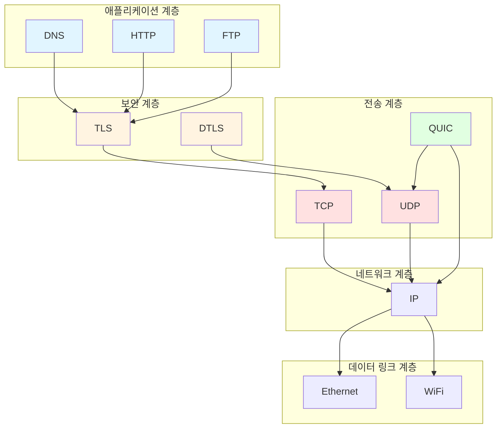
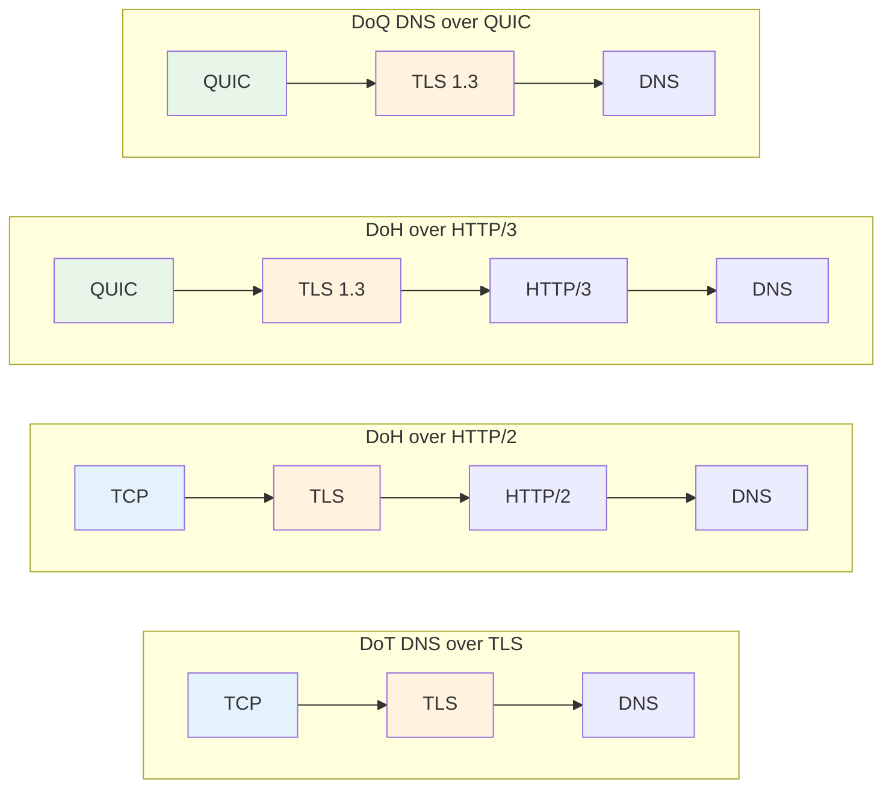

DNS over HTTPS (DoH)와 DNS over TLS (DoT)는 흔히 사용되는 암호화 DNS 전송 방식입니다. 둘 다 DNS 쿼리가 쉽게 도청되거나 변조되는 것을 방지하지만, 기반하는 프로토콜 스택은 다릅니다.

먼저 결론부터 살펴보겠습니다:

- **DoH**: HTTP를 통해 DNS를 전송하며, 기존 웹 인프라를 쉽게 재활용할 수 있습니다.
- **DoT**: TLS 위에 DNS를 직접 전송하며, 프로토콜 경로가 더 짧고 구조가 더 직접적입니다.
- **두 방식의 핵심 목표는 동일합니다**: DNS 쿼리의 개인정보 보호와 무결성을 보호합니다.

해당 표준은 다음과 같습니다:

| 프로토콜 | 표준 | 설명 |
| --- | --- | --- |
| DoT | [RFC 7858](https://datatracker.ietf.org/doc/html/rfc7858) | DNS over TLS |
| DoH | [RFC 8484](https://datatracker.ietf.org/doc/html/rfc8484) | HTTPS를 통한 DNS 쿼리 |

두 방식의 차이를 진정으로 이해하려면, 네트워크 프로토콜 계층 구조부터 살펴보는 것이 좋습니다.

## 네트워크 프로토콜 계층 구조

현대 네트워크 프로토콜 스택은 분층 설계를 채택하며, 각 계층은 서로 다른 역할을 담당합니다. DNS는 애플리케이션 계층 프로토콜이지만, 특정 전송 방식에 강하게 바인딩되지는 않습니다.

먼저 각 계층의 역할을 빠르게 이해할 수 있는 표를 보겠습니다:

| 계층 | 일반적인 프로토콜 | 주요 역할 |
| --- | --- | --- |
| 애플리케이션 계층 (L7) | DNS, HTTP/1.1, HTTP/2, HTTP/3, FTP | 애플리케이션 의미론 정의 |
| 보안 계층 | TLS, DTLS | 암호화 및 인증 제공 |
| 전송 계층 (L4) | TCP, UDP, QUIC | 연결, 재전송, 흐름 제어 등 담당 |
| 네트워크 계층 (L3) | IPv4, IPv6 | 라우팅 및 전달 담당 |
| 데이터 링크 계층 (L2) | Ethernet, Wi‑Fi | 로컬 링크 전송 담당 |

여기서 몇 가지 핵심 포인트가 있습니다:

- **DNS는 애플리케이션 계층에 속합니다.**
- **TLS는 애플리케이션 계층과 전송 계층 사이에 위치합니다.**
- **HTTP/3는 여전히 애플리케이션 계층 프로토콜**이며, 단지 QUIC 위에서 실행됩니다.
- **QUIC은 "강화된 전송 계층"으로 간주될 수 있습니다**, 신뢰성 전송, 혼잡 제어, 다중화합 암호화 핸드셰이크 기능을 통합하고 있기 때문입니다.

DoT에서 TLS를 제거하면, 본질적으로 **DNS over TCP**에 가깝습니다. 이는 "암호화 여부"와 "DNS가 어떤 전송 위에서 실행되는지"가 실제로 두 가지 다른 차원임을 보여줍니다.

## Plain DNS의 특징

가장 일반적인 DNS는 일반적으로 Plain DNS라고 하며, UDP 또는 TCP에서 실행됩니다.

| 전송 방식 | 장점 | 단점 | 주요 특징 |
| --- | --- | --- | --- |
| UDP | 연결 설정 오버헤드 낮음, 최초 조회 빠름 | 신뢰성 없음, 패킷 손실 가능 | 전통적인 DNS에서 가장 흔함 |
| TCP | 재전송 메커니즘 존재, 더 안정적 | 핸드셰이크 비용 더 높음 | 장기 연결 설정 후 성능 수용 가능 |

단순히 이해하면:

- **UDP는 더 가볍습니다**: 빠른 요청에 적합합니다.
- **TCP는 더 안정적입니다**: 패킷 손실 발생 시 더 확실합니다.
- **일부 네트워크 환경에서**, 특히 UDP 패킷 손실이 심각할 때, TCP가 오히려 더 안정적일 수 있습니다.

일부 통신사는 네트워크가 혼잡할 때 UDP 패킷을 우선적으로 폐기합니다. 이 경우 UDP에 의존하는 DNS 쿼리가 영향을 받지만, TCP는 재전송 기능이 있어 안정적인 결과를 얻기가 더 쉽습니다.

## 애플리케이션 계층 중첩

DNS와 HTTP는 모두 애플리케이션 계층 프로토콜이므로, DoH는 "**애플리케이션 계층을 한 겹 더 감싼 것**"으로 볼 수 있습니다.

이 부분에서는 두 가지를 집중적으로 파악하면 됩니다:

- **DoH의 핵심은 HTTP라는 이름이 아니라, HTTP라는 전송 방식에 있습니다.**
- **이론적으로 DNS는 다양한 애플리케이션 계층 프로토콜 위에 실행될 수 있습니다**, 하지만 실제로 그렇게 복잡하게 만들 필요는 없습니다.

예를 들어:

- DoH = DNS 요청을 HTTP 요청 안에 넣는 것.
- 암호화되지 않은 HTTP도 DNS를 전송할 수 있지만, 실제적인 이점은 거의 없습니다.
- 이론적으로 "DNS over FTP"도 가능하지만, 현실적인 가치는 없습니다.

## 전송 계층 중첩

QUIC은 UDP 기반이지만, 전통적으로 전송 계층에서 제공하는 많은 기능을 갖추고 있습니다.

일반적으로 다음과 같은 특징을 가집니다:

- 연결 지향
- 혼잡 제어
- 재전송 메커니즘
- 흐름 제어
- 다중화
- TLS 1.3과 깊이 통합

따라서 QUIC은 다음과 같이 이해할 수 있습니다:

| 비교 대상 | QUIC의 특징 |
| --- | --- |
| TCP 대비 | 연결 설정 및 복구 지연 시간이 일반적으로 더 낮음 |
| UDP 대비 | 더 안정적이고, 기능이 더 완전함 |

## 프로토콜 조합 관계

애플리케이션 계층 프로토콜과 전송 계층 프로토콜은 일대일로 바인딩되지 않습니다. 동일한 애플리케이션 프로토콜이 서로 다른 전송 방식 위에서 실행될 수 있습니다.

먼저 간소화된 총괄 표를 보겠습니다:

| 방식 | 프로토콜 조합 |
| --- | --- |
| Plain DNS | UDP/TCP + DNS |
| HTTP/2 | TCP + TLS 1.2/1.3 + HTTP/2 |
| HTTP/3 | QUIC + TLS 1.3 + HTTP/3 |
| DoT | TCP + TLS 1.2/1.3 + DNS |
| DoH | HTTP/2 또는 HTTP/3 + DNS |
| DoQ | QUIC + TLS 1.3 + DNS |

한 문장으로 요약하면:

- **DoT**: 경로가 더 짧으며, TLS 위에 DNS를 직접 실행합니다.
- **DoH**: 먼저 HTTP를 거친 후, 그 위에 DNS를 실행합니다.
- **DoQ**: QUIC을 통해 직접 DNS를 실행합니다.

## 성능 및 호환성 분석

프로토콜 조합을 이해한 후에는 DoH와 DoT의 차이가 더 직관적으로 보입니다.

### 1. 성능

| 항목 | DoH | DoT |
| --- | --- | --- |
| 이론적 저지연 잠재력 | 높음, 특히 DoH/3 | 중간~높음 |
| UDP 환경 의존도 | DoH/3은 QUIC/UDP에 의존 | 주로 TCP에 의존 |
| 네트워크 불량 시 안정성 | HTTP/2로의 폴백 여부에 따라 다름 | 일반적으로 더 안정적 |

단순히 이해하면:

- 서비스 제공업체가 **HTTP/3**을 지원하는 경우, DoH가 더 낮은 지연 잠재력을 가지는 경우가 많습니다.
- 네트워크 환경이 **UDP에 불리한** 경우, DoT가 일반적으로 더 안정적입니다.
- 이론적 속도는 실제 체감과 다를 수 있으며, 통신사의 패킷 폐기 전략이 결과에 직접적인 영향을 미칩니다.

### 2. 개인정보 보호 및 보안

| 항목 | DoH | DoT |
| --- | --- | --- |
| 전송 암호화 | 예 | 예 |
| 도청/변조 방지 | 예 | 예 |
| 일반 기본 포트 | 443 | 853 |

핵심 사항은 다음과 같습니다:

- **DoH와 DoT는 모두 암호화 DNS입니다.**
- 둘 다 DNS 평문 누출 위험을 효과적으로 줄일 수 있습니다.
- DoT가 "식별하기 쉽다"고 자주 언급되는 이유는 대체로 **853 포트가 눈에 띄기 때문**이며, 프로토콜 자체가 더 많은 정보를 노출하는 것은 아닙니다.
- 실제로 **DoT도 853 포트 외의 포트에서 실행될 수 있습니다**, 단 플랫폼별 지원 정도가 다릅니다.

### 3. 확장성 및 서비스 배포

| 항목 | DoH | DoT |
| --- | --- | --- |
| 기존 웹 인프라 재활용 | 강함 | 약함 |
| 443 포트 재활용 용이성 | 예 | 아니오 |
| 서비스 측 확장 공간 | 더 큼 | 상대적으로 제한적 |

이는 서비스 제공업체 관점에서 더 중요합니다:

- DoH는 성숙한 HTTP 서비스 체계를 직접 재활용할 수 있습니다.
- DoH는 443 포트에서 다른 웹 서비스와 함께 배포하기가 더 쉽습니다.
- DoT는 일반적으로 "전용 DNS 서비스"에 가깝고, 프로토콜 경로가 더 순수하지만, HTTP 생태계만큼의 확장 능력은 없습니다.

### 4. 플랫폼 호환성

| 플랫폼/시스템 | DoH | DoT |
| --- | --- | --- |
| Chromium 브라우저 | 지원 | 시스템 또는 확장 프로그램에 의존 |
| Windows 11 | 기본 지원 | 구성에 따라 다름 |
| Android 8+ | 일부 시나리오에서 지원 | 기본 지원 |
| Android 11+ | 기본 지원 | 기본 지원 |
| macOS | 기본 지원 | 기본 지원 |
| iOS | 기본 지원 | 기본 지원 |

전반적인 추세는:

- **DoH의 플랫폼 보급률이 점점 높아지고 있습니다.**
- **DoT는 Android에서 먼저 시작했습니다.**
- 일반 사용자에게는 시스템에서 기본 제공하는 진입점이 있는지가 중요합니다.

## 실제 선택 권장 사항

일반 사용자에게 한 가지를 추천해야 한다면, 아래 표를 참고할 수 있습니다:

| 시나리오 | 더 추천하는 방식 |
| --- | --- |
| 편리하고 호환성을 모두 원함 | DoH |
| 네트워크가 UDP에 불리한 경우 | DoT |
| 서비스 제공업체가 HTTP/3을 지원함 | DoH 우선 시도 |
| 시스템에서 DoT만 기본 제공 | 우선 DoT 사용 |

추가 설명:

- 대부분의 사용자에게 **DoH가 일반적으로 더 편리합니다**.
- 서비스 제공업체가 **DoH/3**을 지원하는 경우, 네트워크 상태가 좋을 때 일반적으로 더 낮은 지연 시간을 제공합니다.
- 네트워크 상태가 좋지 않은 경우, DoH는 HTTP/2로 폴백하여 가용성을 유지할 수 있습니다.
- 로컬 네트워크에서 UDP 패킷이 자주 손실되는 경우, **DoT가 DoH/3보다 더 안정적**일 수 있습니다.

### 선택 시 확인할 사항

다음 4가지를 순서대로 확인하는 것을 권장합니다:

1. **서비스 제공업체가 HTTP/3 / DoH/3을 지원하는지**
2. **내 통신사 네트워크에서 UDP 패킷 손실이 잦은지**
3. **내 기기가 DoH 또는 DoT를 기본으로 지원하는지**
4. **편리한 설정을 더 중시하는지, 아니면 네트워크 안정성을 더 중시하는지**

### 실용적인 팁

[宁屏](https://www.nullprivate.com/)을 사용해 보시는 것을 추천합니다. DoT와 DoH/3을 모두 지원하며, 광고 차단 및 DNS 분류 기능도 제공합니다. 자체 배포가 필요하다면 [오픈소스 라이브러리](https://github.com/NullPrivate/NullPrivate)도 사용할 수 있습니다.

## 요약

마지막으로 3가지로 정리하겠습니다:

- **DoH와 DoT는 모두 DNS 개인정보 보호 수준을 크게 향상시킵니다.**
- **DoH는 호환성과 생태계 재활용에 더 강점**이 있고, **DoT는 직접성과 안정성에 더 강점**이 있습니다.
- **대부분의 사용자에게 DoH가 일반적으로 더 균형 잡힌 선택**이지만, 궁극적으로는 네트워크 환경과 서비스 제공업체의 지원 여부에 따라 결정해야 합니다.
