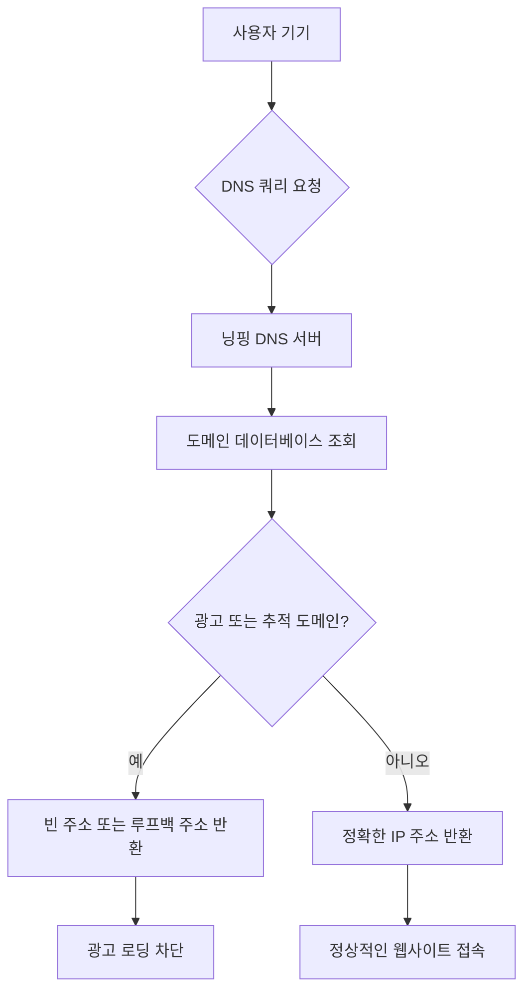

오늘날 디지털 시대에 광고는 인터넷 생태계의 중요한 구성 요소가 되었지만, 과도한 광고는 사용자 경험을 해칠 뿐 아니라 개인정보 유출 위험도 초래할 수 있습니다. 닝핑(NullPrivate)은 개인정보 보호에 특화된 DNS 서비스로, AdGuard Home과 유사한 DNS 필터링 기술을 채택하여 사용자에게 효율적인 광고 차단 솔루션을 제공합니다.

## 닝핑 광고 차단의 작동 원리

닝핑의 광고 차단 기능은 DNS(도메인 시스템) 필터링 기술을 기반으로 하며, 다음과 같은 워크플로우를 따릅니다:

### DNS 요청 모니터링

기기에서 웹사이트에 접속하려고 할 때, 먼저 DNS 서버에 도메인에 해당하는 IP 주소를 쿼리합니다. 닝핑을 기본 DNS 서버로 설정하면, 닝핑이 이러한 쿼리 요청을 수신하고 분석합니다.

### 스마트 필터링 메커니즘

닝핑은 방대한 광고 및 추적 도메인 데이터베이스를 유지 관리합니다. 사용자가 접속하려는 도메인이 광고 또는 추적 범주에 속하는 것으로 감지되면 시스템이 즉시 해당 요청을 차단합니다.

### 고효율 응답

차단된 요청에 대해 닝핑은 빈 주소 또는 로컬 루프백 주소(예: 127.0.0.1)를 반환하여 광고 콘텐츠 로딩을 방지합니다. 정상적인 웹사이트 접속 요청에 대해서는 올바른 IP 주소를 제공하여 사용자가 목표 사이트에 정상적으로 접속할 수 있도록 합니다.

## 기술적 이점

### 고효율성

- **네트워크 레벨 차단**: DNS 해석 단계에서 광고 로딩을 차단하여 웹 콘텐츠 다운로드를 기다릴 필요 없음
- **밀리초 단위 응답**: 로컬라이즈된 DNS 응답 메커니즘으로 웹페이지 로딩 속도에 거의 영향을 주지 않음
- **모든 기기 보호**: 한 번 설정하면 네트워크 내 모든 기기를 보호

### 정확성

- **다층 필터링**: 정확한 도메인 매칭, 와일드카드 규칙, 정규 표현식 지원
- **스마트 분류**: 필터링 규칙을 광고, 추적기, 악성 소프트웨어 등으로 분류 관리
- **동적 업데이트**: 신뢰할 수 있는 소스로부터 최신 필터링 규칙을 정기적으로 가져옴

### 개인정보 보호

- **흔적 없는 브라우징**: 사용자 접속 기록을 기록하지 않아 브라우징 프라이버시 보호
- **데이터 유출 감소**: 광고주 및 추적기가 사용자 데이터를 수집하는 것을 차단
- **로컬 처리**: 대부분의 필터링 작업이 로컬에서 수행되어 데이터 유출 위험 감소

## AdGuard Home과의 유사점

닝핑은 광고 차단 측면에서 AdGuard Home과 동일한 핵심 기술 원리를 채택하고 있습니다:

1. **DNS 기반 필터링 메커니즘**: 둘 다 DNS 쿼리를 차단하여 광고 도메인 해석을 방지
2. **필터링 규칙 관리**: 사용자 정의 필터링 규칙 및 화이트/블랙리스트 구성 지원
3. **네트워크 범위 보호**: 전체 LAN에 광고 차단 서비스를 제공
4. **오픈소스 커뮤니티 지원**: 오픈소스 커뮤니티에서 유지 관리하는 필터링 규칙 목록의 혜택을 받음

## 사용자 경험 최적화

닝핑은 설계 단계에서 사용자 경험에 특히 중점을 두어, 광고 차단 기능이 효율적이면서도 정상적인 사용에 방해가 되지 않도록 합니다:

### 투명한 관리

- 상세한 차단 통계 정보를 제공하여 보호 효과를 사용자에게 알림
- 유연한 화이트리스트 구성을 지원하여 중요 웹사이트를 오차단 방지
- 실시간으로 적용되는 규칙 업데이트로 기기 재시작 불필요

### 사용 편의성 설계

- 설정 절차를 간소화하여 일반 사용자도 쉽게 사용 가능
- 다국어 지원으로 다양한 사용자 요구 충족
- 다양한 네트워크 환경 및 기기 유형과 호환
- 안정적이고 신뢰할 수 있는 DNS 서버 지원

### 개인정보 보호

- 엄격한 개인정보 보호 조치로 사용자 프라이버시 보호
- 사용자 개인 식별 정보를 수집하지 않음
- 사용자 데이터 보안 보장

## 사용 권장사항

최상의 광고 차단 효과를 얻기 위해 사용자에게 다음을 권장합니다:

1. **규칙 적절히 구성**: 실제 필요에 따라 적절한 필터링 규칙 목록 선택
2. **정기적으로 업데이트 확인**: 필터링 규칙 라이브러리가 최신 상태인지 확인
3. **차단 통계 확인**: 통계 데이터를 통해 광고 차단 효과 파악
4. **화이트리스트 즉시 조정**: 오차단된 정상 웹사이트를 화이트리스트에 추가

## 결론

닝핑은 첨단 DNS 필터링 기술을 통해 사용자에게 효율적이고 정확하며 개인정보 보호에 중점을 둔 광고 차단 솔루션을 제공합니다. 우리는 사용자가 광고로부터 보호받으면서도 정상적인 네트워크 사용 경험에 영향을 주지 않도록 노력하고 있습니다. 닝핑을 선택하면 더욱 깔끔하고 안전한 네트워크 환경을 만날 수 있습니다.

디지털 시대에 모든 사람은 깨끗하고 프라이빗한 사이버 공간을 가질 자격이 있습니다. 닝핑은 바로 이러한 목표를 달성하기 위해 설계되었으며, 사용자가 자신의 디지털 라이프를 다시 통제할 수 있도록 돕습니다.
