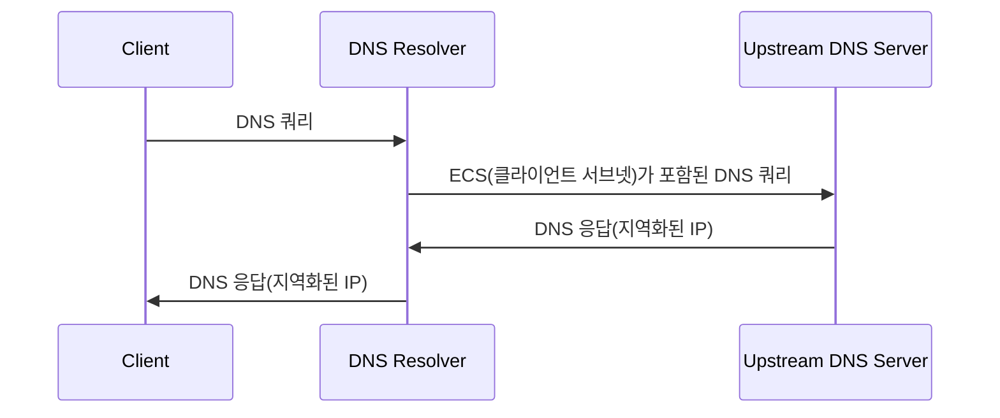

최상의 DNS 해석 경험을 위해 일부 권장 구성을 미리 설정해 두었지만, 사용자가 주의해야 할 설정이 하나 있습니다. 바로 "EDNS 클라이언트 서브넷"입니다.

## EDNS 클라이언트 서브넷(ECS) 활성화

더 나은 경험을 위해 DNS 서버가 지리적으로 가장 가까운 서버 IP를 반환하도록 하려면 `EDNS 클라이언트 서브넷(ECS)`을 활용할 수 있습니다. 이 기능은 DNS 서버에 지리 위치 정보를 포함한 IP 서브넷을 전송하여 최적의 DNS 해석 결과를 반환하도록 합니다.

**작동 원리:**

ECS를 활성화하면 DNS 리졸버(예: AdGuard Home)는 DNS 쿼리에 클라이언트 IP 주소의 일부(보통 처음 24비트로 클라이언트가 속한 서브넷을 나타냄)를 포함하여 상위 DNS 서버로 전송합니다. 상위 DNS 서버는 이 서브넷 정보를 바탕으로 해당 지역에 가장 적합한 서버 IP 주소를 반환합니다.

**개인정보 주의사항:**

ECS를 활성화하면 DNS 해석의 정확성과 속도를 높일 수 있지만, 동시에 일정한 개인정보 영향이 발생할 수 있습니다. 클라이언트 IP 주소의 서브넷을 공유함으로써 대략적인 지리 위치 정보가 상위 DNS 서버에 기록될 수 있습니다. 상황에 따라 이 기능을 활성화할지 여부를 신중히 판단해 주세요.

**절충 방법:**

ECS를 활성화하면 접속 속도와 정확성 사이에서 균형을 이룰 수 있습니다. 개인정보 보호를 중시한다면 ECS를 비활성화할 수 있지만, 이 경우 접속 속도가 떨어질 수 있습니다. 최상의 접속 경험을 원한다면 ECS를 활성화할 수 있지만, 잠재적인 개인정보 영향을 인지해야 합니다. 해당 개인정보는 DNS 상위 서버가 수집하며, 본 서비스는 개인정보 보호정책에 따라 어떠한 정보도 수집하거나 이용하지 않습니다.
