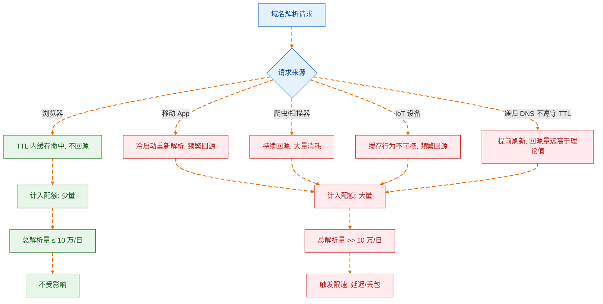
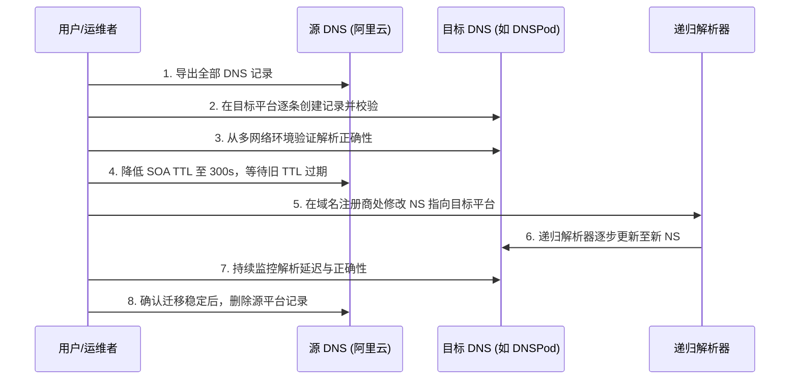

2026 年 5 月 14 日，阿里云发布了一则低调但影响深远的产品公告：自 6 月 24 日起，云解析 DNS 公网权威解析免费版新增单域名日解析量限制，限额 10 万次，超额将触发动态限速——延迟、丢包，或两者兼有[^1]。公告措辞克制，"绝大多数免费用户日均解析量远低于此阈值"，似乎一切风平浪静。

但这条公告的真正分量，不在技术参数本身，而在它所标记的一个转折点：**中国主流云厂商的免费 DNS 服务，正在从"默认够用"转向"需要算账"的阶段。** 对于依赖免费 DNS 的独立开发者、个人站长和中小团队而言，这不是一次孤立的价格调整，而是整个 DNS 服务商业逻辑的重新定价。

## 10 万次到底够不够：解析量的真实构成

官方说"绝大多数用户不受影响"，这句话在统计意义上可能成立——如果只看中位数。但问题在于，一个正常运行的服务站点，其 DNS 解析量受多种因素叠加，10 万次/日并非一个可以高枕无忧的阈值。

影响单域名解析量的核心变量包括：

**子域名数量。** 限额是"单域名"，但这里的"单域名"指主域名及其所有子域名的解析量之和[^1]。一个站点如果使用 `www`、`api`、`cdn`、`static` 等多个子域名，每个子域名的解析都会被计入总额。一个中等复杂度的 Web 应用，解析量轻松翻几倍。

**TTL 与实际缓存行为。** 理论上，递归解析器会按照 TTL 缓存解析结果，从而减少回源查询。但现实是：国内运营商级递归解析器普遍存在不严格遵守 TTL 的情况，部分甚至会在 TTL 过期前提前刷新，或忽略过长的 TTL 值自行缩短。这意味着实际回源查询次数可能远超理论值。

**爬虫与扫描器。** 搜索引擎爬虫、安全扫描器、SEO 工具等会持续触发 DNS 解析。这些流量不产生页面访问，但同样消耗解析配额。

**移动端与 IoT 设备。** 移动 App 的 DNS 缓存行为与浏览器不同，部分实现每次冷启动都会重新解析。IoT 设备的 DNS 实现更是良莠不齐，大量设备根本不缓存或缓存时间极短。

一个有实际案例可供参照：独立博客 yijile.com 在公告后自查发现，其日均解析量超过 30 万次，接近限额的 300%[^2]——而该站点的页面访问量远未达到同等量级。这说明 DNS 解析量与网站 UV/PV 之间存在显著的非线性关系，用"日访问量"来估算"日解析量"并不可靠。

## 限速背后的商业逻辑：免费的终点是限速

阿里云并非第一家对免费 DNS 设置门槛的厂商，也不会是最后一家。

从商业角度看，免费版 DNS 对云厂商而言是一个"负资产"——它消耗着基础设施资源（全球解析节点、带宽、运维人力），但除了品牌曝光和用户入口价值外，几乎不产生直接收入。当用户规模较小时，这种投入可以视为获客成本；但当免费用户量级膨胀到影响全局稳定性时，限速就成了必然选择。

公告中提到的"平台承载的解析总量不断攀升"和"避免局部流量突增或异常查询影响正常业务"，翻译成商业语言就是：**免费用户的超量使用已经开始侵蚀付费用户的 SLA 保障。**

这个逻辑与 Cloudflare、Google Cloud DNS 等国际厂商的路径一致：先用免费服务建立用户基础和市场认知，再逐步收紧免费额度、引导商业转化。不同的是，阿里云选择了更直接的"硬限速"而非"超额后按量计费"——这恰好反映了国内云服务市场的竞争格局：当免费用户迁移成本足够低时，厂商更倾向于直接切走超量用户，而非通过精细化计费来转化。

## 国内替代方案：谁还能免费扛得住

对于日均解析量可能超过 10 万次的站点，迁移到替代 DNS 服务是现实选项。以下是当前国内主流免费 DNS 服务的核心维度对比：

| 服务商 | 免费版解析量限制 | 分区解析 | 最小 TTL | DDoS 防护 | 备注 |
| --- | --- | --- | --- | --- | --- |
| 阿里云 DNS | 10 万次/日（2026.6.24 起） | 付费版支持 | 120s（免费版） | 基础 | 本次限速主角 |
| 腾讯云 DNSPod | 无明确日解析量限制 | 免费版支持（运营商/地域/搜索引擎线路） | 1s | 基础 | 国内最成熟的替代选择 |
| 华为云 DNS | 无明确日解析量限制 | 付费版支持 | 由套餐决定 | 基础 | 相对宽松，适合华为生态用户 |
| 火山引擎 TrafficRoute | 无明确日解析量限制 | 免费版支持基础线路 | 1s | 基础 | 字节跳动出品，生态较新 |

腾讯云 DNSPod 是目前信息最透明的替代选项，其免费版明确支持按运营商（电信、移动、联通）、按地域（境内/境外）和搜索引擎专用线路的分区解析。对于需要区分国内外解析或运营商优化的站点，这是一个阿里云免费版无法提供的差异化能力。

但需要警惕的是：**今天没有限速，不等于明天不会限速。** DNSPod 免费版同样面临用户增长带来的资源压力，只是目前尚未达到触发阈值。选择替代方案时，不要把"当前没有限制"等同于"永远不会限制"。

## 迁移策略：不是换一个 NS 那么简单

DNS 迁移在技术上并不复杂——修改域名注册商的 NS 记录，等待全球递归解析器更新即可。但实际操作中有几个容易被忽略的关键点：

**记录导出与格式兼容。** 不同 DNS 服务商对记录类型的支持程度不同。阿里云支持的部分扩展记录类型（如显性/隐性 URL 转发），DNSPod 和其他厂商可能以不同方式实现或不支持。迁移前需要完整导出所有记录并逐条校验。

**TTL 的过渡期设计。** 迁移 NS 时，新旧两套权威 DNS 会在过渡期内并存（取决于旧 NS 记录的 TTL）。最佳实践是：先在目标平台配置好完全相同的记录，验证无误后，再将 NS 切换到新平台。切换前将旧 NS 的 SOA 记录 TTL 调低（如 300 秒），以缩短过渡窗口。

**分区解析的策略迁移。** 如果原来依赖阿里云付费版的分区解析，迁移到 DNSPod 免费版可以直接复用线路配置；如果迁移到不支持免费分区解析的平台，则需要评估是否接受单一解析策略。

**监控先行。** 在完全切换之前，建立解析监控——持续从多个网络环境（电信、联通、移动）对关键子域名进行解析探测，确保迁移后解析结果和延迟都在可接受范围内。

## 更深一层：免费 DNS 服务的结构性困境

放在更长的历史维度上看，阿里云 DNS 免费版限速不是一个孤立事件，而是免费 DNS 服务模式的结构性问题浮出水面。

DNS 权威解析是一项"薄利多销"的基础设施服务——边际成本极低，但稳定性和可用性要求极高。当一个免费服务承载的域名从十万级增长到百万级、解析量从亿级增长到千亿级，免费模式的可持续性就面临根本性质疑：要么限速分流，要么降级服务质量，要么转付费。

云厂商的困境在于，DNS 是最底层的互联网入口——域名解析失败意味着整个业务不可达，用户不会区分"这是免费版所以服务质量差"，只会归因于"阿里云/腾讯云不行"。这种"免费服务绑架品牌口碑"的压力，是推动限速决策的关键因素。

对于站长和开发者而言，这件事的启示不是"赶紧换到另一个免费平台"，而是：**任何免费的、非自控的基础设施依赖，都内置了一个过期时间。** 今天阿里云限速，明天可能是 DNSPod，后天可能是 Cloudflare Free Plan 调整条款。

## 结论

阿里云 DNS 免费版限速 10 万次/日，在绝对数值上并不苛刻，但它传递的信号比数值更重要：**国内云厂商的免费 DNS 红利期正在收窄。**

对于绝大多数日均解析量远低于阈值的站点，什么也不需要做。对于处于临界线附近的站点，建议立即开启解析量监控，了解自己的真实用量后再做决策。对于已经或即将超限的站点，DNSPod 免费版是当前最务实的迁移目标，但把 DNS 自主可控纳入中长期规划——无论是多供应商冗余部署，还是自建权威 DNS（哪怕是轻量的 NSD 或 CoreDNS 实例），都值得认真考虑。

免费是暂时的，可控才是长期的。

[^1]: 阿里云.《产品变更》云解析DNS-公网权威解析免费版限速通知. 2026-05-14. https://www.aliyun.com/notice/118259
[^2]: 一极乐. 阿里云解析DNS免费版对单个域名限制10万次解析量，换更优平替产品. 2026-05-24. https://yijile.com/zh/alibaba-cloud-dns-resolution-limit-replacement-products/
