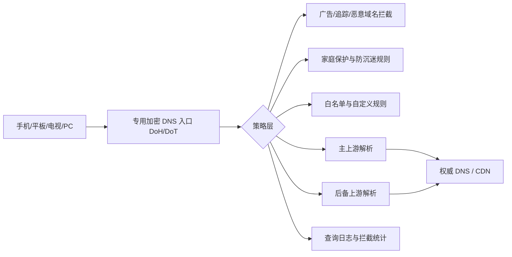

很多用户把 DNS 当作“填一个地址就结束”的基础配置，但 2024 和 2025 年两次公开事故说明：**解析器本身也会故障**，而且会直接放大到“网页打不开、App 无法联网、全家都断网”的体感问题。

本文不讨论“哪家更好”，而是聚焦一件事：**如何把 DNS 从单点依赖改造成可观测、可切换、可恢复的家庭级基础设施**。

## 两次可核验事件：发生了什么

先看公开资料中最关键的时间点（均为 UTC 时间，便于和官方时间线对齐）：

| 事件 | 公开日期 | 关键影响 | 根因类型 |
| --- | --- | --- | --- |
| Cloudflare 1.1.1.1 事件（2024-06-27） | 2024-07-04 发布复盘 | 部分地区用户不可达或高延迟 | 外部路由事件（BGP 劫持 + 路由泄漏） |
| Cloudflare 1.1.1.1 事件（2025-07-14） | 2025-07-15 发布复盘 | 全球多数用户受影响，官方给出 62 分钟中断窗口 | 内部配置错误导致前缀撤销 |

这两次事件有一个共同点：

- 用户侧看起来都是“DNS 不工作了”；
- 但底层原因完全不同（一次偏外部互联网路由，一次偏服务内部变更）；
- 结论是一样的：**单上游、单入口、单协议会把风险集中到一个点**。

## 技术拆解：为什么 DNS 会“看起来全网坏了”

当终端把唯一 DNS 指向一个不可用目标时，应用层通常会出现连锁反应：

- 域名无法解析，表现为 `timeout` 或 `SERVFAIL`。
- 浏览器与 App 会重复重试，导致“偶尔恢复、又再次失败”的抖动体验。
- 即使公网链路正常，用户也会误判为“宽带坏了”或“网站全挂了”。

上图的重点不是“多堆功能”，而是三件事：

- **路径分层**：接入层（DoH/DoT）与策略层（拦截/白名单）分离。
- **上游冗余**：主上游异常时，仍有后备解析路径。
- **可观测性**：有日志和统计，才能判断是误拦截、上游问题，还是终端问题。

## 面向家庭网络的落地方案

结合 jqknono 做的 `nullprivate/adguardprivate` 服务，比较实用的一套做法是：

1. 使用专用加密 DNS 入口（DoH/DoT）
   - 目标是减少明文 DNS 暴露和本地网络干扰。
   - 结合客户端 ID/设备标识，区分家中不同设备。

2. 配置主上游 + 后备上游，避免单点依赖
   - 不把所有解析押注到一个解析服务或一个前缀。
   - 结合分流策略，为不同域名走不同上游路径。

3. 把“防广告、防诈骗、防沉迷”放在策略层统一管理
   - 广告与追踪域名拦截。
   - 恶意/钓鱼域名拦截。
   - 针对孩子设备设置时段管理与内容拦截。

4. 保留误拦截修正通道
   - 通过查询日志定位被拦截域名。
   - 快速加入白名单，避免长期影响正常业务。

5. 定期做“故障演练”
   - 人工临时下线主上游，验证后备链路是否生效。
   - 在家庭网络中验证关键 App（支付、网课、视频会议）是否可用。

## 一个常见误区

很多人以为“用了加密 DNS 就绝对不会中断”。实际上，加密只解决了传输链路的隐私与抗窃听问题，**并不自动等于高可用**。高可用来自：

- 上游冗余设计；
- 策略配置合理；
- 监控与应急动作可执行。

## 实操检查清单

- 是否仍然只有一个 DNS 提供商？
- 是否只有单协议（仅 DoT 或仅 DoH）且无备用？
- 是否能在 3 分钟内从日志定位“误拦截 vs 上游故障”？
- 是否给老人/孩子设备单独配置了家庭保护策略？
- 是否每月做过至少一次切换演练？

如果以上多数答案是否定的，那么“下一次公开 DNS 事故”很可能就会直接落到你的家庭网络上。

## 参考资料（公开可核验）

- Cloudflare：2024 年 6 月 27 日 1.1.1.1 事件复盘（含 BGP 劫持与路由泄漏时间线）  
  https://blog.cloudflare.com/cloudflare-1111-incident-on-june-27-2024
- Cloudflare：2025 年 7 月 14 日 1.1.1.1 事件复盘（含 62 分钟中断说明与修复时间线）  
  https://blog.cloudflare.com/cloudflare-1-1-1-1-incident-on-july-14-2025/
- Cloudflare Radar（可用于观测公开事件期间的 DNS 可用性变化）  
  https://radar.cloudflare.com/

对个人与家庭用户来说，DNS 不只是“快一点”的问题，而是一个基础安全与可用性问题。把专用加密 DNS、广告拦截、家庭保护和可观测能力组合起来，才能在真实故障里减少损失和焦虑。
