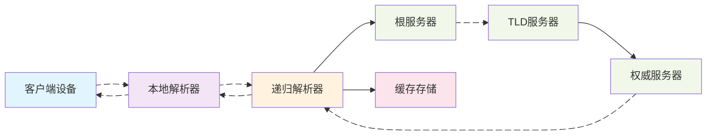
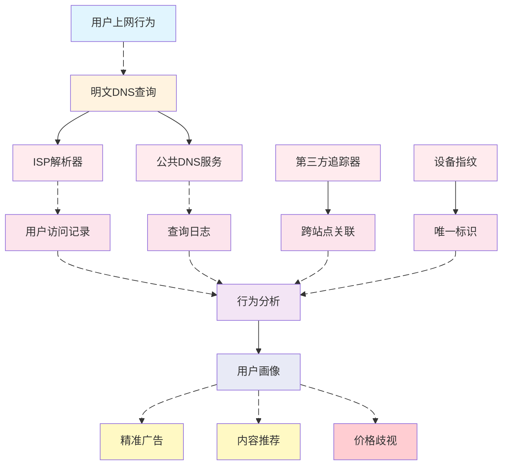
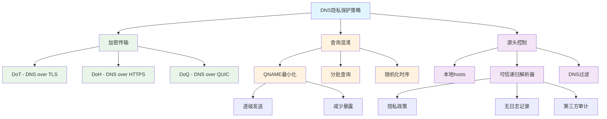

# DNS 隐私防护与用户画像防范策略

> 读者：关注网络隐私与数据治理的工程/运维/安全从业者
> 关键词：本地解析器、递归解析、权威服务器、QNAME最小化、ECS、DNSSEC、DoT/DoH/DoQ

## 背景与问题概述

在数字化时代，用户的网络行为数据成为企业构建用户画像的重要来源。作为互联网基础设施的核心组件，域名系统（DNS）在日常网络活动中承担着将人类可读的域名转换为机器可读的IP地址的关键任务。然而，传统DNS查询通常以明文形式在UDP端口53上进行传输，这使得用户的浏览历史、应用使用习惯等敏感信息容易被网络运营商、互联网服务提供商以及各种中间人获取和分析。

用户画像是通过收集和分析用户的各种行为数据而构建的用户特征模型，企业利用这些模型进行精准营销、内容推荐、风险评估等商业活动。虽然这些服务在一定程度上提升了用户体验，但也带来了隐私泄露、数据滥用和潜在的歧视性定价等问题。了解如何通过DNS层面的技术手段来减少用户画像的准确性，成为保护个人隐私的重要途径。

本文将从DNS基础原理出发，分析用户画像构建过程中的数据收集点，探讨基于DNS的隐私保护策略，并阐述不同场景下的实现思路与注意事项。

## 基础与术语梳理

要理解DNS隐私保护，首先需要掌握DNS查询的基本流程和相关术语。DNS查询通常涉及多个参与者，每个环节都可能成为隐私泄露的节点。

本地解析器（Stub Resolver）是操作系统或应用程序中的DNS客户端组件，负责接收应用程序的DNS查询请求并将其转发给递归解析器。递归解析器（Recursive Resolver）通常由ISP或第三方DNS服务提供，负责完成完整的域名解析过程，包括查询根服务器、顶级域（TLD）服务器和权威服务器，并将最终结果返回给客户端。

权威服务器（Authoritative Server）存储特定域名的DNS记录，是域名信息的最终来源。缓存机制是DNS系统的重要组成部分，递归解析器会缓存查询结果以减少重复查询，提高解析效率。TTL（Time To Live）值决定了DNS记录在缓存中的保存时间。

EDNS Client Subnet（ECS）是一种扩展机制，允许递归解析器向权威服务器传递客户端的子网信息，旨在提高CDN和地理位置服务的准确性。然而，ECS也会暴露用户的地理位置信息，增加隐私泄露风险。

## 隐私威胁与动机

明文DNS查询为用户画像构建提供了丰富的数据源。通过分析DNS查询记录，攻击者或数据收集者可以获取用户的浏览习惯、应用使用情况、地理位置信息等敏感数据，进而构建详细的用户画像。

DNS查询数据对用户画像构建的价值主要体现在几个方面。首先，查询频率和时间模式可以揭示用户的日常作息规律，例如工作日与周末的上网习惯差异、夜间活动模式等。其次，查询的域名类型可以反映用户的兴趣爱好，如新闻网站、社交媒体、视频平台、购物网站等的访问偏好。此外，子域名访问模式可以提供更精细的行为分析，例如用户是否频繁访问特定社交平台的子功能页面。

地理位置信息是用户画像的重要组成部分。通过ECS机制和分析递归解析器的位置，可以推断用户的物理位置或移动轨迹。结合时间序列分析，还可以识别用户的常去地点和活动范围。

跨设备的身份关联是用户画像构建的另一个关键环节。通过分析DNS查询中的特定模式，如相同域名在不同设备上的查询时间分布，可能将同一用户的多个设备关联起来，构建更全面的用户画像。

商业动机驱动着用户画像的构建。精准广告投放是主要应用场景，企业通过分析用户的浏览兴趣展示相关性更高的广告，提高转化率。内容推荐系统利用用户画像提供个性化的新闻、视频和产品推荐，增强用户粘性。风险评估则应用于金融、保险等领域，根据用户行为模式评估信用风险或欺诈可能性。

## 保护策略与原理

针对DNS隐私泄露风险，业界已经发展出多种保护策略，主要围绕加密传输、查询混淆和源头控制三个方向展开。这些策略各有特点，适用于不同的场景和需求。

加密传输是DNS隐私保护的基础手段，主要包括三种技术：DNS over TLS（DoT）、DNS over HTTPS（DoH）和DNS over QUIC（DoQ）。DoT使用TCP端口853传输加密的DNS查询，通过TLS协议提供端到端的加密保护。DoH将DNS查询封装在HTTPS流量中，使用标准443端口，能够更好地融入现有网络环境，避免被防火墙或网络管理设备识别和阻止。DoQ是基于QUIC协议的新兴方案，结合了UDP的低延迟和TLS的安全性，同时支持连接迁移等高级特性。

QNAME最小化（RFC7816）是一种查询混淆技术，递归解析器在向上游服务器发送查询时，逐步发送域名而不是完整域名。例如，查询"www.example.com"时，先查询"com"，再查询"example.com"，最后查询"www.example.com"。这种方式减少了上游服务器获取的完整域名信息，但可能增加查询延迟。

分批查询和时序随机化是额外的查询混淆手段。分批查询将多个DNS请求分散在不同时间发送，避免通过查询模式关联用户行为。时序随机化在查询间隔中引入随机延迟，打破时间模式分析的可能。

源头控制策略关注DNS查询的发起环节。本地hosts文件可以绕过DNS查询直接解析常用域名，减少查询记录的产生。可信递归解析器选择具有严格隐私政策的DNS服务提供商，如承诺不记录查询日志、不接受第三方追踪的服务。DNS过滤通过阻止已知的追踪器和恶意域名，减少不必要的数据暴露。

## 实现路径与注意事项

DNS隐私保护的实现需要考虑技术可行性、性能影响和部署复杂度。在选择和实施具体方案时，需要权衡隐私保护效果与实际可用性。

加密DNS的部署可以采用多种方式。操作系统级支持是最理想的情况，如Android 9+、iOS 14+和Windows 11都内置了DoH或DoT支持。应用程序级实现适用于特定软件，如浏览器内置的加密DNS功能。网络设备级部署则在路由器或防火墙上配置加密DNS，为整个网络提供保护。

QNAME最小化的实施主要由递归解析器负责，用户需要选择支持该功能的DNS服务。需要注意的是，QNAME最小化可能会影响某些依赖完整域名信息的性能优化，如预取和负载均衡。

可信递归解析器的选择需要考虑多个因素。隐私政策是首要考虑，包括是否记录查询日志、日志保留时间、数据共享政策等。服务性能影响用户体验，包括解析延迟、可用性和全球分布。服务透明度也是重要因素，如是否公开运营政策、接受第三方审计等。

DNS过滤需要注意误报和漏报问题。过于激进的过滤可能导致正常网站无法访问，而过于宽松的过滤则无法有效保护隐私。定期更新过滤规则和提供自定义白名单是必要的平衡措施。

混合策略可以提供更好的隐私保护效果。例如，结合加密DNS和QNAME最小化，同时使用DNS过滤阻止追踪器。但需要注意的是，过多的隐私保护措施可能影响网络性能和兼容性，需要根据实际需求进行调整。

## 风险与迁移

部署DNS隐私保护措施可能面临多种风险和挑战，需要制定相应的迁移策略和应急预案。

兼容性风险是主要考虑因素之一。加密DNS可能被某些网络环境阻止，特别是在企业网络或限制性严格的地区。回退机制至关重要，当加密DNS不可用时，系统应该能够优雅地回退到传统DNS，同时尽可能减少隐私泄露。

性能影响需要仔细评估。加密DNS可能会增加查询延迟，特别是首次连接时的握手开销。缓存优化和连接复用可以缓解部分性能问题。在选择加密DNS服务时，应考虑其网络延迟和响应时间，避免地理位置过远的服务器。

合规性要求是企业部署时必须考虑的因素。某些地区可能有数据留存或监控要求，与隐私保护措施可能存在冲突。在部署前需要了解当地法规要求，并在隐私保护与合规性之间找到平衡点。

分层灰度部署是降低风险的有效策略。首先在测试环境中验证方案可行性，然后逐步扩大到小规模用户群体，最后全面部署。监控关键指标如查询成功率、延迟变化和错误率，及时调整配置。

用户教育和培训也不可忽视。许多用户可能不了解DNS隐私的重要性，需要提供清晰的说明和配置指导。特别是在企业环境中，IT部门应该向员工解释隐私保护措施的目的和使用方法。

## 场景化建议

不同使用场景对DNS隐私保护的需求和实施策略各有特点，需要根据具体环境制定针对性的方案。

家庭网络场景下，路由器级部署是不错的选择。支持加密DNS的路由器可以为整个家庭网络提供保护，包括IoT设备和智能家居产品。选择家庭友好的DNS服务，如支持家长控制和恶意网站过滤的服务，可以在保护隐私的同时提供额外的安全功能。

移动办公场景需要特别关注网络切换和电池消耗。选择支持连接迁移的DoQ服务可以提高移动网络切换的稳定性。同时，考虑电池优化策略，避免频繁的DNS查询和加密操作过度消耗电量。

企业环境需要在隐私保护与网络管理之间找到平衡。可能需要部署混合方案，对一般员工流量提供隐私保护，同时对特定业务流量保持可见性以满足管理和合规要求。DNS过滤可以与企业安全策略结合，阻止恶意域名和数据泄露风险。

高隐私需求场景下，如记者、律师和医疗从业者，可能需要采用多重保护措施。结合加密DNS、VPN和Tor等工具，实现层层的隐私保护。同时，可以考虑使用匿名递归解析器，如不记录任何查询日志的服务。

跨境网络场景需要特别关注网络审查和地区限制。某些加密DNS服务可能在特定地区不可用，需要准备多个备选方案。了解当地的网络环境特点，选择最适合当地条件的隐私保护策略。

开发测试环境可以尝试最新的隐私保护技术，如实验性的DoQ实现或自定义的混淆方案。这些环境相对可控，适合测试新技术的影响和兼容性，为生产环境部署积累经验。

## FAQ 与参考

### 常见疑问

**Q: 加密DNS是否完全防止用户画像构建？**
A: 加密DNS可以防止网络层面的中间人窥探DNS查询内容，但递归解析器仍然可以看到完整的查询记录。选择承诺不记录日志的可信服务提供商很重要，同时结合其他隐私保护措施如浏览器防追踪功能，可以提供更全面的保护。

**Q: QNAME最小化会影响DNS解析性能吗？**
A: QNAME最小化可能会增加查询延迟，因为需要多次向上游服务器发送查询。现代递归解析器通常通过智能缓存和并行查询来优化性能，实际影响往往比预期小。对于大多数用户来说，隐私收益远超过轻微的性能损失。

**Q: 如何验证DNS隐私保护是否生效？**
A: 可以使用专门的测试工具如dnsleaktest.com或dnsprivacy.org提供的检测服务，验证DNS查询是否通过加密通道发送。网络抓包工具也可以用来检查DNS流量是否已加密。但需要注意的是，这些测试只能验证技术实现，无法评估服务提供商的实际隐私政策执行情况。

**Q: 企业网络中如何平衡隐私保护与管理需求？**
A: 企业可以采用分层策略，对一般互联网访问提供隐私保护，同时对内部业务流量保持必要的监控能力。使用支持分流技术的解决方案，根据域名或用户组别应用不同的DNS策略。明确的隐私政策和员工沟通也很重要。

**Q: 加密DNS会被网络运营商阻止吗？**
A: 某些网络环境可能会限制或阻止加密DNS流量，特别是使用非标准端口的DoT。DoH由于使用标准HTTPS端口443，通常更难被识别和阻止。在这种情况下，可以考虑使用多种加密DNS方案的组合，或者配合其他隐私工具如VPN。

### 参考资源

**RFC文档:**
- RFC7858: Specification for DNS over Transport Layer Security (TLS)
- RFC8484: DNS Queries over HTTPS (DoH)
- RFC7816: DNS Query Name Minimisation to Improve Privacy
- RFC9250: DNS over Dedicated QUIC Connections

**工具与服务:**
- Cloudflare DNS: 1.1.1.1 (支持DoH/DoT，承诺隐私保护)
- Quad9: 9.9.9.9 (支持DoH/DoT，阻止恶意域名)
- NextDNS: 可定制的隐私DNS服务
- Stubby: 开源的DoT客户端

**测试与验证:**
- dnsleaktest.com: DNS泄露测试
- dnsprivacy.org: DNS隐私测试工具
- browserleaks.com/dns: 浏览器DNS配置检测

**延伸阅读:**
- [DNS隐私保护技术详解](https://nullprivate.com)
- [企业DNS安全与隐私平衡策略](https://blog.jqknono.com)

---

本文从DNS基础原理出发，分析了用户画像构建过程中的隐私风险，并系统介绍了加密传输、查询混淆和源头控制等保护策略。在实际部署中，需要根据具体场景和需求选择合适的方案，平衡隐私保护、性能影响和兼容性要求。DNS隐私保护是一个持续发展的领域，随着技术演进和法规变化，保护策略也需要不断调整和完善。
