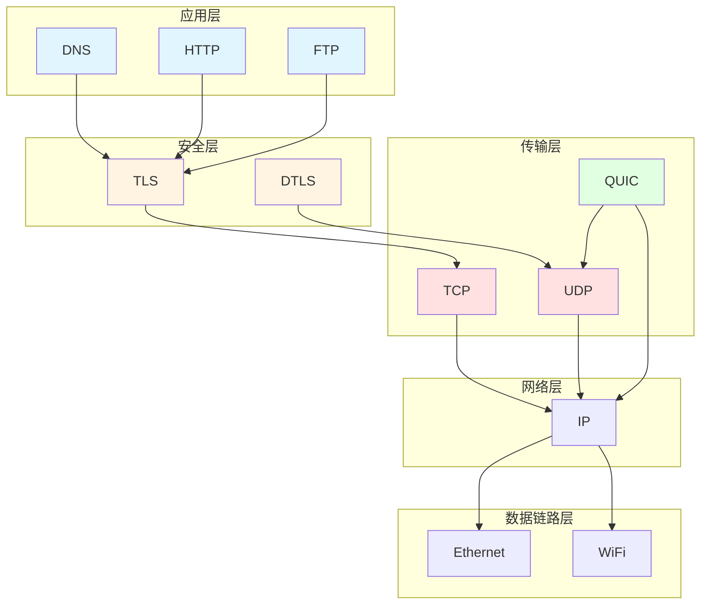
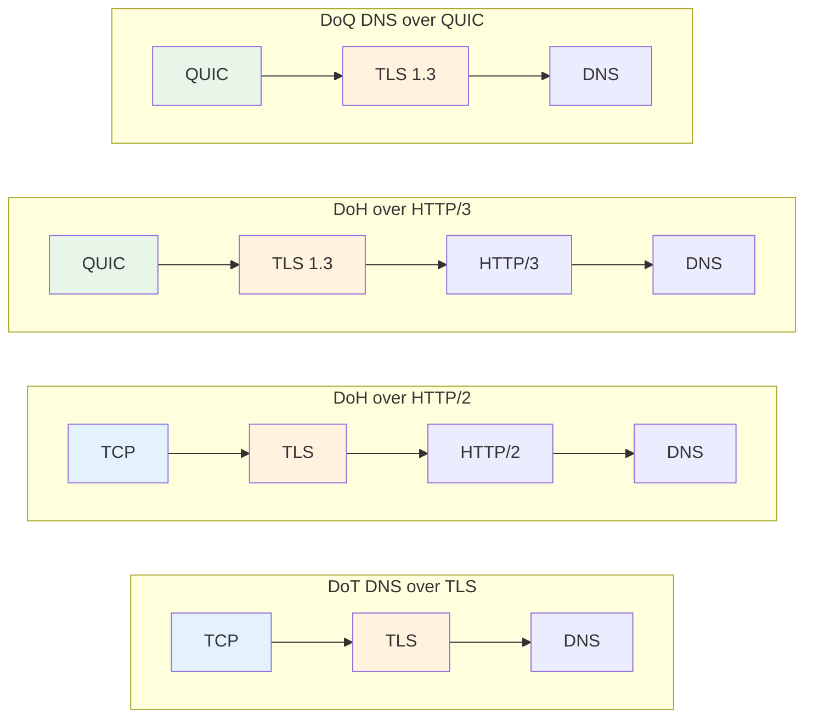

DNS over HTTPS (DoH) 和 DNS over TLS (DoT) 是两种常见的加密 DNS 传输方式. 它们都能保护 DNS 查询不被轻易窃听或篡改, 但所依赖的协议栈不同.

先看结论:

- **DoH**: 借助 HTTP 传输 DNS, 更容易复用现有 Web 基础设施.
- **DoT**: 直接在 TLS 之上传输 DNS, 协议路径更短, 结构更直接.
- **两者核心目标一致**: 保护 DNS 查询的隐私与完整性.

对应标准如下:

| 协议 | 标准 | 说明 |
| --- | --- | --- |
| DoT | [RFC 7858](https://datatracker.ietf.org/doc/html/rfc7858) | DNS over TLS |
| DoH | [RFC 8484](https://datatracker.ietf.org/doc/html/rfc8484) | DNS Queries over HTTPS |

如果想真正理解两者差异, 最好先从网络协议层次结构开始看.

## 网络协议层次结构

现代网络协议栈采用分层设计, 每一层负责不同任务. DNS 虽然是应用层协议, 但它并不强绑定某一种传输方式.

可以先用一张表快速理解各层角色:

| 层级 | 常见协议 | 主要作用 |
| --- | --- | --- |
| 应用层 (L7) | DNS, HTTP/1.1, HTTP/2, HTTP/3, FTP | 定义应用语义 |
| 安全层 | TLS, DTLS | 提供加密与身份校验 |
| 传输层 (L4) | TCP, UDP, QUIC | 负责连接, 重传, 流控等 |
| 网络层 (L3) | IPv4, IPv6 | 负责路由和转发 |
| 数据链路层 (L2) | Ethernet, Wi‑Fi | 负责本地链路传输 |

这里有几个关键点:

- **DNS 属于应用层**.
- **TLS 位于应用层和传输层之间**.
- **HTTP/3 仍然是应用层协议**, 只是它运行在 QUIC 之上.
- **QUIC 常被视为“增强型传输层”**, 因为它集成了可靠传输, 拥塞控制, 多路复用和加密握手能力.

如果把 DoT 里的 TLS 拿掉, 它本质上就接近 **DNS over TCP**. 这说明“是否加密”与“DNS 运行在哪种传输之上”其实是两个不同维度.

## Plain DNS 的特点

最普通的 DNS 一般被称为 Plain DNS, 常见运行方式是 UDP 或 TCP.

| 承载方式 | 优点 | 缺点 | 典型特点 |
| --- | --- | --- | --- |
| UDP | 建连开销低, 首次查询快 | 不可靠, 容易丢包 | 传统 DNS 最常见 |
| TCP | 有重传机制, 更可靠 | 握手成本更高 | 长连接建立后性能可接受 |

可以简单理解为:

- **UDP 更轻量**: 更适合快速请求.
- **TCP 更稳定**: 遇到丢包时更有保障.
- **在部分网络环境下**, 尤其是 UDP 丢包严重时, TCP 反而可能更稳定.

一些运营商在网络繁忙时会优先丢弃 UDP 报文. 这种情况下, 依赖 UDP 的 DNS 查询会受到影响, 而 TCP 由于具备重传能力, 往往更容易得到稳定结果.

## 应用层嵌套

DNS 和 HTTP 都属于应用层协议, 所以 DoH 可以看作是“**应用层再包一层应用层**”.

这一节可以抓住两点:

- **DoH 的核心不是 HTTP 这个名字, 而是 HTTP 这个承载方式**.
- **理论上 DNS 可以承载在很多应用层协议之上**, 只是现实中没有必要把它做得过于复杂.

例如:

- DoH = 把 DNS 请求放进 HTTP 请求里.
- 未加密的 HTTP 也能承载 DNS, 但几乎没有实际优势.
- 从理论上说, 甚至可以做“DNS over FTP”, 只是没有现实价值.

## 传输层嵌套

QUIC 基于 UDP, 但提供了很多传统上传输层才具备的能力.

它通常具备这些特征:

- 面向连接
- 拥塞控制
- 重传机制
- 流量控制
- 多路复用
- 与 TLS 1.3 深度整合

因此可以把 QUIC 理解为:

| 对比对象 | QUIC 的特点 |
| --- | --- |
| 相比 TCP | 建连和恢复时延通常更低 |
| 相比 UDP | 更可靠, 能力更完整 |

## 协议组合关系

应用层协议和传输层协议之间并不是一一绑定的. 同一种应用协议, 可以跑在不同传输方式上.

先看一个简化版总表:

| 方案 | 协议组合 |
| --- | --- |
| Plain DNS | UDP/TCP + DNS |
| HTTP/2 | TCP + TLS 1.2/1.3 + HTTP/2 |
| HTTP/3 | QUIC + TLS 1.3 + HTTP/3 |
| DoT | TCP + TLS 1.2/1.3 + DNS |
| DoH | HTTP/2 或 HTTP/3 + DNS |
| DoQ | QUIC + TLS 1.3 + DNS |

如果再用一句话概括:

- **DoT**: 路径更短, 直接在 TLS 上跑 DNS.
- **DoH**: 先走 HTTP, 再承载 DNS.
- **DoQ**: 用 QUIC 直接承载 DNS.

## 性能和兼容性分析

理解协议组合之后, 再看 DoH 和 DoT 的差异会更直观.

### 1. 性能

| 维度 | DoH | DoT |
| --- | --- | --- |
| 理论低时延潜力 | 高, 尤其是 DoH/3 | 中等偏高 |
| 对 UDP 环境依赖 | DoH/3 依赖 QUIC/UDP | 主要依赖 TCP |
| 网络差时稳定性 | 取决于是否回退 HTTP/2 | 通常更稳定 |

简化理解:

- 如果服务商支持 **HTTP/3**, DoH 往往有更好的低延迟潜力.
- 如果网络环境对 **UDP 不友好**, DoT 往往更稳定.
- 理论速度不等于实际体验, 运营商丢包策略会直接影响结果.

### 2. 隐私与安全

| 维度 | DoH | DoT |
| --- | --- | --- |
| 传输加密 | 是 | 是 |
| 防窃听/防篡改 | 是 | 是 |
| 常见默认端口 | 443 | 853 |

要点如下:

- **DoH 和 DoT 都是加密 DNS**.
- 两者都能有效降低 DNS 明文泄露风险.
- DoT 经常被提到的“容易被识别”, 很大程度上是因为 **853 端口较显眼**, 而不是协议本身天然暴露更多信息.
- 实际上, **DoT 也可以运行在非 853 端口**, 只是不同平台支持程度不同.

### 3. 扩展性与服务部署

| 维度 | DoH | DoT |
| --- | --- | --- |
| 复用现有 Web 基础设施 | 强 | 弱 |
| 易于复用 443 端口 | 是 | 否 |
| 服务端扩展空间 | 更大 | 相对有限 |

这一点更偏向服务商视角:

- DoH 可以直接复用成熟的 HTTP 服务体系.
- DoH 更容易和其他 Web 服务一起部署在 443 端口上.
- DoT 一般更像“专用 DNS 服务”, 协议路径更纯粹, 但扩展能力不如 HTTP 生态.

### 4. 平台兼容性

| 平台/系统 | DoH | DoT |
| --- | --- | --- |
| Chromium 浏览器 | 支持 | 依赖系统或扩展 |
| Windows 11 | 原生支持 | 视配置而定 |
| Android 8+ | 部分场景支持 | 原生支持 |
| Android 11+ | 原生支持 | 原生支持 |
| macOS | 原生支持 | 原生支持 |
| iOS | 原生支持 | 原生支持 |

整体趋势是:

- **DoH 的平台普及度越来越高**.
- **DoT 在 Android 上起步较早**.
- 对普通用户来说, 哪个更方便, 往往取决于系统是否提供原生入口.

## 实际选择建议

如果只给普通用户一个简短建议, 可以直接参考下表:

| 场景 | 更推荐 |
| --- | --- |
| 想省心, 想兼顾兼容性 | DoH |
| 网络对 UDP 不友好 | DoT |
| 服务商支持 HTTP/3 | 优先尝试 DoH |
| 系统只提供 DoT 原生入口 | 先用 DoT |

进一步展开:

- 对大多数用户来说, **DoH 往往更省心**.
- 如果服务商支持 **DoH/3**, 它通常能在网络良好时提供更低时延.
- 如果网络状况较差, DoH 还可能回退到 HTTP/2, 维持可用性.
- 如果本地网络经常丢 UDP 包, **DoT 可能比 DoH/3 更稳定**.

### 选择时重点看什么

建议按下面 4 项依次判断:

1. **服务商是否支持 HTTP/3 / DoH/3**
2. **你的运营商网络是否容易丢 UDP 包**
3. **你的设备是否原生支持 DoH 或 DoT**
4. **你是否更看重省心配置还是更看重网络稳定性**

### 一个实用建议

推荐尝试 [宁屏](https://www.nullprivate.com/), 它支持 DoT 和 DoH/3, 同时提供广告拦截和 DNS 分流功能. 如果你需要自部署, 也可以使用它的 [开源库](https://github.com/NullPrivate/NullPrivate).

## 总结

最后用 3 句话收尾:

- **DoH 和 DoT 都能显著提升 DNS 隐私保护**.
- **DoH 更偏向兼容性与生态复用**, **DoT 更偏向直接与稳定**.
- **对大多数用户而言, DoH 通常是更平衡的选择**, 但最终仍要看网络环境和服务商支持情况.
