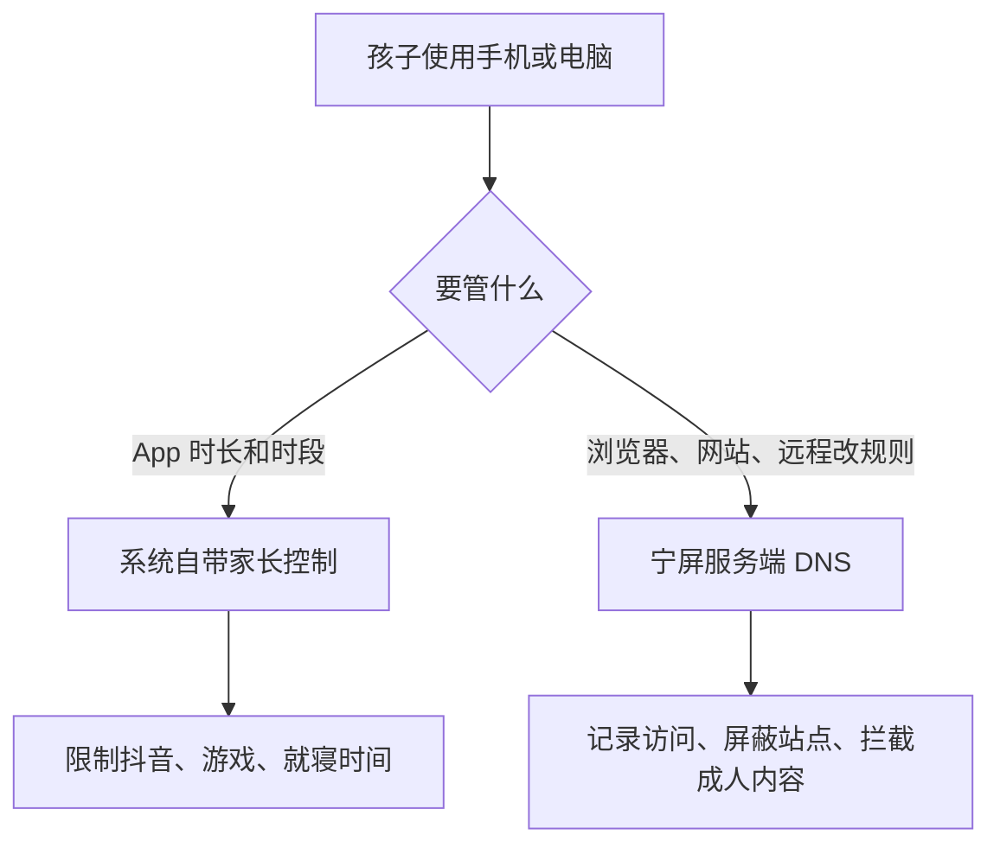

如何保护青少年上网，先别急着买第三方管控 App。手机系统已经把高权限收回去了，终端软件越来越难真正管住设备；如果目标只是限制使用时长、使用时段和单个 App，系统自带的家长控制通常就够用。真正需要额外方案的，是浏览器这一层：看清访问记录、远程改屏蔽规则、拦住成人内容。宁屏做的是服务端 DNS 管控，补的是手机管不到的那一段。

## 终端管控为什么越来越难做成

很多家长会先搜“在手机上装一个管控软件”。这条路现在越来越窄。操作系统不会把核心权限轻易交给第三方应用；当一个 App 申请的权限过多时，应用商店也很难判断它是保护程序还是恶意软件。

安卓上这个问题更明显。过去十几年里，高权限应用里有相当一部分后来被证明是恶意程序。整机厂商因此在出厂时就把高级权限收进自家安全组件，不再对普通应用开放。Root 门槛也越来越高。结果是：你在终端上装的管控 App，常常既装不深，也管不稳。

这不是某一款软件做得差，而是权限模型变了。想靠一个第三方 App 接管整台手机，已经不符合现在的系统现实。

## 只想管 App，先用手机自带功能

现在的手机大多自带家长控制，苹果和安卓都类似。常见能力包括：

- 统计每个 App 的使用时长
- 限制每天可用时间
- 限制可用时段
- 按 App 单独开关

华为的“健康使用手机”、苹果的“屏幕使用时间”、安卓的数字健康，做的都是这件事。它们由系统提供权限，不需要再向商店申请一堆危险能力，卸载、绕过的成本也更高。

如果您对孩子的监管只需要管到 App，系统自带功能就能覆盖，不必额外为此花钱。宁屏也不会假装自己能替代锁屏密码、应用限额或就寝模式。那一层本来就该交给系统。

## 浏览器和远程屏蔽，才需要服务端

家长真正容易漏掉的，不是抖音能不能打开，而是浏览器里发生了什么。

App 管控看不到孩子在浏览器里访问了哪些网站，也很难在家长不碰那台手机时远程改规则。孩子换一个浏览器、开无痕模式、点开搜索结果里的陌生链接，终端侧往往只显示“用了 Safari / Chrome 20 分钟”，具体去过哪里并不清楚。

如果您希望同时做到下面几件事，就需要一个在服务端做管控的方案：

- 记录设备的上网域名，而不只是 App 名称
- 远程查看最近访问和拦截情况
- 按网站屏蔽，而不是只按 App 开关
- 拦截成人内容和明显不良站点
- 规则改完立刻对已接入的设备生效

这正是 [DNS 过滤](https://adguard-dns.io/kb/general/dns-filtering/) 适合补上的一层：设备发起域名查询时，服务端就能决定放行还是拦截，不必在每台手机上再装一个高权限 App。

## 宁屏补上服务端这一层

[宁屏](https://www.nullprivate.com) 是运行在云端的专用 DNS 保护服务，基于 [AdGuard Home](https://adguard-dns.io/kb/adguard-home/overview/) 增强。设备把加密 DNS 指过来之后，浏览请求会先经过您自己的服务实例，再决定是否解析。

对保护青少年上网来说，关键不是再装一个客户端，而是家长能远程看到、改到、拦住。

### 先看访问，再决定拦什么

私有服务提供访问记录和统计。您能看到最近请求过哪些域名、哪些域名被拦得最多，而不是只看到“今天用了多久手机”。

这和手机里的“使用统计”不是同一件事。系统统计告诉您 App 开了多久；宁屏告诉您浏览器和后台请求去了哪些站。两者叠在一起，讨论规则时才有共同事实，而不是只靠感觉。

更完整的日志说明见 [访问请求日志](/docs/feature/query/)，家庭场景的使用方式见 [青少年网络安全保护指南](/docs/hide_me/protect-the-teenager/)。

### 成人内容和站点屏蔽放在服务端

宁屏可以启用家长控制、成人内容过滤，以及自定义屏蔽规则。拦截发生在域名解析阶段，不依赖手机厂商开放额外权限，也不要求孩子那台设备保持某个管控 App 一直存活。

成人内容过滤的原理和适用边界，见 [成人内容拦截](/docs/feature/adult/)。它拦的是已知不良站点的域名解析，不是对页面里每一张图做识别；遇到新站、改名站或被套在正常域名后的内容，仍需要结合日志再补规则。

### 防沉迷清单管的是服务，不是锁屏

如果目标是学习时段关掉微博、TikTok 一类服务，宁屏提供的是应用级阻止清单，而不是再去做一套手机桌面管控。您可以从 [list.adguardprivate.com](https://list.adguardprivate.com) 生成防沉迷直链，导入后再按时间表生效。

操作步骤见 [创建并导入防沉迷清单](/docs/startup/tutorial/block-services/list-builder/)，完整演示见 [使用 list.adguardprivate.com 创建防沉迷清单](/blog/list-adguardprivate-anti-addiction-guide/)。上网时段的设置见 [设置上网时段](/docs/feature/schedule/)。

这一层适合回答“晚上 9 点后不许刷短视频网站”，不适合回答“把整台手机锁死”。后者继续用系统自带功能。

## 两层一起用，比再买一个管控 App 更稳

比较常见的有效组合是：

| 要解决的问题 | 更合适的工具 | 原因 |
| --- | --- | --- |
| App 使用时长、就寝、单应用开关 | 手机系统家长控制 | 系统有权限，卸载成本高 |
| 浏览器访问了哪些网站 | 宁屏访问记录 | 按域名记录，可远程查看 |
| 远程屏蔽某个网站 | 宁屏过滤规则 | 改完即对已接入设备生效 |
| 成人内容和安全搜索 | 宁屏家长控制 | 在 DNS 层拦截，不依赖终端权限 |
| 学习时段关掉社交/短视频服务 | 宁屏防沉迷清单 | 按服务和时间表拦截 |

设备接入后，规则在服务端统一生效。孩子换浏览器、换无痕模式，只要 DNS 还走宁屏，网站屏蔽和访问记录就还在。家长改规则时也不必把孩子的手机拿过来点来点去。

它做不到的事情也要说清：宁屏不能替代亲子约定，不能识别所有变种站点，也不能在设备根本没接入加密 DNS 时生效。保护青少年上网，技术是辅助，[家庭里怎么谈规则](/docs/hide_me/protect-the-teenager/) 仍然更重要。

如果您已经确认需要服务端这一层，可以从 [购买宁屏服务](/pages/pricing/) 开通实例，再按 [使用指南](/docs/startup/) 把设备指过来。只想先看效果，也可以从试用版开始。配置过程中有问题，直接找我们即可。
