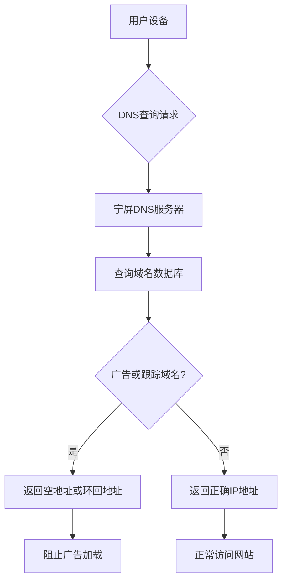

在当今数字化时代，广告已成为互联网生态的重要组成部分，但过多的广告不仅影响用户体验，还可能带来隐私泄露风险。宁屏（NullPrivate）作为一款专注于隐私保护的DNS服务，采用了与AdGuard Home类似的DNS过滤技术，为用户提供高效的广告拦截解决方案。

## 宁屏去广告的工作原理

宁屏的广告拦截功能基于DNS（域名系统）过滤技术，其工作流程如下：

### DNS请求监控

当您的设备尝试访问网站时，会首先向DNS服务器查询域名对应的IP地址。宁屏作为您的首选DNS服务器，会接收并分析这些查询请求。

### 智能过滤机制

宁屏维护着一个庞大的广告和跟踪域名数据库。当检测到用户尝试访问的域名属于广告或跟踪类别时，系统会立即拦截该请求。

### 高效响应

对于被拦截的请求，宁屏会返回一个空地址或本地环回地址（如127.0.0.1），从而阻止广告内容的加载。对于正常的网站访问请求，宁屏则会提供正确的IP地址，确保用户可以正常访问目标网站。

## 技术优势

### 高效性

- **网络层面拦截**：在DNS解析阶段就阻止广告加载，无需等待网页内容下载
- **毫秒级响应**：本地化的DNS响应机制，几乎不影响网页加载速度
- **全设备保护**：一次配置，保护网络中的所有设备

### 精准性

- **多层次过滤**：支持精确域名匹配、通配符规则和正则表达式
- **智能分类**：将过滤规则按广告、跟踪器、恶意软件等分类管理
- **动态更新**：定期从可信源获取最新的过滤规则

### 隐私保护

- **无痕浏览**：不记录用户访问记录，保护浏览隐私
- **减少数据泄露**：阻止广告商和跟踪器收集用户数据
- **本地处理**：大部分过滤工作在本地完成，减少数据外泄风险

## 与AdGuard Home的相似之处

宁屏在广告拦截方面与AdGuard Home采用了相同的核心技术原理：

1. **基于DNS的过滤机制**：两者都通过拦截DNS查询来阻止广告域名解析
2. **过滤规则管理**：都支持自定义过滤规则和黑白名单配置
3. **网络范围保护**：都能为整个局域网提供广告拦截服务
4. **开源社区支持**：都受益于开源社区维护的过滤规则列表

## 用户体验优化

宁屏在设计上特别注重用户体验，确保广告拦截功能既高效又不会对正常使用造成干扰：

### 透明化管理

- 提供详细的拦截统计信息，让用户了解防护效果
- 支持灵活的白名单配置，避免误拦截重要网站
- 实时生效的规则更新，无需重启设备

### 易用性设计

- 简化配置流程，普通用户也能轻松上手
- 提供多语言支持，满足不同用户需求
- 兼容各种网络环境和设备类型
- 具备安全可靠的DNS服务器支持

### 隐私保护

- 严格的隐私保护措施，保护用户隐私
- 不收集用户个人身份信息
- 确保用户数据安全

## 使用建议

为了获得最佳的广告拦截效果，我们建议用户：

1. **合理配置规则**：根据实际需求选择合适的过滤规则列表
2. **定期检查更新**：确保过滤规则库保持最新状态
3. **关注拦截统计**：通过统计数据了解广告拦截效果
4. **及时调整白名单**：将误拦截的正常网站添加到白名单中

## 结语

宁屏通过先进的DNS过滤技术，为用户提供了一个高效、精准且注重隐私的广告拦截解决方案。我们致力于在保护用户免受广告骚扰的同时，确保不影响正常的网络使用体验。选择宁屏，让您的网络环境更加清爽、安全。

在数字时代，每个人都应该拥有一个干净、私密的网络空间。宁屏正是为了实现这一目标而设计，帮助用户重新掌控自己的数字生活。
