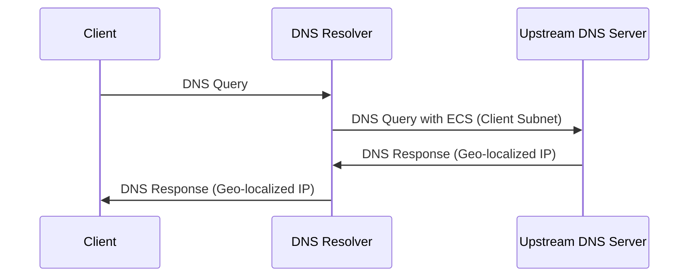

为了获得最佳的 DNS 解析体验，我们已经预设了一些推荐配置, 但仍然有需要用户注意的配置, 那就是"EDNS 客户端子网".

## 启用EDNS客户端子网(ECS)

为了获得更佳的体验，您可能希望 DNS 服务器返回在地理位置上最接近您的服务器 IP 结果。`EDNS 客户端子网 (ECS)` 能够实现这一点。它允许将包含地理位置信息的 IP 子网发送到 DNS 服务器，以便服务器返回最佳的 DNS 解析结果。

**工作原理:**

当启用 ECS 时，您的 DNS 解析器（例如 AdGuard Home）会将客户端 IP 地址的一部分（通常是前 24 位，表示客户端所在的子网）包含在 DNS 查询中，并将其发送到上游 DNS 服务器。上游 DNS 服务器会根据此子网信息，返回最适合该区域的服务器 IP 地址。

**隐私注意事项:**

启用 ECS 能够在提高 DNS 解析准确性和速度的同时，也可能带来一定的隐私影响。通过共享客户端 IP 地址的子网，您的粗略地理位置信息可能会被上游 DNS 服务器记录。请您根据自身情况，权衡是否启用此功能。

**如何权衡:**

启用 ECS 可以在访问速度和准确性之间取得平衡。如果您对隐私保护有较高要求，可以选择禁用 ECS，但可能会降低访问速度。如果您希望获得最佳的访问体验，可以启用 ECS，但请知悉潜在的隐私影响。该隐私信息由DNS上游搜集, 本服务仍然按照隐私政策承诺, 不搜集利用任何信息。
