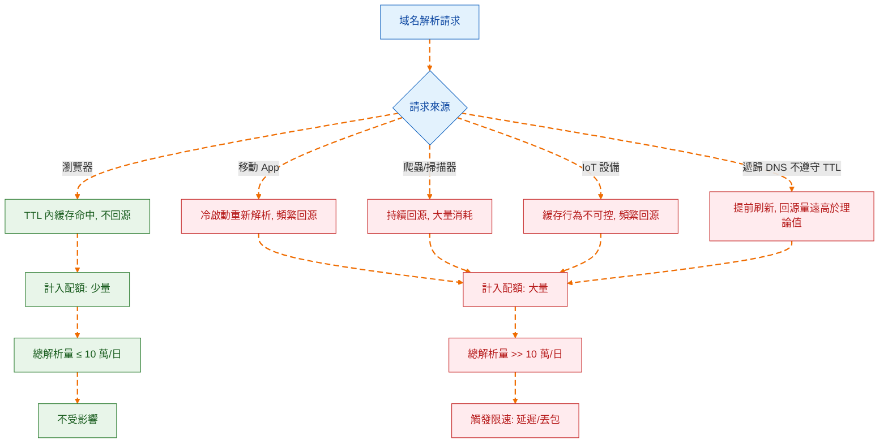
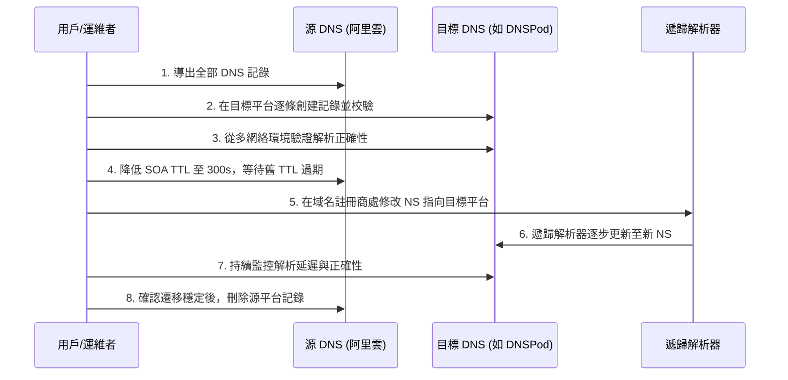

2026 年 5 月 14 日，阿里雲發佈了一則低調但影響深遠的產品公告：自 6 月 24 日起，雲解析 DNS 公網權威解析免費版新增單域名日解析量限制，上限為 10 萬次，超額將觸發動態限速——延遲、丟包，或兩者兼有[^1]。公告措辭克制，「絕大多數免費用戶日均解析量遠低於此閾值」，似乎一切風平浪靜。

但這條公告的真正分量，不在技術參數本身，而在它所標記的一個轉折點：**中國主流雲廠商的免費 DNS 服務，正從「預設夠用」轉向「需要算賬」的階段。** 對於依賴免費 DNS 的獨立開發者、個人站長和中小團隊而言，這不是一次孤立的價格調整，而是整個 DNS 服務商業邏輯的重新定價。

## 10 萬次到底夠不夠：解析量的真實構成

官方說「絕大多數用戶不受影響」，這句話在統計意義上可能成立——如果只看中位數。但問題在於，一個正常運行的服務站點，其 DNS 解析量受多種因素疊加，10 萬次/日並非一個可以高枕無憂的閾值。

影響單域名解析量的核心變量包括：

**子域名數量。** 限額是「單域名」，但這裡的「單域名」指主域名及其所有子域名的解析量之和[^1]。一個站點如果使用 `www`、`api`、`cdn`、`static` 等多個子域名，每個子域名的解析都會被計入總額。一個中等複雜度的 Web 應用，解析量輕鬆翻幾倍。

**TTL 與實際緩存行為。** 理論上，遞歸解析器會按照 TTL 緩存解析結果，從而減少回源查詢。但現實是：國內運營商級遞歸解析器普遍存在不嚴格遵守 TTL 的情況，部分甚至會在 TTL 過期前提前刷新，或忽略過長的 TTL 值自行縮短。這意味著實際回源查詢次數可能遠超理論值。

**爬蟲與掃描器。** 搜索引擎爬蟲、安全掃描器、SEO 工具等會持續觸發 DNS 解析。這些流量不產生頁面訪問，但同樣消耗解析配額。

**移動端與 IoT 設備。** 移動 App 的 DNS 緩存行為與瀏覽器不同，部分實現每次冷啟動都會重新解析。IoT 設備的 DNS 實現更是良莠不齊，大量設備根本不緩存或緩存時間極短。

一個有實際案例可供參照：獨立博客 yijile.com 在公告後自查發現，其日均解析量超過 30 萬次，接近限額的 300%[^2]——而該站點的頁面訪問量遠未達到同等量級。這說明 DNS 解析量與網站 UV/PV 之間存在顯著的非線性關係，用「日訪問量」來估算「日解析量」並不可靠。

## 限速背後的商業邏輯：免費的終點是限速

阿里雲並非第一家對免費 DNS 設置門檻的廠商，也不會是最後一家。

從商業角度看，免費版 DNS 對雲廠商而言是一個「負資產」——它消耗着基礎設施資源（全球解析節點、頻寬、運維人力），但除了品牌曝光和用戶入口價值外，幾乎不產生直接收入。當用戶規模較小時，這種投入可以視為獲客成本；但當免費用戶量級膨脹到影響全局穩定性時，限速就成了必然選擇。

公告中提到的「平台承載的解析總量不斷攀升」和「避免局部流量突增或異常查詢影響正常業務」，翻譯成商業語言就是：**免費用戶的超量使用已經開始侵蝕付費用戶的 SLA 保障。**

這個邏輯與 Cloudflare、Google Cloud DNS 等國際廠商的路徑一致：先用免費服務建立用戶基礎和市場認知，再逐步收緊免費額度、引導商業轉化。不同的是，阿里雲選擇了更直接的「硬限速」而非「超額後按量計費」——這恰好反映了國內雲服務市場的競爭格局：當免費用戶遷移成本足夠低時，廠商更傾向於直接切走超量用戶，而非通過精細化計費來轉化。

## 國內替代方案：誰還能免費扛得住

對於日均解析量可能超過 10 萬次的站點，遷移到替代 DNS 服務是現實選項。以下是當前國內主流免費 DNS 服務的核心維度對比：

| 服務商 | 免費版解析量限制 | 分區解析 | 最小 TTL | DDoS 防護 | 備註 |
| --- | --- | --- | --- | --- | --- |
| 阿里雲 DNS | 10 萬次/日（2026.6.24 起） | 付費版支持 | 120s（免費版） | 基礎 | 本次限速主角 |
| 騰訊雲 DNSPod | 無明確日解析量限制 | 免費版支持（運營商/地域/搜索引擎線路） | 1s | 基礎 | 國內最成熟的替代選擇 |
| 華為雲 DNS | 無明確日解析量限制 | 付費版支持 | 由套餐決定 | 基礎 | 相對寬鬆，適合華為生態用戶 |
| 火山引擎 TrafficRoute | 無明確日解析量限制 | 免費版支持基礎線路 | 1s | 基礎 | 字節跳動出品，生態較新 |

騰訊雲 DNSPod 是目前信息最透明的替代選項，其免費版明確支持按運營商（電信、移動、聯通）、按地域（境內/境外）和搜索引擎專用線路的分區解析。對於需要區分國內外解析或運營商優化的站點，這是一個阿里雲免費版無法提供的差異化能力。

但需要警惕的是：**今天沒有限速，不等於明天不會限速。** DNSPod 免費版同樣面臨用戶增長帶來的資源壓力，只是目前尚未達到觸發閾值。選擇替代方案時，不要把「當前沒有限制」等同於「永遠不會限制」。

## 遷移策略：不是換一個 NS 那麼簡單

DNS 遷移在技術上並不複雜——修改域名註冊商的 NS 記錄，等待全球遞歸解析器更新即可。但實際操作中有幾個容易被忽略的關鍵點：

**記錄導出與格式兼容。** 不同 DNS 服務商對記錄類型的支持程度不同。阿里雲支持的部分擴展記錄類型（如顯性/隱性 URL 轉發），DNSPod 和其他廠商可能以不同方式實現或不支持。遷移前需要完整導出所有記錄並逐條校驗。

**TTL 的過渡期設計。** 遷移 NS 時，新舊兩套權威 DNS 會在過渡期內並存（取決於舊 NS 記錄的 TTL）。最佳實踐是：先在目標平台配置好完全相同的記錄，驗證無誤後，再將 NS 切換到新平台。切換前將舊 NS 的 SOA 記錄 TTL 調低（如 300 秒），以縮短過渡窗口。

**分區解析的策略遷移。** 如果原來依賴阿里雲付費版的分區解析，遷移到 DNSPod 免費版可以直接複用線路配置；如果遷移到不支持免費分區解析的平台，則需要評估是否接受單一解析策略。

**監控先行。** 在完全切換之前，建立解析監控——持續從多個網絡環境（電信、聯通、移動）對關鍵子域名進行解析探測，確保遷移後解析結果和延遲都在可接受範圍內。

## 更深一層：免費 DNS 服務的結構性困境

放在更長的歷史維度上看，阿里雲 DNS 免費版限速不是一個孤立事件，而是免費 DNS 服務模式的結構性問題浮出水面。

DNS 權威解析是一項「薄利多銷」的基礎設施服務——邊際成本極低，但穩定性和可用性要求極高。當一個免費服務承載的域名從十萬級增長到百萬級、解析量從億級增長到千億級，免費模式的可持续性就面臨根本性質疑：要麼限速分流，要麼降級服務質量，要麼轉付費。

雲廠商的困境在於，DNS 是最底層的互聯網入口——域名解析失敗意味著整個業務不可達，用戶不會區分「這是免費版所以服務質量差」，只會歸因於「阿里雲/騰訊雲不行」。這種「免費服務綁架品牌口碑」的壓力，是推動限速決策的關鍵因素。

對於站長和開發者而言，這件事的啟示不是「趕緊換到另一個免費平台」，而是：**任何免費的、非自控的基礎設施依賴，都內置了一個過期時間。** 今天阿里雲限速，明天可能是 DNSPod，後天可能是 Cloudflare Free Plan 調整條款。

## 結論

阿里雲 DNS 免費版限速 10 萬次/日，在絕對數值上並不苛刻，但它傳遞的信號比數值更重要：**國內雲廠商的免費 DNS 紅利期正在收窄。**

對於絕大多數日均解析量遠低於閾值的站點，什麼也不需要做。對於處於臨界線附近的站點，建議立即開啟解析量監控，了解自己的真實用量後再做決策。對於已經或即將超限的站點，DNSPod 免費版是當前最務實的遷移目標，但把 DNS 自主可控納入中長期規劃——無論是多供應商冗餘部署，還是自建權威 DNS（哪怕是輕量的 NSD 或 CoreDNS 實例），都值得認真考慮。

免費是暫時的，可控才是長期的。

[^1]: 阿里雲.《產品變更》雲解析DNS-公網權威解析免費版限速通知. 2026-05-14. https://www.aliyun.com/notice/118259
[^2]: 一極樂. 阿里雲解析DNS免費版對單個域名限制10萬次解析量，換更優平替產品. 2026-05-24. https://yijile.com/zh/alibaba-cloud-dns-resolution-limit-replacement-products/
