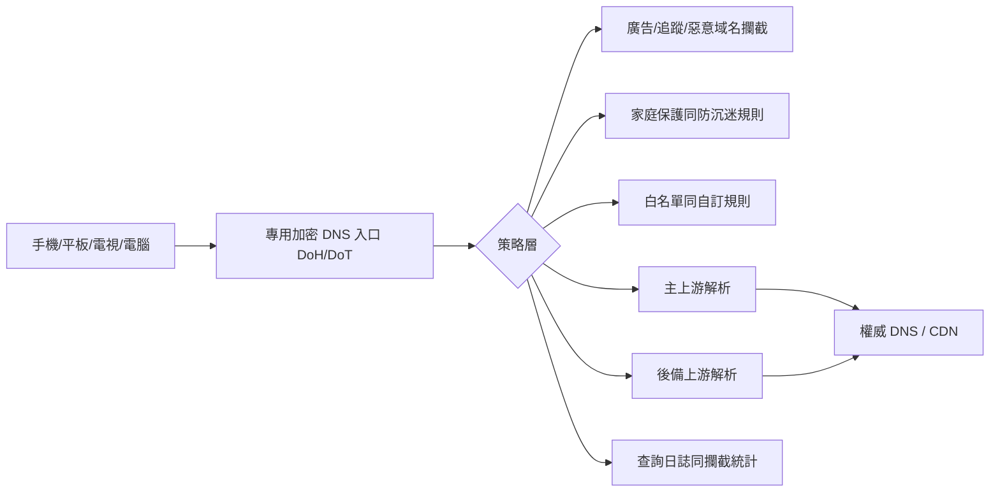

很多用戶將 DNS 視為「填一個地址就完事」的基本設定，但 2024 及 2025 年兩次公開事故說明：**解析器本身也會出故障**，而且會直接放大至「網頁打唔開、App 無法上網、全家斷家斷網」嘅體感問題。

本文唔討論「邊間更好」，而係聚焦一件事：**點樣將 DNS 由單點依賴改造成可觀測、可切換、可恢復嘅家庭級基礎設施**。

## 兩次可核實事件：發生咗乜

先睇公開資料入面最關鍵嘅時間點（均為 UTC 時間，方便同官方時間線對齊）：

| 事件 | 公開日期 | 關鍵影響 | 根因類型 |
| --- | --- | --- | --- |
| Cloudflare 1.1.1.1 事件（2024-06-27） | 2024-07-04 發佈復盤 | 部分地區用戶不可達或高延遲 | 外部路由事件（BGP 劫持 + 路由洩漏） |
| Cloudflare 1.1.1.1 事件（2025-07-14） | 2025-07-15 發佈復盤 | 全球大多數用戶受影響，官方給出 62 分鐘中斷窗口 | 內部設定錯誤導致前綴撤銷 |

呢兩次事件有一個共通點：

- 用戶睇落去都係「DNS 唔工作咗」；
- 但底層原因完全不同（一次偏外部互聯網路由，一次偏服務內部變更）；
- 結論係一樣一樣嘅：**單上游、單入口、單協議會將風險集中到一個點**。

## 技術拆解：點解 DNS 會「睇落去全網壞咗」

當終端將唯一 DNS 指向一個不可用目標時，應用層通常會出現連鎖反應：

- 域名無法解析，表現為 `timeout` 或 `SERVFAIL`。
- 瀏覽器同 App 會反覆重試，導致「偶爾恢復、又再次失敗」嘅抖動體驗。
- 即使公網鏈路正常，用戶都會誤判為「寬頻壞咗」或「網站全部掛咗」。

上面圖嘅重點唔係「多堆功能」，而係三件事：

- **路徑分層**：接入層（DoH/DoT）同策略層（攔截/白名單）分開。
- **上游冗餘**：主上游異常時，仍有後備解析路徑。
- **可觀測性**：有日誌同統計，先可以判斷係誤攔截、上游問題，定係終端問題。

## 面向家庭網絡嘅落地方案

結合 jqknono 製作嘅 `nullprivate/adguardprivate` 服務，比較實用嘅一套做法係：

1. 使用專用加密 DNS 入口（DoH/DoT）
   - 目標係減少明文 DNS 暴露同本地網絡干擾。
   - 結合客戶端 ID/裝置識別，區分屋企唔同裝置。

2. 設定主上游 + 後備上游，避免單點依賴
   - 唔好將所有解析都押注單一個解析服務或一個前綴。
   - 結合分流策略，為唔同域名行唔同上游路徑。

3. 將「防廣告、防詐騙、防沉迷」放喺策略層統一管理
   - 廣告同追蹤域名攔截。
   - 惡意/釣魚域名攔截。
   - 針對小朋友裝置設定時段管理同內容攔截。

4. 保留誤攔截修正通道
   - 透過查詢日誌定位被攔截域名。
   - 快速加入白名單，避免長期影響正常業務。

5. 定期做「故障演練」
   - 人手臨時下線主上游，驗證後備鏈路有否生效。
   - 喺家庭網絡驗證關鍵 App（支付、網課、視像會議）能否正常運作。

## 一個常見誤區

好多人以為「用咗加密 DNS 就絕對唔會中斷」。實際上，加密只解決咗傳輸鏈路嘅隱私同抗竊聽問題，**並唔自動等同高可用**。高可用來自：

- 上游冗餘設計；
- 策略設定合理；
- 監控同應急動作可執行。

## 實操檢查清單

- 係咪仍然只有一個 DNS 提供商？
- 係咪只有單一協議（只用 DoT 或只用 DoH）而且冇備用？
- 係咪能喺 3 分鐘內由日誌定位「誤攔截定上游故障」？
- 係咪有為長者／小朋友裝置獨立設定家庭保護策略？
- 係咪每月至少做過一次切換演練？

如果以上大多數答案係否定否定嘅，咁「下一次公開 DNS 事故」好大概率就會直接落到你嘅家庭網絡上。

## 參考資料（公開可核實）

- Cloudflare：2024 年 6 月 27 日 1.1.1.1 事件復盤（含 BGP 劫持與路由洩漏時間線）  
  https://blog.cloudflare.com/cloudflare-1111-incident-on-june-27-2024
- Cloudflare：2025 年 7 月 14 日 1.1.1.1 事件復盤（含 62 分鐘中斷說明與修復時間線）  
  https://blog.cloudflare.com/cloudflare-1-1-1-1-incident-on-july-14-2025/
- Cloudflare Radar（可用於觀察公開事件期間嘅 DNS 可用性變化）  
  https://radar.cloudflare.com/

對個人同家庭用戶嚟講，DNS 唔止係「快啲」嘅問題，而係一個基礎安全同可用性問題。將專用加密 DNS、廣告攔截、家庭保護同可觀測能力組合起來，先至可以在實際故障入面減少損失同焦慮。
