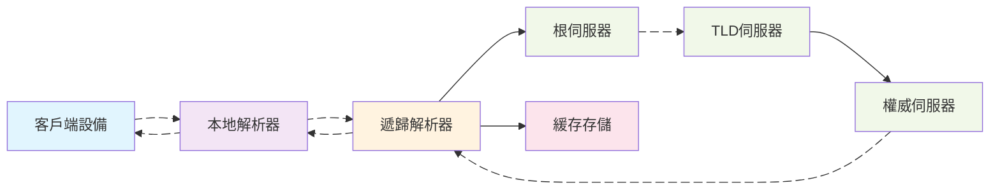
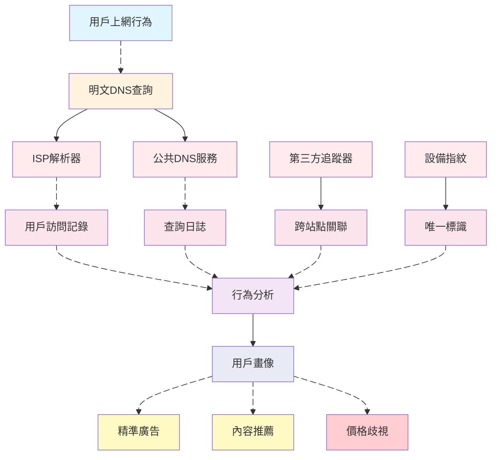
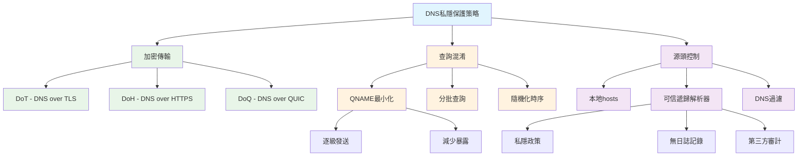

---
layout: blog
categories: ["network"]
tags: ["DNS", "DoH", "DoT", "DoQ", "私隱", "用戶畫像"]
draft: false
title: DNS 私隱防護與用戶畫像防範策略
date: 2025-10-09 22:00:00 +0800
comments: false
giscus_comments: false
description: 圍繞DNS查詢與用戶畫像構建，從原理與風險出發，基於公開標準與資料闡述可行的私隱保護策略與注意事項，避免臆測性的評測與實操。
weight: 100
---

# DNS 私隱防護與用戶畫像防範策略

> 讀者：關注網絡私隱與數據治理的工程/運維/安全從業者  
> 關鍵詞：本地解析器、遞歸解析、權威伺服器、QNAME最小化、ECS、DNSSEC、DoT/DoH/DoQ  

## 背景與問題概述  

在數碼化時代，用戶的網絡行為數據成為企業構建用戶畫像的重要來源。作為互聯網基礎設施的核心組件，域名系統（DNS）在日常網絡活動中承擔著將人類可讀的域名轉換為機器可讀的IP地址的關鍵任務。然而，傳統DNS查詢通常以明文形式在UDP端口53上進行傳輸，這使得用戶的瀏覽歷史、應用使用習慣等敏感信息容易被網絡營運商、互聯網服務供應商以及各種中間人獲取和分析。  

用戶畫像是通過收集和分析用戶的各種行為數據而構建的用戶特徵模型，企業利用這些模型進行精準營銷、內容推薦、風險評估等商業活動。雖然這些服務在一定程度上提升了用戶體驗，但也帶來了私隱洩露、數據濫用和潛在的歧視性定價等問題。了解如何通過DNS層面的技術手段來減少用戶畫像的準確性，成為保護個人私隱的重要途徑。  

本文將從DNS基礎原理出發，分析用戶畫像構建過程中的數據收集點，探討基於DNS的私隱保護策略，並闡述不同場景下的實現思路與注意事項。  

## 基礎與術語梳理  

要理解DNS私隱保護，首先需要掌握DNS查詢的基本流程和相關術語。DNS查詢通常涉及多個參與者，每個環節都可能成為私隱洩露的節點。  

本地解析器（Stub Resolver）是操作系統或應用程式中的DNS客戶端組件，負責接收應用程式的DNS查詢請求並將其轉發給遞歸解析器。遞歸解析器（Recursive Resolver）通常由ISP或第三方DNS服務提供，負責完成完整的域名解析過程，包括查詢根伺服器、頂級域（TLD）伺服器和權威伺服器，並將最終結果返回給客戶端。  

權威伺服器（Authoritative Server）儲存特定域名的DNS記錄，是域名信息的最終來源。緩存機制是DNS系統的重要組成部分，遞歸解析器會緩存查詢結果以減少重複查詢，提高解析效率。TTL（Time To Live）值決定了DNS記錄在緩存中的保存時間。  

EDNS Client Subnet（ECS）是一種擴展機制，允許遞歸解析器向權威伺服器傳遞客戶端的子網信息，旨在提高CDN和地理位置服務的準確性。然而，ECS也會暴露用戶的地理位置信息，增加私隱洩露風險。  

## 私隱威脅與動機  

明文DNS查詢為用戶畫像構建提供了豐富的數據源。通過分析DNS查詢記錄，攻擊者或數據收集者可以獲取用戶的瀏覽習慣、應用使用情況、地理位置信息等敏感數據，進而構建詳細的用戶畫像。  

DNS查詢數據對用戶畫像構建的價值主要體現在幾個方面。首先，查詢頻率和時間模式可以揭示用戶的日常作息規律，例如工作日與周末的上網習慣差異、夜間活動模式等。其次，查詢的域名類型可以反映用戶的興趣愛好，如新聞網站、社交媒體、影片平台、購物網站等的訪問偏好。此外，子域名訪問模式可以提供更精細的行為分析，例如用戶是否頻繁訪問特定社交平台的子功能頁面。  

地理位置信息是用戶畫像的重要組成部分。通過ECS機制和分析遞歸解析器的位置，可以推斷用戶的物理位置或移動軌跡。結合時間序列分析，還可以識別用戶的常去地點和活動範圍。  

跨設備的身份關聯是用戶畫像構建的另一個關鍵環節。通過分析DNS查詢中的特定模式，如相同域名在不同設備上的查詢時間分佈，可能將同一用戶的多個設備關聯起來，構建更全面的用戶畫像。  

商業動機驅動著用戶畫像的構建。精準廣告投放是主要應用場景，企業通過分析用戶的瀏覽興趣展示相關性更高的廣告，提高轉化率。內容推薦系統利用用戶畫像提供個性化的新聞、影片和產品推薦，增強用戶粘性。風險評估則應用於金融、保險等領域，根據用戶行為模式評估信用風險或欺詐可能性。  

## 保護策略與原理  

針對DNS私隱洩露風險，業界已經發展出多種保護策略，主要圍繞加密傳輸、查詢混淆和源頭控制三個方向展開。這些策略各有特點，適用於不同的場景和需求。  

加密傳輸是DNS私隱保護的基礎手段，主要包括三種技術：DNS over TLS（DoT）、DNS over HTTPS（DoH）和DNS over QUIC（DoQ）。DoT使用TCP端口853傳輸加密的DNS查詢，通過TLS協議提供端到端的加密保護。DoH將DNS查詢封裝在HTTPS流量中，使用標準443端口，能夠更好地融入現有網絡環境，避免被防火牆或網絡管理設備識別和阻止。DoQ是基於QUIC協議的新興方案，結合了UDP的低延遲和TLS的安全性，同時支援連接遷移等高級特性。  

QNAME最小化（RFC7816）是一種查詢混淆技術，遞歸解析器在向上游伺服器發送查詢時，逐步發送域名而不是完整域名。例如，查詢"www.example.com"時，先查詢"com"，再查詢"example.com"，最後查詢"www.example.com"。這種方式減少了上游伺服器獲取的完整域名信息，但可能增加查詢延遲。  

分批查詢和時序隨機化是額外的查詢混淆手段。分批查詢將多個DNS請求分散在不同時間發送，避免通過查詢模式關聯用戶行為。時序隨機化在查詢間隔中引入隨機延遲，打破時間模式分析的可能。  

源頭控制策略關注DNS查詢的發起環節。本地hosts文件可以繞過DNS查詢直接解析常用域名，減少查詢記錄的產生。可信遞歸解析器選擇具有嚴格私隱政策的DNS服務供應商，如承諾不記錄查詢日誌、不接受第三方追蹤的服務。DNS過濾通過阻止已知的追蹤器和惡意域名，減少不必要的數據暴露。  

## 實現路徑與注意事項  

DNS私隱保護的實現需要考慮技術可行性、性能影響和部署複雜度。在選擇和實施具體方案時，需要權衡私隱保護效果與實際可用性。  

加密DNS的部署可以採用多種方式。操作系統級支援是最理想的情況，如Android 9+、iOS 14+和Windows 11都內置了DoH或DoT支援。應用程式級實現適用於特定軟件，如瀏覽器內置的加密DNS功能。網絡設備級部署則在路由器或防火牆上配置加密DNS，為整個網絡提供保護。  

QNAME最小化的實施主要由遞歸解析器負責，用戶需要選擇支援該功能的DNS服務。需要注意的是，QNAME最小化可能會影響某些依賴完整域名信息的性能優化，如預取和負載均衡。  

可信遞歸解析器的選擇需要考慮多個因素。私隱政策是首要考慮，包括是否記錄查詢日誌、日誌保留時間、數據共享政策等。服務性能影響用戶體驗，包括解析延遲、可用性和全球分佈。服務透明度也是重要因素，如是否公開營運政策、接受第三方審計等。  

DNS過濾需要注意誤報和漏報問題。過於激進的過濾可能導致正常網站無法訪問，而過於寬鬆的過濾則無法有效保護私隱。定期更新過濾規則和提供自定義白名單是必要的平衡措施。  

混合策略可以提供更好的私隱保護效果。例如，結合加密DNS和QNAME最小化，同時使用DNS過濾阻止追蹤器。但需要注意的是，過多的私隱保護措施可能影響網絡性能和兼容性，需要根據實際需求進行調整。  

## 風險與遷移  

部署DNS私隱保護措施可能面臨多種風險和挑戰，需要制定相應的遷移策略和應急預案。  

兼容性風險是主要考慮因素之一。加密DNS可能被某些網絡環境阻止，特別是在企業網絡或限制性嚴格的地區。回退機制至關重要，當加密DNS不可用時，系統應該能夠優雅地回退到傳統DNS，同時盡可能減少私隱洩露。  

性能影響需要仔細評估。加密DNS可能會增加查詢延遲，特別是首次連接時的握手開銷。緩存優化和連接復用可以緩解部分性能問題。在選擇加密DNS服務時，應考慮其網絡延遲和響應時間，避免地理位置過遠的伺服器。  

合規性要求是企業部署時必須考慮的因素。某些地區可能有數據留存或監控要求，與私隱保護措施可能存在衝突。在部署前需要了解當地法規要求，並在私隱保護與合規性之間找到平衡點。  

分層灰度部署是降低風險的有效策略。首先在測試環境中驗證方案可行性，然後逐步擴大到小規模用戶群體，最後全面部署。監控關鍵指標如查詢成功率、延遲變化和錯誤率，及時調整配置。  

用戶教育和培訓也不可忽視。許多用戶可能不了解DNS私隱的重要性，需要提供清晰的說明和配置指導。特別是在企業環境中，IT部門應該向員工解釋私隱保護措施的目的和使用方法。  

## 場景化建議  

不同使用場景對DNS私隱保護的需求和實施策略各有特點，需要根據具體環境制定針對性的方案。  

家庭網絡場景下，路由器級部署是不錯的選擇。支援加密DNS的路由器可以為整個家庭網絡提供保護，包括IoT設備和智能家居產品。選擇家庭友好的DNS服務，如支援家長控制和惡意網站過濾的服務，可以在保護私隱的同時提供額外的安全功能。  

移動辦公場景需要特別關注網絡切換和電池消耗。選擇支援連接遷移的DoQ服務可以提高移動網絡切換的穩定性。同時，考慮電池優化策略，避免頻繁的DNS查詢和加密操作過度消耗電量。  

企業環境需要在私隱保護與網絡管理之間找到平衡。可能需要部署混合方案，對一般員工流量提供私隱保護，同時對特定業務流量保持可見性以滿足管理和合規要求。DNS過濾可以與企業安全策略結合，阻止惡意域名和數據洩露風險。  

高私隱需求場景下，如記者、律師和醫療從業者，可能需要採用多重保護措施。結合加密DNS、VPN和Tor等工具，實現層層的私隱保護。同時，可以考慮使用匿名遞歸解析器，如不記錄任何查詢日誌的服務。  

跨境網絡場景需要特別關注網絡審查和地區限制。某些加密DNS服務可能在特定地區不可用，需要準備多個備選方案。了解當地的網絡環境特點，選擇最適合當地條件的私隱保護策略。  

開發測試環境可以嘗試最新的私隱保護技術，如實驗性的DoQ實現或自定義的混淆方案。這些環境相對可控，適合測試新技術的影響和兼容性，為生產環境部署積累經驗。  

## FAQ 與參考  

### 常見疑問  

**Q: 加密DNS是否完全防止用戶畫像構建？**  
A: 加密DNS可以防止網絡層面的中間人窺探DNS查詢內容，但遞歸解析器仍然可以看到完整的查詢記錄。選擇承諾不記錄日誌的可信服務供應商很重要，同時結合其他私隱保護措施如瀏覽器防追蹤功能，可以提供更全面的保護。  

**Q: QNAME最小化會影響DNS解析性能嗎？**  
A: QNAME最小化可能會增加查詢延遲，因為需要多次向上游伺服器發送查詢。現代遞歸解析器通常通過智能緩存和並行查詢來優化性能，實際影響往往比預期小。對於大多數用戶來說，私隱收益遠超過輕微的性能損失。  

**Q: 如何驗證DNS私隱保護是否生效？**  
A: 可以使用專門的測試工具如dnsleaktest.com或dnsprivacy.org提供的檢測服務，驗證DNS查詢是否通過加密通道發送。網絡抓包工具也可以用來檢查DNS流量是否已加密。但需要注意的是，這些測試只能驗證技術實現，無法評估服務供應商的實際私隱政策執行情況。  

**Q: 企業網絡中如何平衡私隱保護與管理需求？**  
A: 企業可以採用分層策略，對一般互聯網訪問提供私隱保護，同時對內部業務流量保持必要的監控能力。使用支援分流技術的解決方案，根據域名或用戶組別應用不同的DNS策略。明確的私隱政策和員工溝通也很重要。  

**Q: 加密DNS會被網絡營運商阻止嗎？**  
A: 某些網絡環境可能會限制或阻止加密DNS流量，特別是使用非標準端口的DoT。DoH由於使用標準HTTPS端口443，通常更難被識別和阻止。在這種情況下，可以考慮使用多種加密DNS方案的組合，或者配合其他私隱工具如VPN。  

### 參考資源  

**RFC文檔:**  
- RFC7858: Specification for DNS over Transport Layer Security (TLS)  
- RFC8484: DNS Queries over HTTPS (DoH)  
- RFC7816: DNS Query Name Minimisation to Improve Privacy  
- RFC9250: DNS over Dedicated QUIC Connections  

**工具與服務:**  
- Cloudflare DNS: 1.1.1.1 (支援DoH/DoT，承諾私隱保護)  
- Quad9: 9.9.9.9 (支援DoH/DoT，阻止惡意域名)  
- NextDNS: 可定制的私隱DNS服務  
- Stubby: 開源的DoT客戶端  

**測試與驗證:**  
- dnsleaktest.com: DNS洩漏測試  
- dnsprivacy.org: DNS私隱測試工具  
- browserleaks.com/dns: 瀏覽器DNS配置檢測  

**延伸閱讀:**  
- [DNS私隱保護技術詳解](https://nullprivate.com)  
- [企業DNS安全與私隱平衡策略](https://blog.jqknono.com)  

---  

本文從DNS基礎原理出發，分析了用戶畫像構建過程中的私隱風險，並系統介紹了加密傳輸、查詢混淆和源頭控制等保護策略。在實際部署中，需要根據具體場景和需求選擇合適的方案，平衡私隱保護、性能影響和兼容性要求。DNS私隱保護是一個持續發展的領域，隨著技術演進和法規變化，保護策略也需要不斷調整和完善。
