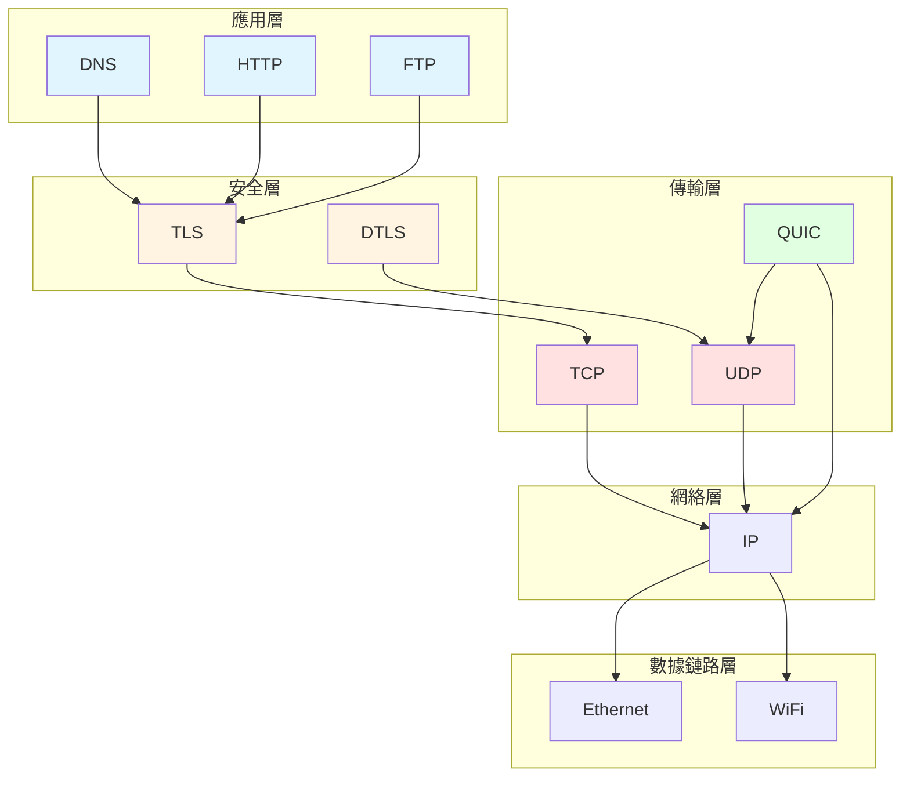
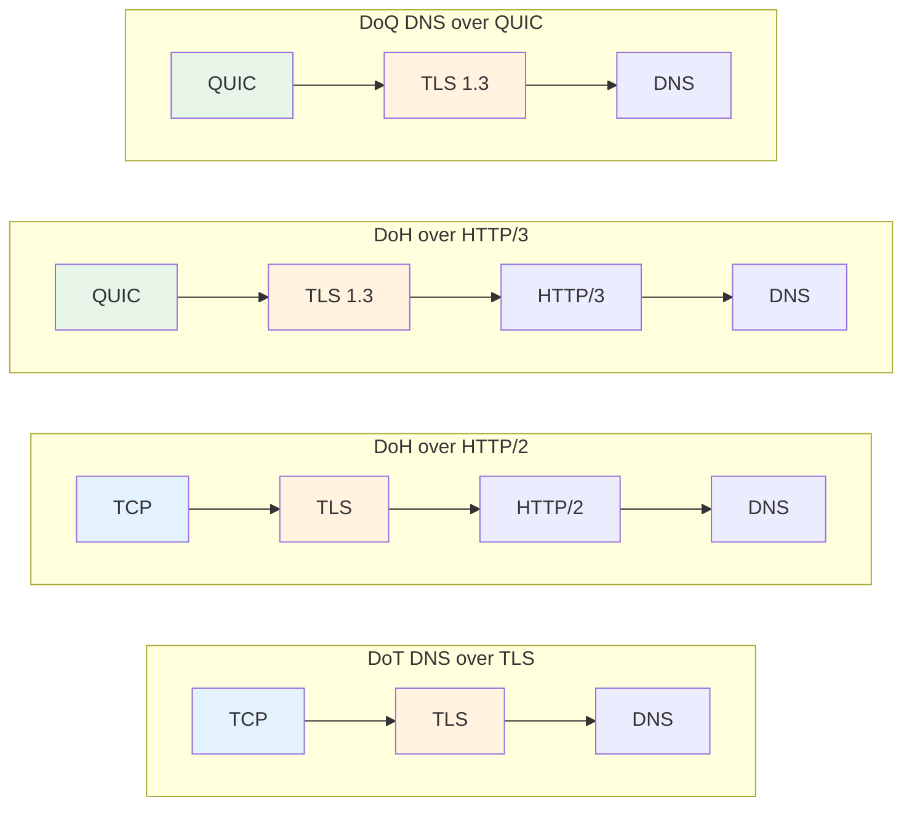

DNS over HTTPS (DoH) 和 DNS over TLS (DoT) 是兩種常見的加密 DNS 傳輸方式. 它們都能保護 DNS 查詢不被轻易竊聽或篡改, 但所依賴的協議棧不同.

先看結論:

- **DoH**: 借助 HTTP 傳輸 DNS, 更容易複用現有 Web 基礎設施.
- **DoT**: 直接在 TLS 之上傳輸 DNS, 協議路徑更短, 結構更直接.
- **兩者核心目標一致**: 保護 DNS 查詢的隱私與完整性.

對應標準如下:

| 協議 | 標準 | 說明 |
| --- | --- | --- |
| DoT | [RFC 7858](https://datatracker.ietf.org/doc/html/rfc7858) | DNS over TLS |
| DoH | [RFC 8484](https://datatracker.ietf.org/doc/html/rfc8484) | DNS Queries over HTTPS |

如果想真正理解兩者差異, 最好先從網絡協議層次結構開始看.

## 網絡協議層次結構

現代網絡協議棲採用分層設計, 每一層負責不同任務. DNS 雖然是應用層協議, 但它並不強綁定某一種傳輸方式.

可以先用以一張表快速理解各層角色:

| 層級 | 常見協議 | 主要作用 |
| --- | --- | --- |
| 應用層 (L7) | DNS, HTTP/1.1, HTTP/2, HTTP/3, FTP | 定義應用語義 |
| 安全層 | TLS, DTLS | 提供加密與身份校驗 |
| 傳輸層 (L4) | TCP, UDP, QUIC | 負責連接, 重傳, 流控等 |
| 網絡層 (L3) | IPv4, IPv6 | 負責路由和轉發 |
| 數據鏈路層 (L2) | Ethernet, Wi‑Fi | 負責本地鏈路傳輸 |

這裏有幾個關鍵點:

- **DNS 屬於應用層**.
- **TLS 位於應用層和傳輸層之間**.
- **HTTP/3 仍然是應用層協議**, 只是它運行在 QUIC 之上.
- **QUIC 常被視作「增強型傳輸層」**, 因爲它集成了可靠傳輸, 擁塞控制, 多路複用和加密握手能力.

如果把 DoT 裏的 TLS 拿掉, 它本質上就接近 **DNS over TCP**. 這說明「是否加密」與「DNS 運行在哪種傳輸之上」其實是兩個不同維度.

## Plain DNS 的特點

最普通的 DNS 一般被稱爲 Plain DNS, 常見運行方式是 UDP 或 TCP.

| 承載方式 | 優點 | 缺點 | 典型特點 |
| --- | --- | --- | --- |
| UDP | 建連開銷低, 首次查詢快 | 不可靠, 容易丟包 | 傳統 DNS 最常見 |
| TCP | 有重傳機制, 更可靠 | 握手成本更高 | 長連接建立後性能可接受 |

可以簡單理解爲:

- **UDP 更輕量**: 更適合快速請求.
- **TCP 更穩定**: 遇到丟包時更有保障.
- **在部分網絡環境下**, 尤其是 UDP 丟包嚴重時, TCP 反而可能更穩定.

一些運營商在網絡繁忙時會優先丟棄 UDP 報文. 這種情況下, 依賴 UDP 的 DNS 查詢會受到影響, 而 TCP 由於具備重傳能力, 往往更容易得到穩定結果.

## 應用層嵌套

DNS 和 HTTP 都屬於應用層協議, 所以 DoH 可以看作是「**應用層再包一層應用層**」.

這一節可以抓住兩點:

- **DoH 的核心不是 HTTP 這個名字, 而是 HTTP 這個承載方式**.
- **理論上 DNS 可以承載在很多應用層協議之上**, 只是現實中沒有必要把它做得過於複雜.

例如:

- DoH = 把 DNS 請求放進 HTTP 請求裏.
- 未加密的 HTTP 也能承載 DNS, 但幾乎沒有實際優勢.
- 從理論上說, 甚至可以做「DNS over FTP」, 只是沒有現實價值.

## 傳輸層嵌套

QUIC 基於 UDP, 但提供了很多傳統上傳輸層才具備的能力.

它通常具備這些特徵:

- 面向連接
- 擁塞控制
- 重傳機制
- 流量控制
- 多路複用
- 與 TLS 1.3 深度整合

因此可以把 QUIC 理解爲:

| 對比對象 | QUIC 的特點 |
| --- | --- |
| 相比 TCP | 建連和恢復時延通常更低 |
| 相比 UDP | 更可靠, 能力更完整 |

## 協議組合關係

應用層協議和傳輸層協議之間並不是一對一綁定的. 同一種應用協議, 可以跑在不同傳輸方式上.

先看一個化總表:

| 方案 | 協議組合 |
| --- | --- |
| Plain DNS | UDP/TCP + DNS |
| HTTP/2 | TCP + TLS 1.2/1.3 + HTTP/2 |
| HTTP/3 | QUIC + TLS 1.3 + HTTP/3 |
| DoT | TCP + TLS 1.2/1.3 + DNS |
| DoH | HTTP/2 或 HTTP/3 + DNS |
| DoQ | QUIC + TLS 1.3 + DNS |

如果再用一句話概括:

- **DoT**: 路徑更短, 直接在 TLS 上跑 DNS.
- **DoH**: 先走 HTTP, 再承載 DNS.
- **DoQ**: 用 QUIC 直接承載 DNS.

## 性能和兼容性分析

理解協議組合之後, 再看 DoH 和 DoT 的差異會更直觀.

### 1. 性能

| 維度 | DoH | DoT |
| --- | --- | --- |
| 理論低時延潛力 | 高, 尤其是 DoH/3 | 中等偏高 |
| 對 UDP 環境依賴 | DoH/3 依賴 QUIC/UDP | 主要依賴 TCP |
| 網絡差時穩定性 | 取決於是否回退 HTTP/2 | 通常更穩定 |

化理解:

- 如果服務商支持 **HTTP/3**, DoH 往往有更好的低延遲潛力.
- 如果網絡環境對 **UDP 不友好**, DoT 往往更穩定.
- 理論速度不等於實際體驗, 運營商丟包策略會直接影響結果.

### 2. 隱私與安全

| 維度 | DoH | DoT |
| --- | --- | --- |
| 傳輸加密 | 是 | 是 |
| 防竊聽/防篡改 | 是 | 是 |
| 常見默認端口 | 443 | 853 |

要點如下:

- **DoH 和 DoT 都是加密 DNS**.
- 兩者都能有效降低 DNS 明文洩露風險.
- DoT 经常被提到的「容易被識別」, 很很大程度上是因爲 **853 端口較顯眼**, 而不是協議本身天然暴露更多信息.
- 實際上, **DoT 也可以運行在非 853 端口**, 只是不同平臺支持程度不同.

### 3. 擴展性與服務部署

| 維度 | DoH | DoT |
| --- | --- | --- |
| 複用現有 Web 基礎設施 | 強 | 弱 |
| 易于複用 443 端口 | 是 | 否 |
| 服務端擴展空間 | 更大 | 相對有限 |

這一點更偏向服務商視角:

- DoH 可以直接複用成熟的 HTTP 服務體系.
- DoH 更容易和其他 Web 服務一起部署在 443 端口上.
- DoT 一般更像「專用 DNS 服務」, 協議路徑更純粹, 但擴展能力不如 HTTP 生態.

### 4. 平臺兼容性

| 平臺/系統 | DoH | DoT |
| --- | --- | --- |
| Chromium 瀏覽器 | 支持 | 依賴系統或擴展 |
| Windows 11 | 原生支持 | 視配置而定 |
| Android 8+ | 部分場景支持 | 原生支持 |
| Android 11+ | 原生支持 | 原生支持 |
| macOS | 原生支持 | 原生支持 |
| iOS | 原生支持 | 原生支持 |

整體趨勢是:

- **DoH 的平臺普及度越來越高**.
- **DoT 在 Android 上起步較早**.
- 對普通用戶來說, 哪個更方便, 往往取決於系統是否提供原生入口.

## 實際選擇建議

如果只給普通用戶一個簡短建議, 可以直接參考下表:

| 場景 | 更推薦 |
| --- | --- |
| 想省心, 想兼顧兼容性 | DoH |
| 網絡對 UDP 不友好 | DoT |
| 服務商支持 HTTP/3 | 優先嘗試 DoH |
| 系統只提供 DoT 原生入口 | 先用 DoT |

進一步展開:

- 對大多數用戶來說, **DoH 往往更省心**.
- 如果服務商支持 **DoH/3**, 它通常能在網絡良好時提供更低時延.
- 如果網絡狀況較差, DoH 還可能回退到 HTTP/2, 維持可用性.
- 如果本地網絡經常丟 UDP 包, **DoT 可能比 DoH/3 更穩定**.

### 選擇時重點看什麼

建議按下面 4 項依次判斷:

1. **服務商是否支持 HTTP/3 / DoH/3**
2. **你的運營商網絡是否容易丟 UDP 包**
3. **你的設是否原生支持 DoH 或 DoT**
4. **你是否更看重省心配置還是更看重網絡穩定性**

### 一個實用建議

推薦嘗試 [寧屏](https://www.nullprivate.com/), 它支持 DoT 和 DoH/3, 同時提供廣告攔截和 DNS 分流功能. 如果你需要自部署, 也可以使用它的 [開源庫](https://github.com/NullPrivate/NullPrivate).

## 總結

最後用 3 句話收尾:

- **DoH 和 DoT 都能顯著提升 DNS 隱私保護**.
- **DoH 更偏向兼容性与生態複用**, **DoT 更偏向直接與穩定**.
- **對大多數用戶而言, DoH 通常是更平衡的選擇**, 但最終仍要看網絡環境和服務商支持情況.
