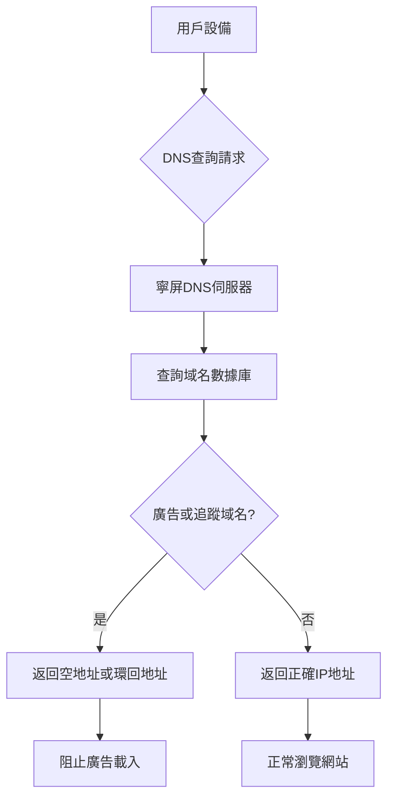

在當今數碼化時代，廣告已成為互聯網生態的重要組成部分，但過多的廣告不僅影響用戶體驗，還可能帶來私隱洩露風險。寧屏（NullPrivate）作為一款專注於私隱保護的DNS服務，採用了與AdGuard Home類似的DNS過濾技術，為用戶提供高效的廣告攔截解決方案。

## 寧屏去廣告的工作原理

寧屏的廣告攔截功能基於DNS（域名系統）過濾技術，其工作流程如下：

### DNS請求監控

當您的設備嘗試瀏覽網站時，會首先向DNS伺服器查詢域名對應的IP地址。寧屏作為您的首選DNS伺服器，會接收並分析這些查詢請求。

### 智能過濾機制

寧屏維護著一個龐大的廣告和追蹤域名數據庫。當檢測到用戶嘗試瀏覽的域名屬於廣告或追蹤類別時，系統會立即攔截該請求。

### 高效響應

對於被攔截的請求，寧屏會返回一個空地址或本地環回地址（如127.0.0.1），從而阻止廣告內容的載入。對於正常的網站瀏覽請求，寧屏則會提供正確的IP地址，確保用戶可以正常瀏覽目標網站。

## 技術優勢

### 高效性

- **網絡層面攔截**：在DNS解析階段就阻止廣告載入，無需等待網頁內容下載
- **毫秒級響應**：本地化的DNS響應機制，幾乎不影響網頁載入速度
- **全設備保護**：一次配置，保護網絡中的所有設備

### 精準性

- **多層次過濾**：支援精確域名匹配、通配符規則和正則表達式
- **智能分類**：將過濾規則按廣告、追蹤器、惡意軟件等分類管理
- **動態更新**：定期從可信源獲取最新的過濾規則

### 私隱保護

- **無痕瀏覽**：不記錄用戶瀏覽記錄，保護瀏覽私隱
- **減少數據洩露**：阻止廣告商和追蹤器收集用戶數據
- **本地處理**：大部分過濾工作在本地完成，減少數據外洩風險

## 與AdGuard Home的相似之處

寧屏在廣告攔截方面與AdGuard Home採用了相同的核心技術原理：

1. **基於DNS的過濾機制**：兩者都通過攔截DNS查詢來阻止廣告域名解析
2. **過濾規則管理**：都支援自定義過濾規則和黑白名單配置
3. **網絡範圍保護**：都能為整個局域網提供廣告攔截服務
4. **開源社區支援**：都受益於開源社區維護的過濾規則列表

## 用戶體驗優化

寧屏在設計上特別注重用戶體驗，確保廣告攔截功能既高效又不會對正常使用造成干擾：

### 透明化管理

- 提供詳細的攔截統計資訊，讓用戶了解防護效果
- 支援靈活的白名單配置，避免誤攔截重要網站
- 實時生效的規則更新，無需重啟設備

### 易用性設計

- 簡化配置流程，普通用戶也能輕鬆上手
- 提供多語言支援，滿足不同用戶需求
- 兼容各種網絡環境和設備類型
- 具備安全可靠的DNS伺服器支援

### 私隱保護

- 嚴格的私隱保護措施，保護用戶私隱
- 不收集用戶個人身份資訊
- 確保用戶數據安全

## 使用建議

為了獲得最佳的廣告攔截效果，我們建議用戶：

1. **合理配置規則**：根據實際需求選擇合適的過濾規則列表
2. **定期檢查更新**：確保過濾規則庫保持最新狀態
3. **關注攔截統計**：通過統計數據了解廣告攔截效果
4. **及時調整白名單**：將誤攔截的正常網站添加到白名單中

## 結語

寧屏通過先進的DNS過濾技術，為用戶提供了一個高效、精準且注重私隱的廣告攔截解決方案。我們致力於在保護用戶免受廣告騷擾的同時，確保不影響正常的網絡使用體驗。選擇寧屏，讓您的網絡環境更加清爽、安全。

在數碼時代，每個人都應該擁有一個乾淨、私密的網絡空間。寧屏正是為了實現這一目標而設計，幫助用戶重新掌控自己的數碼生活。
