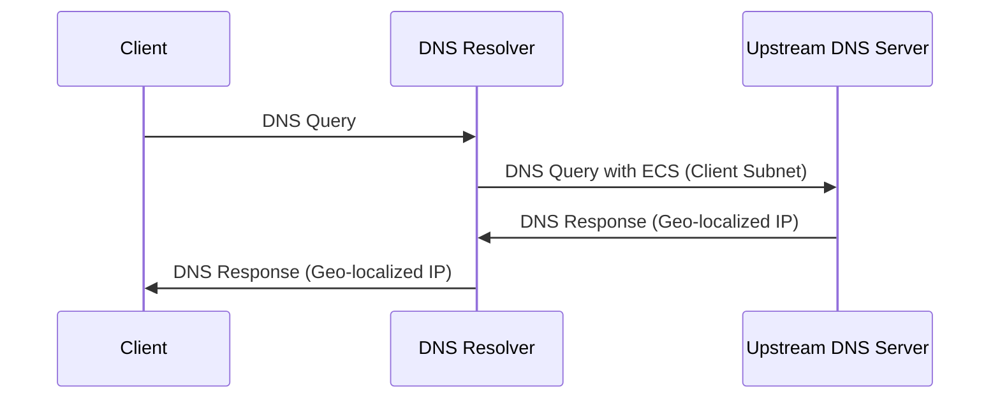

為了獲得最佳的 DNS 解析體驗，我們已經預設了一些建議配置, 但仍然有需要用戶注意的配置, 那就是「EDNS 客戶端子網」。

## 啟用EDNS客戶端子網(ECS)

為了獲得更佳的體驗，您可能希望 DNS 伺服器返回在地理位置上最接近您的伺服器 IP 結果。`EDNS 客戶端子網 (ECS)` 能夠實現這一點。它允許將包含地理位置資訊的 IP 子網發送到 DNS 伺服器，以便伺服器返回最佳的 DNS 解析結果。

**工作原理:**

當啟用 ECS 時，您的 DNS 解析器（例如 AdGuard Home）會將客戶端 IP 位址的一部分（通常是前 24 位，表示客戶端所在的子網）包含在 DNS 查詢中，並將其發送到上游 DNS 伺服器。上游 DNS 伺服器會根據此子網資訊，返回最適合該區域的伺服器 IP 位址。

**私隱注意事項:**

啟用 ECS 能夠在提高 DNS 解析準確性和速度的同時，也可能帶來一定的私隱影響。通過共享客戶端 IP 位址的子網，您的粗略地理位置資訊可能會被上游 DNS 伺服器記錄。請您根據自身情況，權衡是否啟用此功能。

**如何權衡:**

啟用 ECS 可以在存取速度和準確性之間取得平衡。如果您對私隱保護有較高要求，可以選擇停用 ECS，但可能會降低存取速度。如果您希望獲得最佳的存取體驗，可以啟用 ECS，但請知悉潛在的私隱影響。該私隱資訊由DNS上游搜集, 本服務仍然按照私隱政策承諾, 不搜集利用任何資訊。
