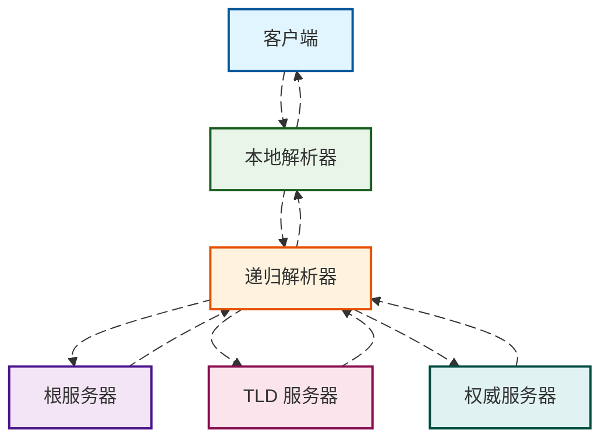
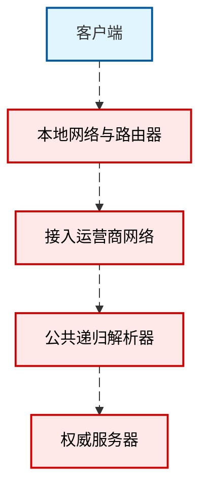

# DNS 会如何影响你的上网体验

当我们打开一个网页、刷一条视频或点击一条应用内链接时，第一跳几乎总会落在 DNS 上。它像一份网络世界的电话簿，负责把人类友好的域名翻译成机器能理解的 IP 地址。很多人把"网页慢、打不开、时好时坏"归因于"网速差"，其实相当一部分体验波动与 DNS 的解析成功率、耗时、缓存命中与隐私策略相关。理解 DNS 如何工作、它在链路中的暴露点与可选的保护策略，能帮助我们把"慢与不稳"拆解为可控的因素。

## 背景与问题概述

DNS 是几乎所有联网请求的入口。解析一次域名往往只需几十毫秒，但这几十毫秒决定了后续连接将指向哪台服务器、是否命中就近的 CDN 节点、是否会被运营商劫持或被某些中间节点观察。家庭、蜂窝网络与公共 Wi‑Fi 的体验差异，也常常来自不同解析器的缓存质量、丢包率与策略差异。本文面向普通网民，用连续叙述解释 DNS 与上网体验的关系，重点放在原理与取舍，而不是具体的部署步骤或评测结论。

## 基础与术语梳理

浏览器或应用发起解析请求后，通常先询问系统的本地解析器，再由递归解析器逐层向根、顶级域与权威服务器查询，最终得到一条带有 TTL 的答案。本地或网络侧的缓存若命中，可省去外部查询，大幅降低时延；若缓存未命中或过期，则需要完成完整的递归流程。下图用一个简化流程呈现解析的来回路径，动画仅用来强调数据流动而非表示真实耗时顺序。

TTL 是每条记录的“保质期”。在 TTL 有效期内，递归解析器可以直接把缓存答案返回给客户端，这对体感“快与稳”的贡献往往超过我们直觉的估计。另一方面，解析器如何处理 IPv4 与 IPv6 记录的并行请求、是否启用 ECS 扩展、是否对失败查询做负缓存，也会间接影响你的连接指向与首包时间。

## 隐私威胁与动机

传统明文 DNS 在链路上暴露了“你要访问哪个域名”的元数据。这些信息会在本地网络、接入运营商与公共解析器处留下痕迹，即便内容走的是加密的 HTTPS。对于普通用户，风险更多来自“被动观测与建模”而不是直接内容泄露：长期的查询序列足以推断出你的兴趣、生活作息与所用设备类型。公共 Wi‑Fi、共享热点与境外漫游等场景，链路上可观测者更多，波动与失败也更常见。

需要强调的是，隐私保护并不必然等于“更快”。加密与封装会引入握手与协商，优质的递归解析器通过更好的缓存命中与更低的丢包反而可能更快。现实世界的体验好坏，取决于所处网络、解析器质量与目标站点的部署方式三者的共同作用。

## 保护策略与原理

加密 DNS 把“你要问什么域名”包裹进加密隧道，降低被窃听与篡改的机会。常见方式包括基于 TLS 的 DoT、基于 HTTPS 的 DoH 与基于 QUIC 的 DoQ。它们都复用成熟的传输层安全机制，差异更多体现在端口与复用模型上。无论采用哪种方式，客户端通常仍会先向本地解析栈发起查询，再由加密隧道把请求送至上游解析器，下图用顺序图示意这一封装与返回。

除了加密，解析器侧的 QNAME 最小化可以减少向上游暴露的查询粒度，DNSSEC 提供记录完整性校验，ECS 控制影响 CDN 的就近性与命中率。对于终端用户而言，实际可感知的是“是否更稳定”“是否更容易命中就近节点”“是否更少被劫持”。

## 实现路径与注意事项

从用户角度出发，系统和路由器常常内置了解析器或转发器，很多公共服务在移动系统与浏览器层面也提供了内建的 DoH 开关。选择可信的递归解析器与恰当的加密方式，往往已经覆盖了绝大多数需求。需要注意的是，部分企业或校园网络对加密 DNS 有策略限制，特定安全产品也可能拦截或重定向 DNS 流量；在这些环境中，优先保证连通与合规，再考虑隐私与性能。对海外站点访问的体验，解析器的地理策略与 CDN 的接入布局同样重要，错误的就近策略会把你导向跨洲节点，体感“慢半拍”。

## 风险与迁移

任何切换都值得保留回退路径。对个人设备，先在单设备上启用加密 DNS 并观察一周，关注异常多发的应用与站点；对家庭网关，建议灰度到少量设备，必要时保留备用解析器并开启健康检查。若网络有内网域或分离 DNS，切换前确认解析范围与搜索域的兼容性，避免引入解析失败与意外泄露。

## 场景化建议

在蜂窝网络与公共 Wi‑Fi 中，优先选择稳定的公共解析器并开启 DoH 或 DoT，常能同时获得更稳与更洁净的解析。在家庭宽带中，更重要的是缓存命中与少丢包，优质公共解析器或本地网关缓存都能带来“点开就有”的顺滑感。跨境访问时，解析器的地域策略决定了你会被导向哪里，遇到某些站点“能连但很慢”，不妨更换解析器或关闭 ECS 再试。对需要家长控制与分流的家庭，选择具备分类策略与日志透明度的解析器更实际。

## FAQ 与参考

常见疑问包括“加密 DNS 是否一定更快”“为何不同解析器返回的 IP 不同”“切换解析器会不会影响安全软件工作”。这些问题没有放之四海而皆准的唯一答案，它们取决于链路质量、解析器实现与站点接入策略。进一步阅读可参考 IETF 的相关 RFC、主流浏览器与操作系统文档，以及可信的网络基础设施博客。
