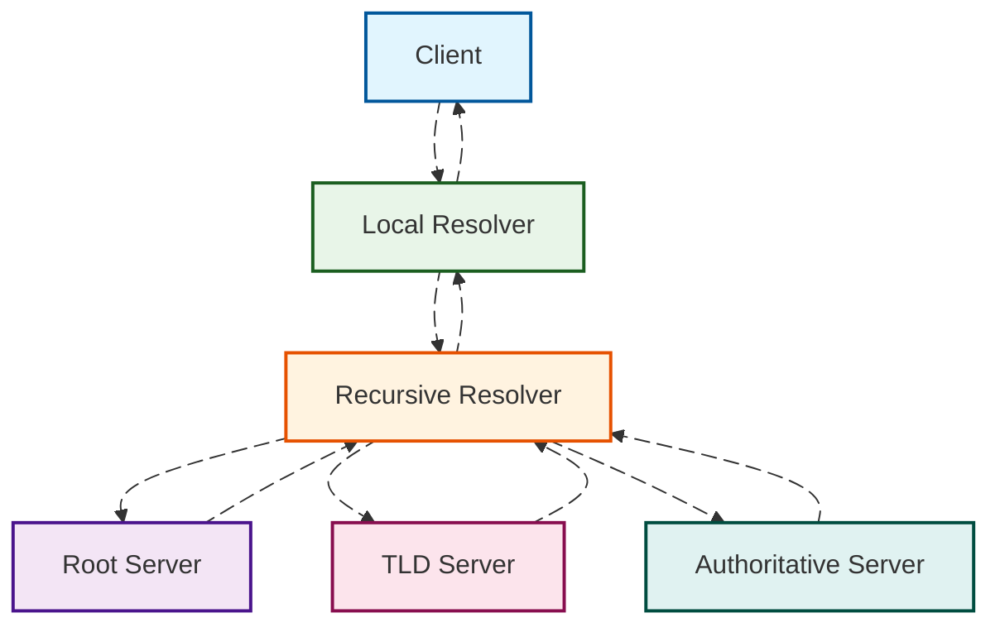
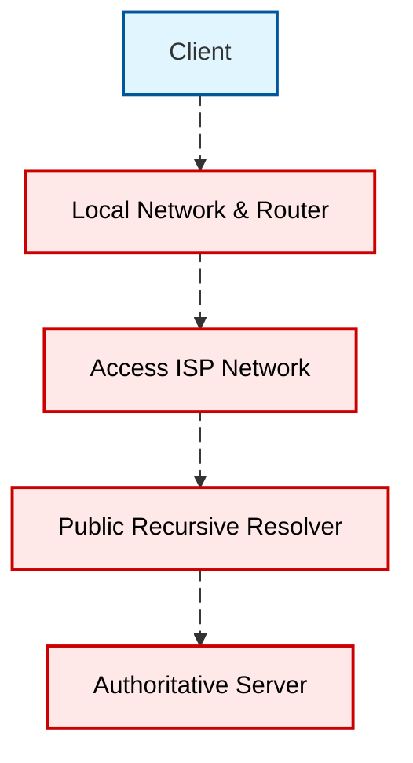

---
title: How DNS Affects Your Internet Experience
description: DNS is the entry point for almost all network requests. Resolving a domain name typically takes only tens of milliseconds, but these milliseconds determine which server subsequent connections will point to, whether CDN nodes are hit nearby, and whether they will be hijacked by ISPs or observed by certain intermediate nodes. This article targets ordinary netizens, using continuous narrative to explain the relationship between DNS and internet experience.
slug: dns-impact-on-browsing
date: 2025-10-13
tags: [DNS, Network Technology, Privacy Protection, Performance Optimization]
---

# How DNS Affects Your Internet Experience

When we open a webpage, stream a video, or click an in-app link, the first hop almost always lands on DNS. It acts like a phonebook for the internet world, translating human-friendly domain names into machine-understandable IP addresses. Many people attribute "slow webpages, inability to open, intermittent issues" to "poor network speed," but a significant portion of experience fluctuations relate to DNS resolution success rate, latency, cache hit rate, and privacy policies. Understanding how DNS works, its exposure points in the network chain, and available protection strategies can help us break down "slowness and instability" into controllable factors.

## Background and Problem Overview

DNS is the entry point for almost all network requests. Resolving a domain name typically takes only tens of milliseconds, but these milliseconds determine which server subsequent connections will point to, whether CDN nodes are hit nearby, and whether they will be hijacked by ISPs or observed by certain intermediate nodes. The experience differences between home, cellular, and public Wi-Fi networks often stem from variations in resolver cache quality, packet loss rates, and policy differences among resolvers. This article targets ordinary netizens, using continuous narrative to explain the relationship between DNS and internet experience, focusing on principles and trade-offs rather than specific deployment steps or evaluation conclusions.

## Basics and Terminology

After a browser or application initiates a resolution request, it typically first queries the system's local resolver, which then recursively queries root, TLD, and authoritative servers layer by layer, ultimately obtaining an answer with TTL. If local or network-side cache hits, external queries can be skipped, significantly reducing latency; if cache misses or expires, the full recursive process must be completed. The following diagram uses a simplified flow to show the resolution path, with animations emphasizing data flow rather than actual timing sequence.

TTL is the "shelf life" of each record. Within the TTL validity period, recursive resolvers can directly return cached answers to clients, contributing more to the perception of "speed and stability" than we intuitively estimate. On the other hand, how resolvers handle parallel IPv4 and IPv6 requests, whether ECS extensions are enabled, and whether negative caching is implemented for failed queries can indirectly affect your connection direction and first-packet time.

## Privacy Threats and Motivations

Traditional plaintext DNS exposes metadata about "which domain you want to access" on the network path. This information leaves traces at local networks, access ISPs, and public resolvers, even if content is encrypted via HTTPS. For ordinary users, risks come more from "passive observation and profiling" than direct content leakage: long-term query sequences can infer your interests, lifestyle patterns, and device types. Scenarios like public Wi-Fi, shared hotspots, and international roaming involve more observable points on the path, with more common fluctuations and failures.

It's important to emphasize that privacy protection doesn't necessarily equate to "faster." Encryption and encapsulation introduce handshakes and negotiations, but high-quality recursive resolvers may actually be faster through better cache hits and lower packet loss. Real-world experience quality depends on the combined effects of your network, resolver quality, and target site deployment.

## Protection Strategies and Principles

Encrypted DNS wraps "which domain you're asking about" into encrypted tunnels, reducing opportunities for eavesdropping and tampering. Common methods include TLS-based DoT, HTTPS-based DoH, and QUIC-based DoQ. They all reuse mature transport layer security mechanisms, with differences mainly in ports and multiplexing models. Regardless of the method, clients typically still initiate queries to the local resolver stack first, then use encrypted tunnels to send requests to upstream resolvers. The following diagram illustrates this encapsulation and return process.

Beyond encryption, resolver-side QNAME minimization reduces query granularity exposed to upstream, DNSSEC provides record integrity verification, and ECS controls CDN proximity and hit rates. For end users, the actual perceptible differences are "whether it's more stable," "whether it's easier to hit nearby nodes," and "whether there's less hijacking."

## Implementation Path and Considerations

From a user perspective, systems and routers often have built-in resolvers or forwarders, and many public services offer built-in DoH switches at the mobile OS and browser levels. Choosing a trustworthy recursive resolver and appropriate encryption method usually covers most needs. Note that some enterprise or campus networks may have policy restrictions on encrypted DNS, and certain security products might intercept or redirect DNS traffic; in these environments, prioritize connectivity and compliance before considering privacy and performance. For overseas site access, the resolver's geographical strategy and CDN deployment layout are equally important—incorrect proximity strategies may route you to transcontinental nodes, resulting in a "half-second lag" perception.

## Risks and Migration

Any switch should preserve a rollback path. For personal devices, first enable encrypted DNS on a single device and observe for a week, paying attention to frequently problematic apps and sites. For home gateways, consider grayscale rollout to a few devices, keeping backup resolvers and enabling health checks when necessary. If the network has internal domains or split DNS, confirm compatibility of resolution scope and search domains before switching to avoid resolution failures and accidental leaks.

## Scenario-based Recommendations

On cellular networks and public Wi-Fi, prioritizing stable public resolvers with DoH or DoT enabled often provides both more stable and cleaner resolution. For home broadband, cache hits and low packet loss are more important—quality public resolvers or local gateway caching can deliver the "instant open" smoothness. When accessing cross-border content, the resolver's geographical strategy determines where you'll be routed. If certain sites are "connectable but very slow," try changing resolvers or disabling ECS. For families needing parental controls and traffic splitting, choosing resolvers with classification policies and transparent logging is more practical.

## FAQ and References

Common questions include "Is encrypted DNS always faster?", "Why do different resolvers return different IPs?", and "Will changing resolvers affect security software?" There are no one-size-fits-all answers—they depend on link quality, resolver implementation, and site access policies. Further reading can refer to relevant IETF RFCs, mainstream browser and OS documentation, and trusted network infrastructure blogs.
