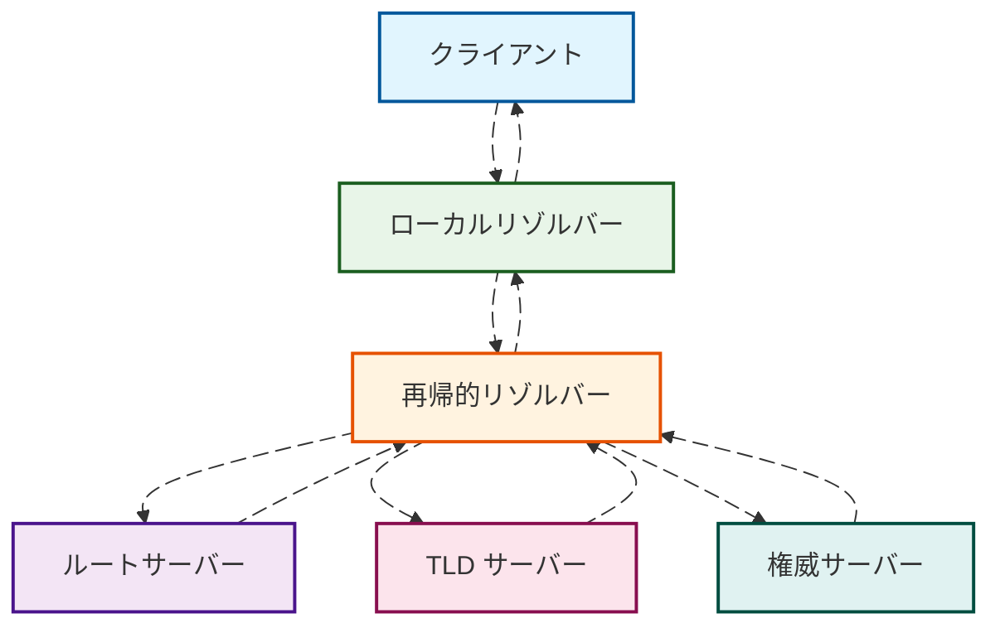
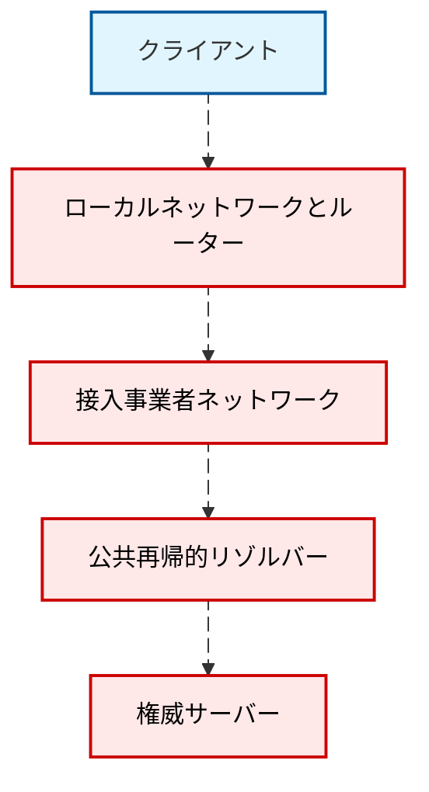
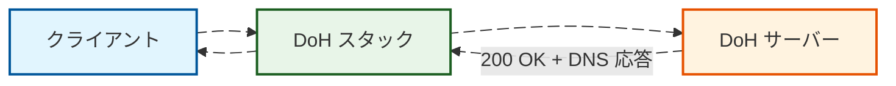

# DNS があなたのインターネット体験にどのように影響するか

ウェブページを開いたり、動画を再生したり、アプリ内のリンクをクリックしたりするとき、最初のホップはほぼ常に DNS に当たります。DNS はネットワーク世界の電話帳のようなもので、人間に優しいドメイン名を機械が理解できる IP アドレスに変換する役割を担っています。多くの人は「ウェブページが遅い、開かない、時々調子が悪い」ことを「回線速度が遅い」と原因归结めますが、実際にはかなりの部分の体験の変動は DNS の解決成功率、処理時間、キャッシュヒット率、プライバシー戦略に関連しています。DNS がどのように機能するか、そのチェーン内での露出ポイントと選択可能な保護戦略を理解することで、「遅さと不安定さ」を制御可能な要素に分解できます。

## 背景と問題の概要

DNS はほぼすべてのネットワーク接続要求の入口です。ドメイン名の解決にはわずか数十ミリ秒しかかかりませんが、この数十ミリ秒によってその後の接続がどのサーバーに向かうか、近接した CDN ノードにヒットするか、事業者にハイジャックされるか、中間ノードで観察されるかが決まります。家庭、セルラーネットワーク、公共 Wi-Fi の体験の違いも、多くの場合、異なるリゾルバーのキャッシュ品質、パケットロス率、戦略の違いに起因します。本記事は一般ユーザーを対象に、DNS とインターネット体験の関係を連続した叙述で説明し、重点を原理とトレードオフに置き、具体的な展開手順や評価結果には置きません。

## 基礎と用語の整理

ブラウザまたはアプリが解決要求を发起すると、通常はシステムのローカルリゾルバーに問い合わせた後、再帰的リゾルバーが段階的にルート、トップレベルドメイン、権威サーバーに問い合わせを行い、最終的に TTL 付きの回答を得ます。ローカルまたはネットワーク側のキャッシュがヒットすれば、外部問い合わせを省略でき、レイテンシを大幅に削減できます。キャッシュがヒットしないか期限切れの場合、完全な再帰的フローを完了する必要があります。下図は簡略化したフローで解決の往復パスを示しており、アニメーションはデータの流れを強調するためのものであり、実際の時間順序を表すものではありません。

TTL は各レコードの「保存期間」です。TTL が有効な間、再帰的リゾルバーはキャッシュされた回答を直接クライアントに返すことができ、これは体感上の「速さと安定性」への貢献が私たちの直感的な予測を超えることがよくあります。一方、リゾルバーが IPv4 と IPv6 レコードの並列要求をどのように処理するか、ECS 拡張を有効にするか、失敗した問い合わせを負のキャッシュにするかも、間接的に接続の向きと初パケット時間に影響を与えます。

## プライバシー脅威と動機

従来の平文 DNS はチェーン上で「どのドメイン名にアクセスするか」のメタデータを露出させます。これらの情報はローカルネットワーク、接入事業者、公共リゾルバーに痕跡を残し、コンテンツが暗号化された HTTPS であっても同様です。一般ユーザーにとって、リスクは直接的なコンテンツ漏洩よりも「受動的観測とモデリング」に起因することが多いです。長期間の問い合わせシーケンスは、あなたの興味、生活リズム、使用デバイスタイプを推測するのに十分です。公共 Wi-Fi、共有ホットスポット、海外ローミングなどのシナリオでは、チェーン上の観測者が多く、変動と失敗もより一般的です。

強調すべきは、プライバシー保護が必ずしも「より速い」ことを意味しないということです。暗号化とカプセル化はハンドシェイクとネゴシエーションを導入し、優れた再帰的リゾルバーはより良いキャッシュヒットと低いパケットロスによってむしろ速くなる可能性があります。現実世界の体験の良し悪しは、所在ネットワーク、リゾルバーの品質、ターゲットサイトの展開方法の三者の共同作用に依存します。

## 保護戦略と原理

暗号化 DNS は「どのドメイン名を問い合わせるか」を暗号化トンネルに包み込み、盗聴と改ざんの機会を低減します。一般的な方法には、TLS ベースの DoT、HTTPS ベースの DoH、QUIC ベースの DoQ が含まれます。これらはすべて成熟したトランスポート層セキュリティ機構を再利用し、差異は主にポートと多重化モデルに現れます。どの方式を採用しても、クライアントは通常まずローカルリゾルバースタックに問い合わせを发起し、次に暗号化トンネルで要求を上流リゾルバーに送信します。下図は順序図でこのカプセル化と返信を示しています。

暗号化に加えて、リゾルバー側の QNAME 最小化は上流に露出する問い合わせの粒度を減らし、DNSSEC はレコードの完全性検証を提供し、ECS は CDN の近接性とヒット率に影響を与えます。エンドユーザーにとって、実際に感知できるのは「より安定しているか」「より近接ノードにヒットしやすいか」「ハイジャックされにくいか」です。

## 実装パスと注意事項

ユーザーの観点から、システムとルーターは多くの場合、リゾルバーまたはフォワーダーを内蔵しており、多くの公共服务はモバイルシステムとブラウザレベルでも内蔵の DoH スイッチを提供しています。信頼できる再帰的リゾルバーと適切な暗号化方式を選択することは、多くの場合、大多数の要件をカバーします。注意すべきは、一部の企業またはキャンパスネットワークは暗号化 DNS に戦略制限があり、特定のセキュリティ製品が DNS トラフィックを拦截またはリダイレクトする可能性があることです。これらの環境では、接続性とコンプライアンスを優先し、その後でプライバシーとパフォーマンスを考慮してください。海外サイトへのアクセス体験については、リゾルバーの地理戦略と CDN の接続レイアウトも同様に重要であり、誤った近接戦略はあなたを大陸間ノードに導き、体感として「一歩遅れる」ことになります。

## リスクと移行

どのような切り替えでも、ロールバックパスを維持する価値があります。個人デバイスについては、まず単一デバイスで暗号化 DNS を有効にし、1週間観察し、異常が多発するアプリとサイトに注意してください。家庭ゲートウェイについては、少数のデバイスに段階的に展開し、必要に応じてバックアップリゾルバーを維持し、ヘルスチェックを有効にすることをお勧めします。ネットワークに内部ドメインまたは分離 DNS がある場合は、切り替え前に解決範囲と検索ドメインの互換性を確認し、解決失敗と意図しない漏洩を避けてください。

## シナリオベースの提案

セルラーネットワークと公共 Wi-Fi では、安定した公共リゾルバーを優先して選択し、DoH または DoT を有効にすることで、多くの場合、より安定しクリーンな解決を同時に得ることができます。家庭ブロードバンドでは、キャッシュヒットとパケットロスの少なさがより重要であり、優れた公共リゾルバーまたはローカルゲートウェイキャッシュは「開いた瞬間から」の滑らかさをもたらします。跨境アクセス時には、リゾルバーの地域戦略がどこに導かれるかを決定し、特定のサイトで「接続できるが遅い」場合には、リゾルバーを変更するか ECS を無効にして再試行することをお勧めします。家长管理とトラフィック分割を必要とする家庭では、分類戦略とログ透明性を備えたリゾルバーを選択する方が現実的です。

## FAQ と参考

一般的な疑問には、「暗号化 DNS は必ずしも速いのか」「なぜ異なるリゾルバーが異なる IP を返すのか」「リゾルバーを切り替えるとセキュリティソフトの動作に影響するか」などがあります。これらの質問には万能な唯一の答えはなく、リンク品質、リゾルバーの実装、サイトの接入戦略に依存します。さらに読むには、IETF の関連 RFC、主流ブラウザとオペレーティングシステムのドキュメント、および信頼できるネットワークインフラストラクチャブログを参照してください。
