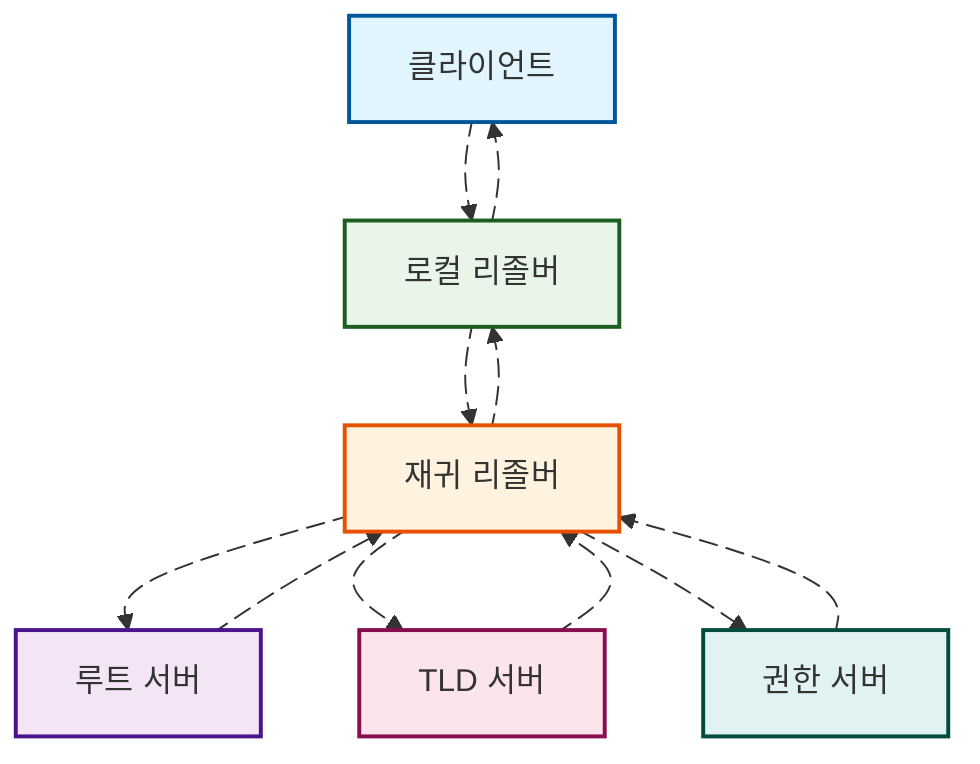
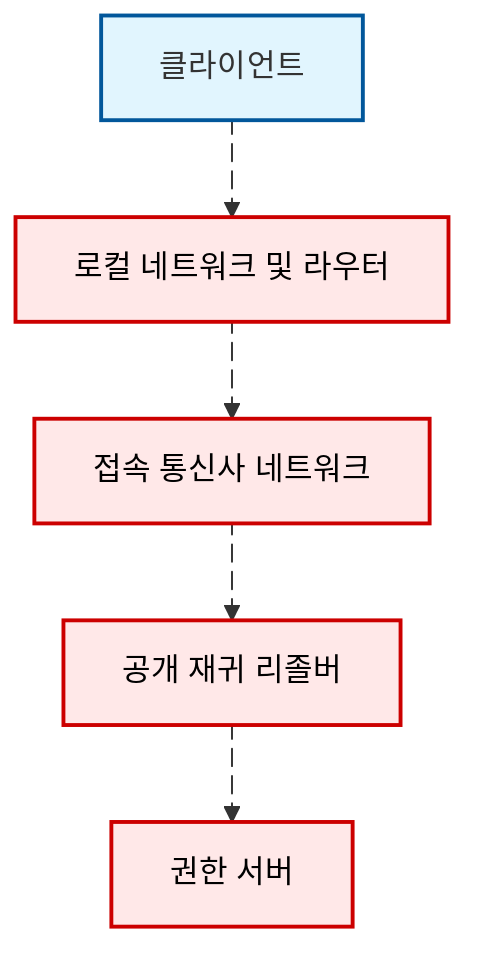

---
title: DNS가 인터넷 사용 경험에 미치는 영향
description: DNS는 거의 모든 네트워크 요청의 시작점입니다. 도메인 이름을 한 번 확인하는 데는 보통 수십 밀리초밖에 걸리지 않지만, 이 짧은 시간이 이후 연결이 어떤 서버로 향할지, 가까운 CDN 노드에 도달할지, 통신사에 의해 하이재킹되거나 중간 노드에서 관찰될지를 결정합니다. 이 글은 일반 네티즌을 대상으로 DNS와 인터넷 사용 경험의 관계를 연속적인 설명으로 풀어냅니다.
slug: dns-impact-on-browsing
date: 2025-10-13
tags: [DNS, 네트워크 기술, 개인정보 보호, 성능 최적화]
---

# DNS가 인터넷 사용 경험에 미치는 영향

웹페이지를 열거나 동영상을 보거나 앱 내 링크를 클릭할 때, 첫 번째 연결은 거의 항상 DNS로 향합니다. DNS는 네트워크 세계의 전화번호부처럼 인간 친화적인 도메인 이름을 기계가 이해할 수 있는 IP 주소로 변환합니다. 많은 사람들이 "웹페이지가 느리거나 열리지 않거나 상태가 들쭉날쭉하다"는 문제를 "인터넷 속도가 느리다"고 생각하지만, 실제로는 상당 부분이 DNS 확인 성공률, 소요 시간, 캐시 적중률 및 개인정보 정책과 관련이 있습니다. DNS가 어떻게 작동하는지, 네트워크 경로에서의 노출 지점과 선택 가능한 보호 전략을 이해하면 "느리고 불안정함"을 통제 가능한 요소로 분해할 수 있습니다.

## 배경 및 문제 개요

DNS는 거의 모든 네트워크 요청의 시작점입니다. 도메인 이름을 한 번 확인하는 데는 보통 수십 밀리초밖에 걸리지 않지만, 이 짧은 시간이 이후 연결이 어떤 서버로 향할지, 가까운 CDN 노드에 도달할지, 통신사에 의해 하이재킹되거나 중간 노드에서 관찰될지를 결정합니다. 가정, 셀룰러 네트워크 및 공공 Wi-Fi의 경험 차이도 종종 다른 리졸버의 캐시 품질, 패킷 손실률 및 정책 차이에서 비롯됩니다. 이 글은 일반 네티즌을 대상으로 DNS와 인터넷 사용 경험의 관계를 설명하며, 구체적인 배포 단계나 평가 결과보다는 원리와 선택에 초점을 맞춥니다.

## 기초 및 용어 정리

브라우저나 애플리케이션이 확인 요청을 시작하면 일반적으로 시스템의 로컬 리졸버에 먼저 문의한 후, 재귀 리졸버가 루트, 최상위 도메인(TLD), 권한 서버에 단계적으로 질의하여 TTL이 포함된 최종 답변을 얻습니다. 로컬이나 네트워크 측 캐시가 적중하면 외부 질의를 생략하여 지연 시간을 크게 줄일 수 있습니다. 캐시가 적중하지 않거나 만료된 경우 전체 재귀 프로세스를 완료해야 합니다. 아래 다이어그램은 단순화된 확인 경로를 보여주며, 애니메이션은 실제 소요 시간 순서가 아닌 데이터 흐름을 강조하기 위한 것입니다.

TTL은 각 레코드의 "유효 기간"입니다. TTL 유효 기간 내에 재귀 리졸버는 캐시된 답변을 클라이언트에 직접 반환할 수 있으며, 이는 "빠르고 안정적"이라는 체감 속도에 직관적인 예상보다 큰 영향을 미칩니다. 반면, 리졸버가 IPv4와 IPv6 레코드에 대한 병렬 요청을 어떻게 처리하는지, ECS 확장을 활성화했는지, 실패한 질의에 대해 네거티브 캐싱을 하는지 여부도 연결 방향과 첫 패킷 시간에 간접적으로 영향을 미칩니다.

## 개인정보 위협 및 동기

기존의 일반 텍스트 DNS는 "어떤 도메인에 접속하려는지"에 대한 메타데이터를 네트워크 경로에 노출시킵니다. 이 정보는 로컬 네트워크, 접속 통신사 및 공개 리졸버에 흔적을 남기며, 내용이 암호화된 HTTPS로 전송되더라도 마찬가지입니다. 일반 사용자에게 위험은 직접적인 내용 유출보다는 "수동 관찰 및 모델링"에서 더 많이 발생합니다: 장기간의 질의 시퀀스는 사용자의 관심사, 생활 패턴 및 사용 기기 유형을 추론하기에 충분합니다. 공공 Wi-Fi, 공유 핫스팟 및 해외 로밍과 같은 시나리오에서는 네트워크 경로상의 관찰자가 더 많으며, 변동성과 실패도 더 흔합니다.

강조할 점은 개인정보 보호가 반드시 "더 빠름"을 의미하지는 않는다는 것입니다. 암호화와 캡슐화는 핸드셰이크와 협상을 수반하며, 우수한 재귀 리졸버는 더 나은 캐시 적중률과 낮은 패킷 손실률로 오히려 더 빠를 수 있습니다. 현실 세계의 경험 품질은 사용자의 네트워크 환경, 리졸버 품질 및 대상 사이트의 배포 방식 세 가지가 함께 작용하여 결정됩니다.

## 보호 전략 및 원리

암호화 DNS는 "어떤 도메인을 질의하는지"를 암호화 터널 안에 감춰 도청과 변조 기회를 줄입니다. 일반적인 방식으로는 TLS 기반의 DoT, HTTPS 기반의 DoH, QUIC 기반의 DoQ가 있습니다. 이들은 모두 검증된 전송 계층 보안 메커니즘을 재사용하며, 차이점은 주로 포트와 멀티플렉싱 모델에 있습니다. 어떤 방식을 채택하든 클라이언트는 일반적으로 먼저 로컬 DNS 스택에 질의를 시작한 후 암호화 터널을 통해 요청을 상위 리졸버로 전송합니다. 아래 순서도는 이 캡슐화와 반환 과정을 보여줍니다.

암호화 외에도 리졸버 측의 QNAME 최소화는 상위 계층에 노출되는 질의 세분성을 줄일 수 있으며, DNSSEC는 레코드 무결성 검증을 제공하고, ECS는 CDN의 근접성과 적중률에 영향을 미칩니다. 최종 사용자에게 실제로 체감되는 것은 "더 안정적인지", "근접 노드에 더 쉽게 적중하는지", "하이재킹을 덜 당하는지"입니다.

## 구현 경로 및 주의사항

사용자 관점에서 시스템과 라우터에는 종종 리졸버나 포워더가 내장되어 있으며, 많은 공공 서비스가 모바일 시스템과 브라우저 수준에서 내장된 DoH 스위치를 제공합니다. 신뢰할 수 있는 재귀 리졸버와 적절한 암호화 방식을 선택하는 것만으로도 대부분의 요구를 충족시킬 수 있습니다. 주의할 점은 일부 기업이나 캠퍼스 네트워크에서 암호화 DNS에 정책적 제한을 가할 수 있으며, 특정 보안 제품이 DNS 트래픽을 차단하거나 리디렉션할 수 있다는 것입니다. 이러한 환경에서는 연결과 규정 준수를 우선 보장한 후 개인정보와 성능을 고려해야 합니다. 해외 사이트 접속 경험의 경우 리졸버의 지리적 정책과 CDN의 접속 레이아웃이 중요하며, 잘못된 근접 정책은 대륙 간 노드로 연결되어 "반박자 느리다"는 체감을 줄 수 있습니다.

## 위험 및 마이그레이션

어떤 전환도 복구 경로를 유지할 가치가 있습니다. 개인 기기의 경우 단일 기기에서 암호화 DNS를 먼저 활성화하고 일주일 동안 관찰하며, 이상이 빈발하는 애플리케이션과 사이트에 주의하세요. 가정용 게이트웨이의 경우 소수 기기에 단계적으로 적용하고 필요한 경우 백업 리졸버를 유지하며 상태 검사를 활성화하세요. 네트워크에 내부 도메인 또는 분할 DNS가 있는 경우 전환 전 확인 범위와 검색 도메인의 호환성을 확인하여 확인 실패와 의도치 않은 유출을 방지하세요.

## 시나리오별 권장사항

셀룰러 네트워크와 공공 Wi-Fi에서는 안정적인 공개 리졸버를 우선 선택하고 DoH 또는 DoT를 활성화하면 동시에 더 안정적이고 깨끗한 확인을 얻을 수 있습니다. 가정용 광대역에서는 캐시 적중률과 낮은 패킷 손실률이 더 중요하며, 우수한 공개 리졸버나 로컬 게이트웨이 캐시는 "클릭하면 바로 열리는" 매끄러운 경험을 제공할 수 있습니다. 해외 접속 시 리졸버의 지역 정책이 어디로 연결될지 결정하며, 일부 사이트가 "연결은 되지만 매우 느린" 경우 리졸버를 변경하거나 ECS를 끄고 다시 시도해 보세요. 자녀 보호 및 분할이 필요한 가정의 경우 분류 정책과 로그 투명성이 있는 리졸버를 선택하는 것이 더 실용적입니다.

## FAQ 및 참고 자료

흔한 질문으로는 "암호화 DNS가 반드시 더 빠른가", "왜 다른 리졸버가 다른 IP를 반환하는가", "리졸버 변경이 보안 소프트웨어 작동에 영향을 미치는가" 등이 있습니다. 이러한 질문에는 보편적으로 적용할 수 있는 단일 답변이 없으며, 이는 링크 품질, 리졸버 구현 및 사이트 접속 정책에 따라 달라집니다. 추가 자료는 IETF의 관련 RFC, 주요 브라우저 및 운영 체제 문서, 신뢰할 수 있는 네트워크 인프라 블로그를 참조하세요.
