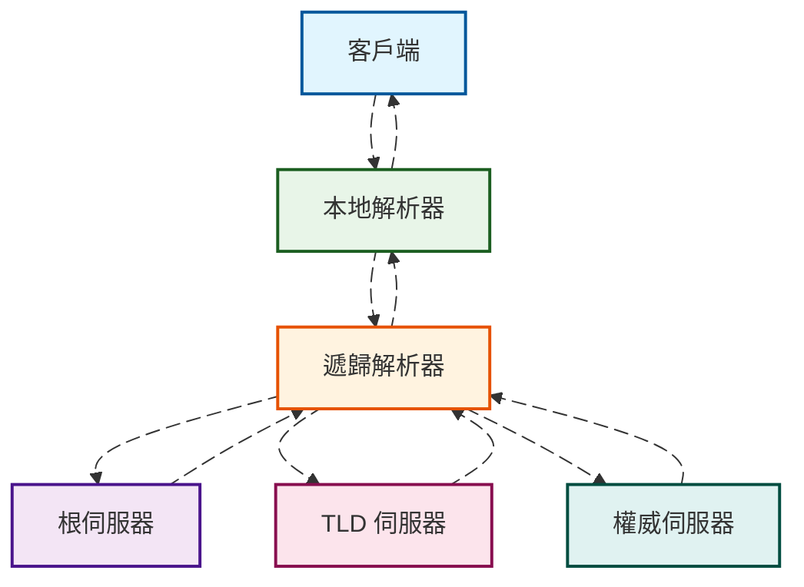
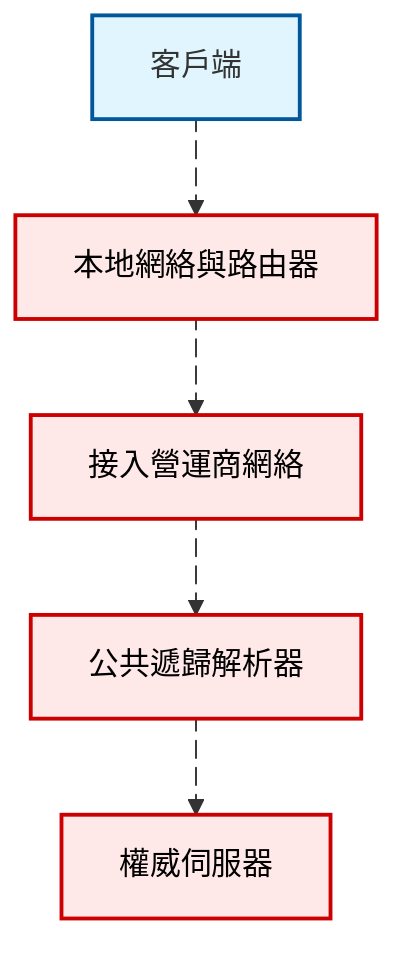

---
title: DNS 會如何影響你的上網體驗
description: DNS 是幾乎所有聯網請求的入口，解析一次域名往往只需幾十毫秒，但這幾十毫秒決定了後續連接將指向哪台伺服器、是否命中就近的 CDN 節點、是否會被營運商劫持或被某些中間節點觀察。本文面向普通網民，用連續敘述解釋 DNS 與上網體驗的關係。
slug: dns-impact-on-browsing
date: 2025-10-13
tags: [DNS, 網絡技術, 私隱保護, 效能優化]
---

# DNS 會如何影響你的上網體驗

當我們打開一個網頁、刷一條影片或點擊一條應用內連結時，第一跳幾乎總會落在 DNS 上。它像一份網絡世界的電話簿，負責把人類友好的域名翻譯成機器能理解的 IP 地址。很多人把「網頁慢、打不開、時好時壞」歸因於「網速差」，其實相當一部分體驗波動與 DNS 的解析成功率、耗時、緩存命中與私隱策略相關。理解 DNS 如何工作、它在鏈路中的暴露點與可選的保護策略，能幫助我們把「慢與不穩」拆解為可控的因素。

## 背景與問題概述

DNS 是幾乎所有聯網請求的入口。解析一次域名往往只需幾十毫秒，但這幾十毫秒決定了後續連接將指向哪台伺服器、是否命中就近的 CDN 節點、是否會被營運商劫持或被某些中間節點觀察。家庭、蜂窩網絡與公共 Wi‑Fi 的體驗差異，也常常來自不同解析器的緩存質量、丟包率與策略差異。本文面向普通網民，用連續敘述解釋 DNS 與上網體驗的關係，重點放在原理與取捨，而不是具體的部署步驟或評測結論。

## 基礎與術語梳理

瀏覽器或應用發起解析請求後，通常先詢問系統的本地解析器，再由遞歸解析器逐層向根、頂級域與權威伺服器查詢，最終得到一條帶有 TTL 的答案。本地或網絡側的緩存若命中，可省去外部查詢，大幅降低時延；若緩存未命中或過期，則需要完成完整的遞歸流程。下圖用一個簡化流程呈現解析的來回路徑，動畫僅用來強調數據流動而非表示真實耗時順序。

TTL 是每條記錄的「保質期」。在 TTL 有效期內，遞歸解析器可以直接把緩存答案返回給客戶端，這對體感「快與穩」的貢獻往往超過我們直覺的估計。另一方面，解析器如何處理 IPv4 與 IPv6 記錄的並行請求、是否啟用 ECS 擴展、是否對失敗查詢做負緩存，也會間接影響你的連接指向與首包時間。

## 私隱威脅與動機

傳統明文 DNS 在鏈路上暴露了「你要訪問哪個域名」的元數據。這些信息會在本地網絡、接入營運商與公共解析器處留下痕跡，即便內容走的是加密的 HTTPS。對於普通用戶，風險更多來自「被動觀測與建模」而不是直接內容洩露：長期的查詢序列足以推斷出你的興趣、生活作息與所用設備類型。公共 Wi‑Fi、共享熱點與境外漫遊等場景，鏈路上可觀測者更多，波動與失敗也更常見。

需要強調的是，私隱保護並不必然等於「更快」。加密與封裝會引入握手與協商，優質的遞歸解析器通過更好的緩存命中與更低的丟包反而可能更快。現實世界的體驗好壞，取決於所處網絡、解析器質量與目標站點的部署方式三者的共同作用。

## 保護策略與原理

加密 DNS 把「你要問什麼域名」包裹進加密隧道，降低被竊聽與篡改的機會。常見方式包括基於 TLS 的 DoT、基於 HTTPS 的 DoH 與基於 QUIC 的 DoQ。它們都複用成熟的傳輸層安全機制，差異更多體現在端口與複用模型上。無論採用哪種方式，客戶端通常仍會先向本地解析棧發起查詢，再由加密隧道把請求送至上游解析器，下圖用順序圖示意這一封裝與返回。

除了加密，解析器側的 QNAME 最小化可以減少向上游暴露的查詢粒度，DNSSEC 提供記錄完整性校驗，ECS 控制影響 CDN 的就近性與命中率。對於終端用戶而言，實際可感知的是「是否更穩定」「是否更容易命中就近節點」「是否更少被劫持」。

## 實現路徑與注意事項

從用戶角度出發，系統和路由器常常內置了解析器或轉發器，很多公共服務在移動系統與瀏覽器層面也提供了內建的 DoH 開關。選擇可信的遞歸解析器與恰當的加密方式，往往已經覆蓋了絕大多數需求。需要注意的是，部分企業或校園網絡對加密 DNS 有策略限制，特定安全產品也可能攔截或重定向 DNS 流量；在這些環境中，優先保證連通與合規，再考慮私隱與效能。對海外站點訪問的體驗，解析器的地理策略與 CDN 的接入佈局同樣重要，錯誤的就近策略會把你導向跨洲節點，體感「慢半拍」。

## 風險與遷移

任何切換都值得保留回退路徑。對個人設備，先在單設備上啟用加密 DNS 並觀察一週，關注異常多發的應用與站點；對家庭網關，建議灰度到少量設備，必要時保留備用解析器並開啟健康檢查。若網絡有內網域或分離 DNS，切換前確認解析範圍與搜索域的兼容性，避免引入解析失敗與意外洩露。

## 場景化建議

在蜂窩網絡與公共 Wi‑Fi 中，優先選擇穩定的公共解析器並開啟 DoH 或 DoT，常能同時獲得更穩與更潔淨的解析。在家庭寬頻中，更重要的是緩存命中與少丟包，優質公共解析器或本地網關緩存都能帶來「點開就有」的順滑感。跨境訪問時，解析器的地域策略決定了你會被導向哪裡，遇到某些站點「能連但很慢」，不妨更換解析器或關閉 ECS 再試。對需要家長控制與分流的家庭，選擇具備分類策略與日誌透明度的解析器更實際。

## FAQ 與參考

常見疑問包括「加密 DNS 是否一定更快」「為何不同解析器返回的 IP 不同」「切換解析器會不會影響安全軟件工作」。這些問題沒有放之四海而皆準的唯一答案，它們取決於鏈路質量、解析器實現與站點接入策略。進一步閱讀可參考 IETF 的相關 RFC、主流瀏覽器與操作系統文檔，以及可信的網絡基礎設施博客。
